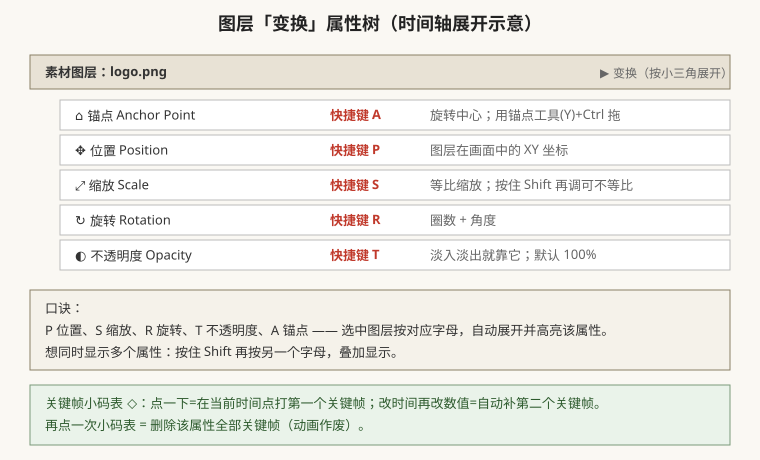
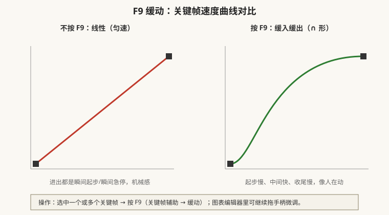

# 关键帧与时间轴动画（让图层动起来）

## 本篇导读

合成建好了、素材拖进来了，这一篇解决最核心的问题：**怎么让一个图层从 A 点跑到 B 点、淡入淡出、慢慢放大**。内容全部来自手写笔记第 2 页的「变换/关键帧/时间轴」部分。

读完你应该能：① 背出 P/S/R/T/A 五个变换属性快捷键；② 用「小码表 + 改时间」三步打出任意位移动画；③ 用 F9 把机械匀速改成自然缓动；④ 熟练 Ctrl+Alt+F 适配画面、Ctrl+K 改时长、Ctrl+D 复制、Ctrl+Shift+D 拆分。

## 本篇目录

- [1. 变换五属性：P / S / R / T / A](#1-变换五属性p--s--r--t--a)
- [2. 打关键帧的标准三步](#2-打关键帧的标准三步)
- [3. Ctrl+Alt+F：一键适配画面大小](#3-ctrlaltf一键适配画面大小)
- [4. F9 缓动与图表编辑器](#4-f9-缓动与图表编辑器)
- [5. 时间轴导航与预览快捷键](#5-时间轴导航与预览快捷键)
- [6. 冻结帧、改时长、纯色层、复制与拆分](#6-冻结帧改时长纯色层复制与拆分)
- [7. 2026 变化概览](#7-2026-变化概览)

---

## 1. 变换五属性：P / S / R / T / A

选中任一图层，展开「变换（Transform）」，里面五个属性：

| 快捷键 | 属性 | 中文 | 干什么用 |
|---|---|---|---|
| **P** | Position | 位置 | 图层 XY 坐标，位移动画主力 |
| **S** | Scale | 缩放 | 放大缩小；按住 Shift 再拖数值框 = 取消等比 |
| **R** | Rotation | 旋转 | 格式是「圈数 + 角度」，如 1x+90° |
| **T** | Opacity | 不透明度 | 0–100%，淡入淡出；默认 100% |
| **A** | Anchor Point | 锚点 | 旋转/缩放的圆心；用**锚点工具（Y 键）**拖动，拖时按 Ctrl 可只移锚点不动画面 |

补充口诀：

- 按一个字母只显示该属性；**按住 Shift 再按另一个字母** = 叠加显示多个属性。
- 手写笔记原话：「图层的单个属性关键帧可以重置，也可以变换右边整体重置」——每个属性名右边都有小菜单，误改后可单属性重置。
- 锚点别动错位置：文字居中排版要调的是「段落 → 锚点居中」，**不是**图层锚点（详见 [../02-图层蒙版与文字/文字动画与字符段落.md](../02-图层蒙版与文字/文字动画与字符段落.md)）。

## 2. 打关键帧的标准三步

以「文字从左移到右」为例：

1. 时间指示器（蓝色播放头）拖到**第 0 秒**，选中图层按 P，点「位置」前面的**小码表 ◇** → 出现第一个菱形关键帧。
2. 播放头拖到 **第 2 秒**，把位置数值 X 改大（比如从 100 改成 1800）→ AE 自动补上第二个关键帧。
3. 按**小键盘 0** 预览：文字 2 秒内从左滑到右。

规则：

- **小码表 = 该属性动画总开关**；再点一次 = 删除该属性所有关键帧（动画全没）。
- 两个关键帧之间自动补间（插值）；不打关键帧的属性在整段时间里是静止的。
- 关键帧可以**叠加**在同一属性上做往返运动（去→回→去）。

## 3. Ctrl+Alt+F：一键适配画面大小

素材拖进来比合成大一圈或小一圈？

**选中图层 → 按 Ctrl+Alt+F**（图层 → 变换 → 适配合成），图层自动缩放/位移铺满整个画面。

注意：这是「强行拉伸适配」，会改变宽高比；要保持比例就手动 S 缩放。手写笔记强调「首先选中图层」再按快捷键。

同类快捷键：

| 快捷键 | 作用 |
|---|---|
| Ctrl+Alt+F | 适配合成（拉伸铺满） |
| Ctrl+Alt+Shift+G | 适配到画面宽度（不拉伸） |

## 4. F9 缓动与图表编辑器

刚打的位移动画默认是**匀速直线**——起步瞬间窜出去、到点瞬间停住，非常机械。

操作：

1. 选中关键帧（框选或框选整段）。
2. 按 **F9**（右键 → 关键帧辅助 → 缓动 / Easy Ease）→ 菱形变成沙漏形，自动「缓入缓出」。
3. 想细调：点时间轴上方的**「图表编辑器」按钮**（曲线图标），打开速度/值曲线，拖手柄改起止快慢；再点一次退出。

手写笔记要点：

- 「选中关键帧、选中图层 → 右击按 F9 打图表编辑器」。
- 关键帧被遮住/选错：框选时 Ctrl 加选、Alt 减选。
- 笔记里的「临时插值 / 空间插值」对应 AE 里：右键关键帧 → 关键帧插值（临时=速度曲线，空间=运动路径形状），新手阶段用 F9 就够。

## 5. 时间轴导航与预览快捷键

| 操作 | 快捷键 | 备注 |
|---|---|---|
| 内存预览（从头播） | **小键盘 0** | 先把工作区条拉到要预览的范围 |
| 前/后一帧 | Page Up / Page Down | 等价于 PR 的 ← / → |
| 时间指示器快移 | Ctrl + 方向键 ← / → | 大步跳，等价 PR 的 ↑/↓ |
| 裁剪工作区入点/出点 | **Alt+[  /  Alt+]** | 等价 PR 的 Q / W（波纹修剪） |
| 放大/缩小时间轴 | 滚轮，或 Ctrl+滚轮 | 手写：按住 Ctrl 缩放鼠标 |
| 复制图层 | **Ctrl+D** | |
| 重命名图层 | 选中后按 **Enter** | |
| 拆分图层（剪刀剪开） | **Ctrl+Shift+D** | 在播放头处把一层剪成两层 |
| 新建纯色层 | **Ctrl+Y** | 笔记另注 Ctrl+Alt+Y（老版本差异，以实际菜单为准） |

> 工作区条（时间轴上方那根灰条）：两端拖，定义「渲染/预览哪些段落」；合成 → 修剪至工作区 = 把合成裁成工作区长度。

## 6. 冻结帧、改时长、纯色层、复制与拆分

### 6.1 冻结帧（让视频停在某一帧）

菜单：**图层 → 时间 → 冻结帧**（Layer → Time → Freeze Frame）。

用法：把播放头停在想定格的那一帧，执行冻结帧，这一层就从该帧开始变成静帧。手写笔记把它和「时间重映射（Time Remap）」归在同一组——图层右键 → 时间 子菜单下还有：

- **启用时间重映射**：给素材打出入点 K 帧，做慢动作/倒放；
- **时间伸缩**：整体拉长/压扁素材速度。

### 6.2 改合成时长：Ctrl+K

中途发现 5 秒不够？选中合成按 **Ctrl+K**（合成设置），把持续时间从 0:00:05:00 改成 0:00:10:00。

> 预合成改时长也是 Ctrl+K 双击进去改——实战中「延长预合成时长」是高频操作。

### 6.3 纯色层：万能载体

**Ctrl+Y** 新建纯色层（Solid），选个颜色。它本身是一张有色底，但 90% 场景是当「特效载体」：

- 给纯色层加「效果 → 生成 → 音频频谱」做音乐可视化；
- 给纯色层加「效果 → 模糊和锐化 → 高斯模糊」做光影；
- 粒子插件（Particular/Form）必须挂在纯色层上——详见 [../05-粒子与特效插件/TrapcodeParticular粒子系统.md](../05-粒子与特效插件/TrapcodeParticular粒子系统.md)。

### 6.4 图层开关列（时间轴上那排小图标）

从左到右高频几个：

| 图标 | 作用 |
|---|---|
| 👁 小眼睛 | 隐藏/显示图层（导出也不渲染） |
| 🔒 锁 | 锁定图层，防止误操作；手写笔记标「locked 锁定」 |
| ▢ 太阳（塌陷/栅格化） | 矢量图层放大不失真（AI/形状层常用） |
| ◇ 3D 立方体 | 打开这一层的三维属性 → 见 [../03-三维空间/三维图层摄像机与灯光.md](../03-三维空间/三维图层摄像机与灯光.md) |

手写提醒：「先开大开关、小开关关闭」——时间轴左下角有个「扩展列开关」，展开后才有父子/蒙版/关键帧等细列，新手找不到属性先点它。

## 7. 2026 变化概览

- **多帧渲染（MFR）已成熟为默认能力**：2026 版不再把它当新特性宣传，预览/渲染自动吃满多核 CPU；旧教程里「渲染设置 → 更多选项 → 多帧渲染」的手动开关，现在在「文件 → 项目设置 → 渲染」里确认即可。
- **Quick Apply（26.2 新增）**：搜索框里直接输效果名回车应用，比翻效果面板快。
- **表达式引擎提速约 5 倍**（JavaScript/V8 引擎）：后面 [../04-跟踪抠像与调色/表达式入门.md](../04-跟踪抠像与调色/表达式入门.md) 会讲 wiggle/time/loopOut，2026 版跑起来比老版本顺。
- **回到上一篇**：界面与导入 → [./界面合成与项目设置.md](./界面合成与项目设置.md)；**下一篇**：蒙版与轨道遮罩 → [../02-图层蒙版与文字/蒙版轨道遮罩与预合成.md](../02-图层蒙版与文字/蒙版轨道遮罩与预合成.md)。
