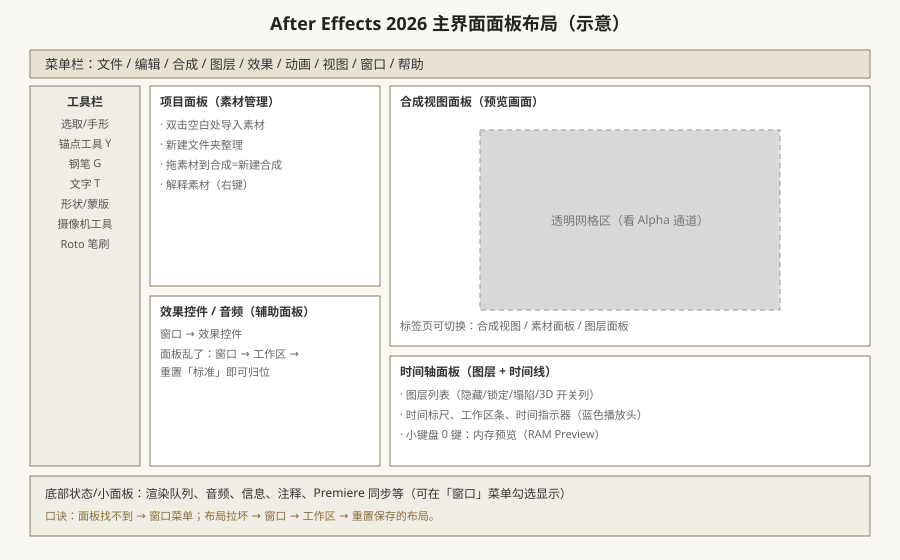
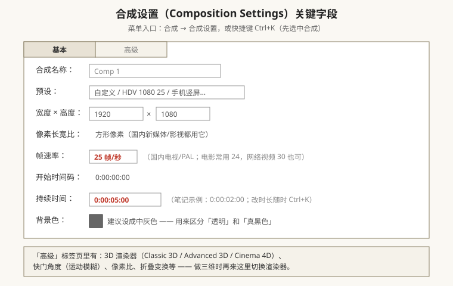

# 界面、合成与项目设置（AE 2026 入门第一课）

## 本篇导读

这一篇回答三个问题：**AE 是干什么的、打开后那一堆面板都是什么、怎么从一张白纸建出第一个能预览的合成**。内容来自手写笔记第 1 页（界面与工作流程）和第 2 页开头（新建合成/导入导出），并按 After Effects 2026（版本号 26.x，最新 26.5）的菜单与事实做了校准。

读完你应该能：① 说清 AE 在短视频/影视行业里的应用岗位；② 面板找不回时自己归位；③ 正确新建一个 25fps、5 秒、1920×1080 的合成；④ 知道 PSD/AI/MOV/PNG 序列分别怎么导、怎么导才不丢透明通道。

## 本篇目录

- [1. 学 AE 能做什么：六大应用领域](#1-学-ae-能做什么六大应用领域)
- [2. 界面六大区块与面板布局](#2-界面六大区块与面板布局)
- [3. 面板乱了怎么办：布局保存与重置](#3-面板乱了怎么办布局保存与重置)
- [4. 新建合成：帧率、时长、背景色](#4-新建合成帧率时长背景色)
- [5. 导入素材：PSD / AI / MOV / PNG 序列](#5-导入素材psd--ai--mov--png-序列)
- [6. 导出与格式速查表](#6-导出与格式速查表)
- [7. 2026 变化概览](#7-2026-变化概览)

---

## 1. 学 AE 能做什么：六大应用领域

手写笔记开篇列的就业方向，2026 年依然成立，按岗位热度排：

| 方向 | 典型产出 | 备注 |
|---|---|---|
| 电视包装 / 栏目包装 | 节目片头、角标、转场包 | 老牌岗位，至今是 AE 基本功试金石 |
| 影视广告 / 宣传片 | 30s–90s 广告动效、产品演示 | 常与 C4D、三维结合 |
| 影视片头 / 大型开场动画 | 电影/活动开场片、创意片头 | MG 动画（Motion Graphics）是主力手法 |
| 婚庆 / 实用短视频 | 婚礼开场、电子相册、快闪 | 「直接剪辑版」——套模板改字即可 |
| UI 动效设计 | APP 交互动效、产品演示动效 | 跟视频教程练，输出给开发标注 |
| MG 动画 / 科普解说 | 节气动画、知识讲解、品牌短片 | 2026 年仍是自由职业接单大头 |

> 一句话口诀：**剪辑用 PR，包装动效用 AE，三维建模用 C4D/Blender**。三者靠 Dynamic Link（动态链接）串起来。

## 2. 界面六大区块与面板布局

AE 2026 启动后的默认长这样（手绘结构示意，不是截图）：

对照上图记六个区块：

| 区块 | 位置 | 作用 | 找它的菜单 |
|---|---|---|---|
| 菜单栏 | 最顶一行 | 文件/编辑/合成/图层/效果/动画/视图/窗口 | 永远在 |
| 工具栏 | 左上竖条 | 选取、手形、锚点(Y)、钢笔(G)、文字(T)、形状/蒙版、摄像机、Roto 笔刷 | 窗口 → 工具 |
| 项目面板 | 左上 | 素材仓库：导入的视频/图片/音频/合成都在这 | 窗口 → 项目 |
| 合成视图面板 | 中间大窗 | 实时预览画面；标签页可切到「素材」「图层」视图 | 合成（自动打开） |
| 时间轴面板 | 下方 | 图层列表 + 时间线，所有动画在这里做 | 窗口 → 时间轴 |
| 辅助面板 | 右侧/浮动 | 效果控件、音频、信息、预览、字符、对齐、跟踪器… | 窗口 → 勾选对应面板 |

要点：

- **双击项目面板空白处** = 导入素材（比菜单快）；也可以直接把文件从文件夹拖进项目面板，笔记特别提醒「直接拖入不会卡死文件」。
- **把素材从项目面板拖到合成视图**：会自动按素材尺寸新建一个合成；拖到已打开的合成里就是加一层。
- 时间轴上方标签页显示当前合成名，一个项目可以有很多个合成。
- 图层面板（Source 层视图）和合成视图共用一块区域，点标签切换。

## 3. 面板乱了怎么办：布局保存与重置

手写原话：「窗口面板都乱掉了，可以重置为已保存的布局」。

实操步骤：

1. **找回单个面板**：菜单栏「窗口」→ 勾选你要的面板名（比如「效果控件」「字符」「对齐」），它就会弹出/复位。
2. **浮动面板**：任何面板都可以用鼠标拖标签，拖出来变浮动小窗、拖到边缘吸附归位；按住拖可以拉宽/拆成左右两栏。
3. **整布局复位**：菜单「窗口 → 工作区（Workspace）→ 重置为已保存的布局」（中文版约为「窗口 → 工作区 → 重置标准」）。
4. **自己存布局**：调好后「窗口 → 工作区 → 另存为新工作区」，以后一键切回。

> 2026 备注：2026-09 起「属性面板（Properties）」与「效果控件」做了重新设计，导航更快；26.2 新增 **Quick Apply（快速应用）**——在焦点处按快捷键唤出搜索框，直接搜效果/预设/菜单命令回车即用，不用再翻「效果和预设」面板。具体快捷键与命名以实际版本为准。

## 4. 新建合成：帧率、时长、背景色

入口：

- 菜单「合成 → 新建合成」，快捷键 **Ctrl+N**；
- 或点项目面板下方那个「新建合成」小胶片图标。

**四个新手必懂的字段**：

| 字段 | 怎么填 | 为什么 |
|---|---|---|
| 帧速率（Frame Rate） | 国内电视/PAL = **25 fps**；电影 24；网络 30 | 一旦素材进来再改帧率，慢动作/抽帧会出问题，**建合同时就定死** |
| 持续时间（Duration） | 笔记示例 `0:00:02:00`（2 秒）；做短片建议先 5–10 秒，后期随时改 | 时间码格式：时:分:秒:帧 |
| 背景色（Background Color） | 建议点色块改成**中灰色** | 灰色能让你一眼分清「透明区域」和「真黑色」；透明格是灰白棋盘格 |
| 宽度×高度 | 新媒体 1920×1080；竖屏 1080×1920；手机 720×1280 等 | 预设里直接挑，也可以手填 |

两个好习惯：

- **改已有合成的时长**：选中合成后按 **Ctrl+K**（合成设置），改持续时间即可——这是后面第二篇要反复用的快捷键。
- **参考素材先拖进项目面板，再拖进合成**：直接拖素材到时间轴，AE 会问你要不要按素材建合成。

## 5. 导入素材：PSD / AI / MOV / PNG 序列

入口：文件 → 导入 → 文件（Ctrl+I），或双击项目面板空白。

| 素材类型 | 怎么导 | 注意事项 |
|---|---|---|
| PSD（Photoshop 分层文件） | 导入时「导入种类」选**合成 – 保持图层大小**，可保留分层继续改 | 🔴 **CMYK 模式的 PSD 不认**（手写笔记：PSD 不支持打印/CMYK 模式），必须在 PS 里转成 RGB 再导；分层要在 PS 里「成组/合成」好 |
| AI（Illustrator 矢量文件） | 同样选「合成 – 保持图层大小」，路径分层进 AE | 导入后在 AE 里勾选「连续栅格化」（时间轴图层上的太阳图标），放大不失真 |
| MOV 视频 | 直接拖入 | ✅ MOV 可以带**透明通道（Alpha）**，是 AE 交换带透明素材的标准格式 |
| PNG 序列（逐帧图片） | 选中序列第一张 → 勾选面板下方「PNG 序列」→ 导入 | 自动拼成一段视频；文件名要连续编号（frame_0001.png…） |
| 静帧图（JPG/PNG） | 直接拖入 | 单张图片默认时长 = 合成时长，可在时间轴拉长 |
| FLV 格式 | ❌ 不导入 | 手写笔记明确：AE 不支持 FLV；需要时先用 PR/格式工厂转成 MP4/MOV |

> **旧版做法（2026 已修正认知）**：老笔记写「MOV 透明通道要先装 QuickTime」。在老版本（CS6/CC2014 前后）Windows 上确实如此，不装 QuickTime 就导不出带 alpha 的 MOV。**2026 版已经内置 Apple ProRes/QuickTime 解码能力，且原生支持 H.264 导出**（文件 → 导出 → 添加到渲染队列 → 格式选 H.264），不再单独提示装 QuickTime；但老旧的 .mov 编码若仍打不开，再按「模板使用与常见问题排查」里的 QuickTime 条目处理。

## 6. 导出与格式速查表

新手阶段最常用的三种出片方式：

| 用途 | 推荐格式/方式 | 路径 |
|---|---|---|
| 给客户审片（带声音的 mp4） | **H.264 MP4** | 合成 → 添加到渲染队列（Ctrl+M）→ 输出模块 → 格式 H.264 → 渲染 |
| 带透明通道、后期还要叠 | **MOV + ProRes 4444 / PNG 序列** | 渲染队列 → 输出模块 → 格式 QuickTime，通道选「RGB+Alpha」 |
| 进 PR 接着剪 | 直接 **Dynamic Link**：PR 里文件 → 从 AE 合成导入，或两个软件都开着直接拖 | 不用出片，改 AE 实时同步 |

速查口诀：

- **要小、要发微信 → H.264 MP4**；
- **要透明、要叠层 → MOV(Alpha) 或 PNG 序列**；
- **还要继续剪 → 别出片，走 Dynamic Link**。

> 2026 事实：AE 2026 原生 H.264 已回到渲染队列（后端复用 Adobe Media Encoder 编码系统），**Media Encoder 并未被废弃**，自动渲染/网络渲染也已成熟。

## 7. 2026 变化概览

- **版本号**：AE 2026 = 版本 26.x；近一年节奏 25.6（2025-11）→ 26.0（2026-01）→ 26.2（2026-04）→ 26.3（2026-06）→ 26.5（2026-09）。
- **简体中文**：官方一等公民语言。安装前在 Creative Cloud 桌面端把应用语言设为「简体中文」即可；macOS 还需把系统语言设为中文。
- **面板**：属性面板/效果控件重新设计；Quick Apply 快速搜索应用。
- **3D 渲染器**：新建合成后在「合成设置 → 高级 → 3D 渲染器」里可切 Classic 3D / **Advanced 3D（新一代 Mercury 3D 引擎）** / Cinema 4D 三选一——详见 [../03-三维空间/三维图层摄像机与灯光.md](../03-三维空间/三维图层摄像机与灯光.md)。
- **AI 相关入口**：AI Assistant（Beta）、Roto 笔刷 3.0、Object Matte、内容识别填充——统一在 [../AI工具与替代方案.md](../AI工具与替代方案.md) 一篇里讲，本文不展开。
- **下一篇**：合成建好了，怎么让图层动起来 → [./关键帧与时间轴动画.md](./关键帧与时间轴动画.md)。
