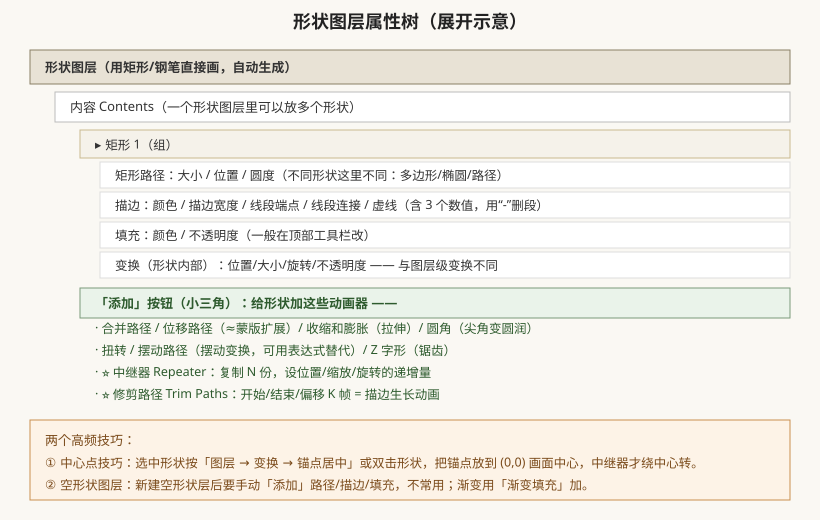
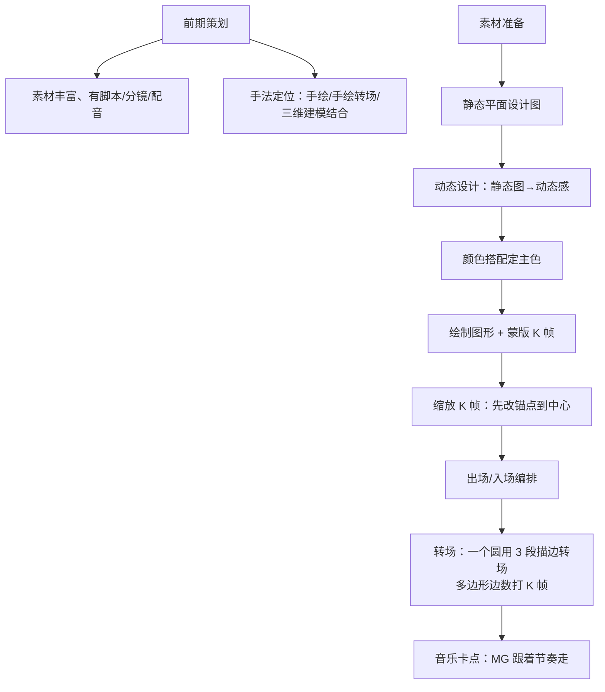

# 形状图层与 MG 图形动画（24 节气/国风实战）

## 本篇导读

钢笔/矩形直接画出来的就是**形状图层（Shape Layer）**——它是矢量的、可无限缩放、自带一堆「动画器」。手写笔记第 4 页讲了形状属性与效果器，第 21 页讲了 24 节气/国风 MG 的完整工作流，这一篇合并讲透。

读完你应该能：① 说清路径/描边/填充/虚线各管什么；② 用中继器做重复图形、用修剪路径做描边生长；③ 按笔记流程做出一段节气 MG 小动画。

## 本篇目录

- [1. 形状图层的创建与层级](#1-形状图层的创建与层级)
- [2. 形状四件套：路径/描边/填充/变换](#2-形状四件套路径描边填充变换)
- [3. 八大效果器：中继器/修剪路径/摆动等](#3-八大效果器中继器修剪路径摆动等)
- [4. 24 节气 / 国风 MG 完整流程](#4-24-节气--国风-mg-完整流程)
- [5. 2026 变化概览](#5-2026-变化概览)

---

## 1. 形状图层的创建与层级

两种创建方式：

1. **直接画**：不选任何图层，工具栏选矩形/椭圆/多边形/钢笔 → 在合成视图画 → 自动生成形状图层。
2. **点空白处再画**：一个形状图层里可以放多个形状；点一下空白位置再画第二个，AE 会自动新开第二个形状图层。

顶部工具栏有个关键开关：**「工具创建形状 / 工具创建蒙版」切换按钮**——画在选中图层上 = 蒙版；画在空白上 = 形状层。新手画不出形状、只给图层加了蒙版，多半是这里没切对。

## 2. 形状四件套：路径/描边/填充/变换

展开一个形状组，里面：

| 部件 | 管什么 | 高频参数 |
|---|---|---|
| **矩形路径**（椭圆/多边形/路径） | 图形的骨架 | 大小、位置、圆度（圆角矩形）；多边形可改「边数」 |
| **描边** | 外框 | 描边宽度、线段端点（圆头/方头）、线段连接、尖角限制；**虚线**带 3 个数值，用「-」按钮删一段 |
| **填充** | 内部颜色 | 颜色、不透明度；一般直接在顶部工具栏改色 |
| **变换（形状内部）** | 这个形状组的局部变换 | 位置/大小/旋转/不透明度——注意它和图层级「变换」是两层东西，别搞混 |

进阶：

- **渐变**：用「添加 → 渐变填充」，可以加过渡小色块。
- **描边/填充上下顺序**：在内容里上下拖动排序，压在下面的被遮住。
- **把形状转成普通路径**：右键形状 → 转换为贝塞尔曲线路径，就能像 PS 钢笔那样加锚点改形。

## 3. 八大效果器：中继器/修剪路径/摆动等

点形状组旁的「添加」小三角，这些效果器是 MG 动画的弹药库：

| 效果器 | 作用 | 典型场景 |
|---|---|---|
| **合并路径** | 多个形状做并集/差集 | 组合图形 |
| **位移路径** | ≈蒙版扩展，整体外扩/内缩 | 加粗轮廓 |
| **收缩和膨胀** | 顶点外鼓/内吸，像果冻 | 弹性气球 |
| **圆角** | 尖角变圆润 | 可爱风 UI |
| **扭转** | 绕中心旋扭 | 漩涡 |
| **摆动路径** | 路径自动抖动（≈加了表达式） | 手绘感线条 |
| **Z 字形** | 直线变锯齿 | 闪电/锯齿 |
| ⭐ **中继器 Repeater** | 复制 N 份，逐份递增位移/缩放/旋转 | 花瓣阵列、旋转圆盘 |
| ⭐ **修剪路径 Trim Paths** | 把描边从 0% 画到 100% | 生长动画、描边描线 |

**中继器三个关键参数**（变换 → 中继器）：

- 位置：每复制一份，偏移多少 X,Y；
- 比例：后一个比前一个放大/缩小百分之几；
- 旋转：在前一个角度基础上再转多少度；
- 可打组、可调整组位置；「合成：之上/之下」控制多层复制时的叠放顺序。

**修剪路径做生长动画**：

1. 给描边形状加「修剪路径」；
2. 时间起点 K「结束 = 0%」，时间终点 K「结束 = 100%」；
3. 播放 = 线条顺着路径画出来。

> 笔记口诀：「修剪路径针对描边，配合关键帧：开始/结束/偏移」。中心点记 10,0（画面中心附近锚点归零，中继器才绕中心转）。

## 4. 24 节气 / 国风 MG 完整流程

手写笔记第 21 页的 MG 方法论，整理成流程图：

笔记里的具体技巧清单：

| 技巧 | 怎么做 |
|---|---|
| 纯色层打底 | Ctrl+Y 纯色层 → 加「生成 → 梯度渐变」做背景 |
| 蒙版路径动画 | 钢笔画蒙版路径 K 帧；双击蒙版适配画面；反转变换方向 |
| 复制层 | Ctrl+D 复制一层改参数，快速出姐妹图形 |
| 同层多形状生长 | 同一层上画多个形状，中心位置 0:0；选中内容加「中继器」做阵列 |
| 中心点 0:0 小技巧 | 双击形状把锚点归中，所有缩放/旋转绕中心 |
| 多边形边数 K 帧 | 多边形路径 → 边数属性直接打关键帧，几边形渐变变形 |
| 国风元素 | 水墨风格：蒙版羽化 + 分形杂色；花瓣/灯泡/「一点儿中国」类原创符号 |

## 5. 2026 变化概览

- **变量字体（Variable Font）字轴动画**：26.0 起支持 OpenType 可变字体，Weight/Width/Style 字轴可打关键帧——文字粗细渐变动画不再需要多层缩放。
- **SVG/Ai 素材直贴（26.3）**：AI 矢量文件拖进 AE 贴到图层上即可保持矢量，配合连续栅格化。
- 形状图层的中继器/修剪路径逻辑与老版本一致，本篇口诀照常使用。
- 实战综合案例（民俗片头流金字、Saber 描边、摄像机空对象）见 [../06-实战与工作流/片头与MG实战案例.md](../06-实战与工作流/片头与MG实战案例.md)。
- **上一篇**：[./蒙版轨道遮罩与预合成.md](./蒙版轨道遮罩与预合成.md)；**下一篇**：[./文字动画与字符段落.md](./文字动画与字符段落.md)。
