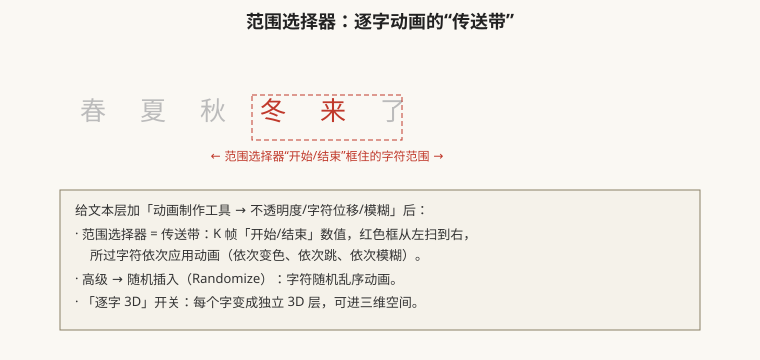

# 文字动画与字符段落（逐字动画、沿路径文字）

## 本篇导读

AE 的文字层不只是打字——它自带「动画制作工具 + 范围选择器」，能做出逐字蹦跳、逐字变色、逐字模糊的 MG 招牌效果。本篇来自手写笔记第 4 页右栏的文字部分。

读完你应该能：① 建文字层并安全换字体；② 用范围选择器做逐字动画；③ 让文字沿蒙版路径排列；④ 知道文本预设在哪里一键套用。

## 本篇目录

- [1. 创建文字层与字符/段落面板](#1-创建文字层与字符段落面板)
- [2. 文本层属性：源文本/路径选项/更多选项](#2-文本层属性源文本路径选项更多选项)
- [3. 动画制作工具与范围选择器](#3-动画制作工具与范围选择器)
- [4. 文本预设与沿路径文字](#4-文本预设与沿路径文字)
- [5. 2026 变化概览](#5-2026-变化概览)

---

## 1. 创建文字层与字符/段落面板

创建两种方式：

1. 工具栏选 **文字工具（T）** → 在合成视图点一下 → 打几个字，自动生成文字层；
2. 菜单「图层 → 新建 → 文本」。

**字符面板**（窗口 → 字符）：

| 注意事项 | 笔记原话/原因 |
|---|---|
| 改字体前先保存 | 有的字体一换就崩 AE，**改字体前 Ctrl+S 先存一下** |
| 字符面板可重置 | 面板菜单 → 重置字符；跑调了别慌 |
| 字体不支持描边 | 有的字体勾了描边没反应 = 该字体不支持，换字体 |
| 对齐 | 左对齐/居中/右对齐三个按钮 |

**段落面板**（窗口 → 段落）——新手最容易踩坑的点：

> **段落 → 锚点居中（文字中心点居中）；千万不要去调图层锚点！**

文字要居中排版，用段落面板的对齐方式；图层锚点是给旋转/缩放当圆心的，动了它文字排版就跑了。

## 2. 文本层属性：源文本/路径选项/更多选项

展开文字层小三角：

| 属性 | 作用 |
|---|---|
| **源文本 Source Text** | 小码表点开后，可以在不同时间点打不同字——做「打字机/数字滚动」类动画：改时间点改文字即自动 K 帧 |
| **路径选项 → 路径** | 给文字层画一个蒙版路径，下拉选它 → **整排文字沿路径排列**（上一篇的钢笔画路径这时候用） |
| **更多选项 → 分组对齐** | 每个字的中心点对齐方式，微调字间距分布 |

## 3. 动画制作工具与范围选择器

文字层展开「文本 → 动画制作工具」小三角，选任意属性（位置/不透明度/字符位移/模糊…），AE 自动挂上一个**范围选择器**：

笔记里的实操清单：

| 效果 | 怎么做 |
|---|---|
| 逐字变色 | 动画制作工具选「填充颜色 → RGB」，改目标色；范围选择器 K 开始/结束 |
| 字符位移/字符值（随机乱码） | 动画制作工具 → 字符位移；数值大小 = 乱码距离；高级里调随机插入 |
| 逐字模糊 | 动画制作工具 → 模糊；范围扫过 = 字依次清晰/糊掉 |
| 高级 → 随机插入 | 字符乱序出现 |
| **逐字 3D 化** | 文字层开关里打开「逐字 3D」按钮，每个字变独立 3D 物体，可进摄像机空间 |

要点：

- 范围遮罩本身可 K 帧；动画制作工具加的多个属性参数不用 F9，范围选择器自己控制节奏。
- 多套动画可叠加（先加位置、再加颜色）。

## 4. 文本预设与沿路径文字

**文本预设**：菜单「动画 → 浏览预设」打开 Adobe Bridge（或旧版「效果和预设」面板里搜 *Text*），里面一堆做好的文字动画预设，双击套用——从时间指示器位置开始生效。

**沿路径文字完整流程**：

1. 选中文字层，钢笔画一条蒙版曲线（算法随便，纯路径用）；
2. 展开文字层 → 路径选项 → 路径 → 下拉选刚画的蒙版；
3. 文字自动贴到路径上；调「首字/末字边距」「垂直于路径」等参数微调；
4. 需要字正立不贴地的，开「旋转于路径」。

> 笔记另注：PSD 里的图层文字旋转导入后仍是可编辑文字层；做细节时新建纯色层转移效果文件（即效果挂在纯色层上而不是文字层）。

## 5. 2026 变化概览

- **Variable Font 变量字体**（26.0）：Weight/Width/Style 字轴可直接打关键帧，文字「由细变粗」动画一行搞定，不用多层缩放；26.3 起按字轴快速筛选变量字体。
- **Quick Apply（26.2）**：直接搜预设名回车套用，不用翻 Bridge。
- 字符/段落/范围选择器菜单逻辑与老版本一致。
- **上一篇**：[./形状图层与MG图形动画.md](./形状图层与MG图形动画.md)；蒙版基础见 [./蒙版轨道遮罩与预合成.md](./蒙版轨道遮罩与预合成.md)。
