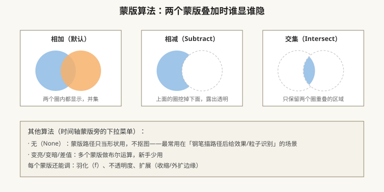
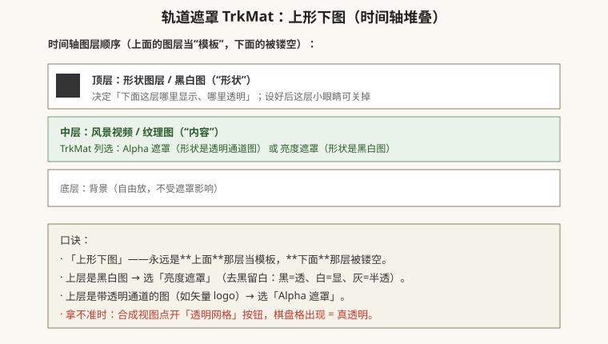
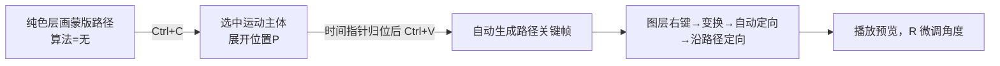

# 蒙版、轨道遮罩与预合成（抠局部、套模板、套娃）

## 本篇导读

这一篇讲 AE 图层的三个「结构件」：**蒙版（Mask，在图层上切个洞）、轨道遮罩（TrkMat，上形下图做镂空）、预合成（Pre-compose，把几层打包成一层）**，外加父子关系和「让形状沿路径跑」的经典技巧。全部来自手写笔记第 3 页。

读完你应该能：① 用矩形/钢笔画蒙版并调羽化；② 说清相加/相减/交集/无的区别；③ 用 TrkMat 让视频只在文字轮廓里显示；④ 区分预合成的两种用途；⑤ 记住「不透明度不参与父子链接」。

## 本篇目录

- [1. 蒙版：矩形/钢笔工具与基本操作](#1-蒙版矩形钢笔工具与基本操作)
- [2. 蒙版五种算法与参数](#2-蒙版五种算法与参数)
- [3. 轨道遮罩 TrkMat：上形下图](#3-轨道遮罩-trkmat上形下图)
- [4. 预合成 Ctrl+Shift+C：两种用途](#4-预合成-ctrlshiftc两种用途)
- [5. 父子关系：分级与链接](#5-父子关系分级与链接)
- [6. 形状沿路径运动（经典技巧）](#6-形状沿路径运动经典技巧)
- [7. 2026 变化概览](#7-2026-变化概览)

---

## 1. 蒙版：矩形/钢笔工具与基本操作

入口：工具栏选**矩形工具**或**钢笔工具（G）**，**先在时间轴选中图层**，再在合成视图里画——画出来的才是这层的蒙版；没选图层直接画 = 新建形状图层（下一篇讲）。

手绘操作要点（笔记原话整理）：

| 操作 | 手法 |
|---|---|
| 改圆角大小 | 画好矩形后，拖内部小圆点；或展开蒙版 → 蒙版路径 → 圆度 |
| 画正方形/正圆 | 按住 **Shift** 拖 |
| 从中心向外画 | 按住 **Ctrl** 拖 |
| 恢复默认形状 | 选中图层 → **双击工具栏里的矩形/钢笔图标** |
| 改锚点/尖角变圆角 | 钢笔搭配 **Ctrl**（切角点）、**Alt**（转圆角手柄）；用「添加/删除锚点工具」加点 |
| 显示/隐藏路径 | 时间轴蒙版旁的 📋 图标（弹窗开关） |

## 2. 蒙版五种算法与参数

一个图层上可以画好几个蒙版，它们之间怎么叠，由每个蒙版右侧的**算法下拉菜单**决定：

| 算法 | 效果 | 什么时候用 |
|---|---|---|
| **相加 Add**（默认） | 蒙版圈内显示，多个圈取并集 | 最常用，切个圆角窗、扣个局部 |
| **相减 Subtract** | 后画的圈从已有蒙版里挖掉 | 做孔洞、反选 |
| **交集 Intersect** | 只保留两个圈重叠的区域 | 少用 |
| **变亮/变暗/差值** | 多蒙版布尔运算 | 特殊图形，新手少用 |
| **无 None** | 路径不参与抠图，只当「形状/轨迹」存在 | ⭐ 极常用：钢笔描一条路径，给「生成 → 描边」、给 Saber 光效、给位置动画当轨迹（见下文明） |

每个蒙版下面还有三个参数（展开「蒙版 1」）：

| 参数 | 快捷键/入口 | 作用 |
|---|---|---|
| 蒙版羽化 Mask Feather | 选中蒙版按 **F** | 边缘虚化，做柔光/渐隐 |
| 蒙版不透明度 | — | 蒙版本身的浓淡 |
| 蒙版扩展 Mask Expansion | — | 边缘向外扩（正值）或向内缩（负值），配合羽化收边 |

> 改蒙版形状时：**选中路径再拖**，边缘出现目标框；移动/缩放完按 **Enter** 确认取消控制点。

## 3. 轨道遮罩 TrkMat：上形下图

蒙版是「在一层上切洞」；轨道遮罩是「拿另一层当洞板」，适合镂空文字、轮廓图形。

操作步骤：

1. 时间轴里至少**两个图层**：上层放「形状/黑白图/透明 logo」，下层放「要被镂空的视频/纹理」。
2. 选中**下层**，展开时间轴左下角「切换列开关」（大开关），找到 **TrkMat** 列（或右键下层 → 轨道遮罩）。
3. 下拉选：
   - **Alpha 遮罩**：上层是带透明通道的图（PNG logo、形状层）；
   - **亮度遮罩**：上层是黑白图——**去黑留白**：白色区域显示下层、黑色全透、灰色半透。
4. 选完后**上层自动关闭小眼睛**（它仍在起作用，别手动删）；点开合成视图「透明网格」确认镂空效果。

口诀：**上形下图**——上一层是模板，下一层是被剪的内容。

> 实战：做「文字里播放视频」片头 = 上层文字层、下层视频层，视频层 TrkMat 选 Alpha 遮罩。民俗片头案例见 [../06-实战与工作流/片头与MG实战案例.md](../06-实战与工作流/片头与MG实战案例.md)。

## 4. 预合成 Ctrl+Shift+C：两种用途

选中一个或多个图层 → 右键 → **预合成（Pre-compose）**，快捷键 **Ctrl+Shift+C**。它是「把选中的图层打包成一个新合成，替换掉原来那几层」。两种用法，笔记分得很清：

| 用法 | 场景 | 选哪个选项 |
|---|---|---|
| **① 单层预合成（做模板发网上）** | 把一层+上面挂的效果打包，外面只看到一个入口；预合成里素材随时可换，属性自动链接回来 | 选「将所有属性移动到新合成」 |
| **② 多层预合成（类似嵌套）** | 五六层一起打组，方便整体移动/加效果/做父子 | 框选多层后 Ctrl+Shift+C |

为什么要预合成：

- 「塌缩变换」后里面的 3D/蒙版不受外层分辨率影响；
- 轨道遮罩、调整图层遇到层级问题时，先预合成一层往往就好；
- 工程太乱时，按镜头分预合成整理。

## 5. 父子关系：分级与链接

时间轴 Parent（父级）列，把 A 层的「螺旋 pickwhip」拖到 B 层 = **A 是子级，B 是父级**。子级跟着父级动。

关键规则（手写原话）：

- **位置、缩放、旋转都会跟着父级链接**——父层转 90°，子层跟着转；父层放大，子层跟着放大。
- **例外：不透明度不链接、效果不链接**——父层淡出，子层不会淡出。
- 用法：摄像机运动幅度大时，把一堆图层父子到一个**空对象**上，给空对象 K 帧 = 整组一起动（三维片会细讲）。
- **Shift 拾取**：按住 Shift 拖 pickwhip，会把子级所有层级一起带上。

## 6. 形状沿路径运动（经典技巧）

让一个小圆头沿着你画的曲线走：

1. 新建**纯色层**（Ctrl+Y），用**钢笔**在上面描一条路径 → 把蒙版算法设为 **无（None）**。
2. 选中这个蒙版路径 → **Ctrl+C** 复制。
3. 选中运动主体图层（比如小圆图层）→ 按 **P** 展开位置 → 把时间指针放到起点时间 → **Ctrl+V** 粘贴——路径上自动生成一串位置关键帧。
4. 方向不对：右键图层 → **变换 → 自动定向（Auto-Orient）→ 沿路径定向**，物体会自动顺着路径转头；按 R 微调初始角度。

> 这条路径复制技巧在 Saber 光效、光带描边里反复用到，见 [../05-粒子与特效插件/牛顿动力学与其他插件.md](../05-粒子与特效插件/牛顿动力学与其他插件.md)。

## 7. 2026 变化概览

- **Mask Tracker（蒙版跟踪器）在 25.6/26.3 持续提速**（官方称蒙版跟踪快 5×）：手绘物体移动镜头里，现在给蒙版打个关键帧后，蒙版能自动跟着特征走，不必逐帧抠——路径：选中蒙版 → 窗口 → 跟踪器 → 蒙版跟踪。
- **Object Matte（26.2 新增，本地 AI 抠像）**：工具栏选 Object Matte 工具，在画面里点一下主体，自动生成隔离+跟踪的蒙版，比手钢笔画快得多——属于本地 AI，订阅内不扣 Firefly 积分，详见 [../AI工具与替代方案.md](../AI工具与替代方案.md)。
- 经典蒙版/轨道遮罩/预合成的菜单逻辑与老版本完全一致，本篇口诀照常成立。
- **下一篇**：形状图层与 MG 图形动画 → [./形状图层与MG图形动画.md](./形状图层与MG图形动画.md)。
