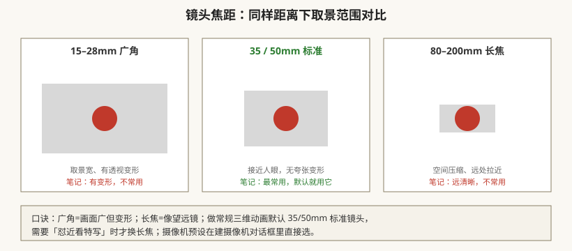
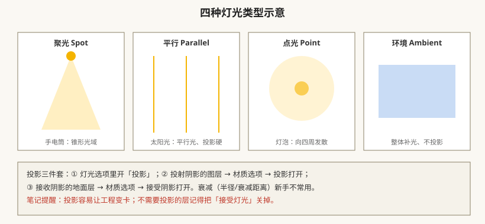
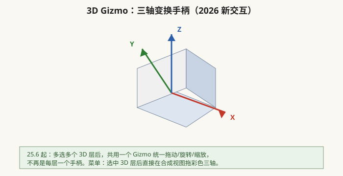

# 三维图层、摄像机与灯光（AE 2026 新 3D 管线）

## 本篇导读

打开图层小开关里的「立方体图标」，图层就从二维纸片进入 XYZ 三维空间。本篇合并手写笔记第 5 页（三维/摄像机/灯光基础）与第 20 页（中国印象三维动画实战心得），并按 AE 2026 的新一代 Advanced 3D 渲染器校准。

读完你应该能：① 开三维开关、用多视图摆位置；② 新建摄像机并选对镜头预设；③ 理解兴趣点/位置/景深/光圈；④ 会建四种灯并开投影；⑤ 知道 2026 版新 3D 管线（GLB 导入、3D Gizmo）是什么。

> 操控工具（Pin Puppet 人偶变形）由另一篇专门讲，本篇只提一句：画面里关节级变形去看 [../06-实战与工作流/片头与MG实战案例.md](../06-实战与工作流/片头与MG实战案例.md)。

## 本篇目录

- [1. 三维图层：打开立方体开关](#1-三维图层打开立方体开关)
- [2. 多视图与构图习惯](#2-多视图与构图习惯)
- [3. 摄像机：单/双节点与镜头预设](#3-摄像机单双节点与镜头预设)
- [4. 摄像机工具与景深](#4-摄像机工具与景深)
- [5. 灯光：四种类型与投影](#5-灯光四种类型与投影)
- [6. 2026 新 3D 管线（Advanced 3D）](#6-2026-新-3d-管线advanced-3d)
- [7. 实战心得（来自第 20 页笔记）](#7-实战心得来自第-20-页笔记)
- [8. 2026 变化概览](#8-2026-变化概览)

---

## 1. 三维图层：打开立方体开关

时间轴图层开关列，找到**立方体图标**点一下 → 这层的变换属性里多出 **Z 轴位置、Z 轴旋转**。

三维与二维的本质区别（笔记原话）：

- **近大远小**：图层离摄像机越远越小；
- **遮挡关系自动算**：二维是「上面的层挡住下面的」，三维是「离摄像机近的挡住远的」；
- 配合摄像机才有透视——不开摄像机，三维层只是平着挪。

## 2. 多视图与构图习惯

合成视图右下角把「1 视图」切到**多视图**，常用两个：

| 视图 | 干什么 |
|---|---|
| **活动摄像机** | 最终导出看到的画面，所有动画在这里检查 |
| **顶部（顶视图）** | 俯视摆 Z 轴：素材从哪里进、从哪里离场 |

笔记口诀：**不要在活动摄像机里操作三维移动**——去「顶部/正面」固定视图里拖位置，再切回活动摄像机看效果。切换视图后记得把分辨率切回「完整」，不然预览糊。

## 3. 摄像机：单/双节点与镜头预设

菜单：**图层 → 新建 → 摄像机**（只对打开了三维开关的层起作用）。

对话框里两个核心选择：

| 项 | 选项 | 说明 |
|---|---|---|
| 类型 | **单节点 / 双节点（可对焦）** | 双节点 = 摄像机 + 一个「兴趣点」目标点，转镜头时绕兴趣点转；新手用双节点 |
| 预设 | 15–28mm 广角 / 35 / 50 / 80–200mm 长焦 | 见下图 |

笔记结论：**35 或 50mm 标准镜头最常用**；广角有透视变形、长焦空间压缩，特殊镜头感才换。

## 4. 摄像机工具与景深

**摄像机工具**（工具栏图标，选中后在合成视图操作）：

| 鼠标操作 | 效果 |
|---|---|
| 左键拖 | 摇移（旋转视图） |
| 滚轮前后滚 | 推拉（沿 Z 轴前进后退） |
| 中键拖 | 平移 |
| 右键拖 | 拉远拉近 |

**摄像机变换两个属性**（展开摄像机层）：

- **兴趣点**：摄像机不动、镜头转向哪——常用，跑歪了右键可重置；
- **位置**：摄像机本体移动；
- 做镜头运动时两个一起 K 帧更稳。

**景深（Depth of Field）**：

1. 摄像机选项里先把「景深」开关打开；
2. 再调：**焦距（对焦平面距离）/ 光圈（越大越虚）/ 模糊层次**；
3. ⚠️ 笔记提醒：开景深很吃性能、容易卡；**景深里不能调缩放**；想变焦用位置推拉。

## 5. 灯光：四种类型与投影

菜单：**图层 → 新建 → 灯光**。

| 类型 | 比喻 | 用途 |
|---|---|---|
| **聚光 Spot** | 手电筒，锥形光域 | 主角打光 |
| **平行 Parallel** | 太阳光 | 硬投影方向光 |
| **点光 Point** | 电灯泡 | 向四周发散 |
| **环境 Ambient** | 整体补光 | 压暗部、整体辉光，不投影 |

**开投影三步**（笔记原话整理）：

1. 灯光选项 → **投影（打开）**；
2. 会投影子的物体层 → 材质选项 → **投影打开**；
3. 接影子的地面层 → 材质选项 → **接受阴影打开**。

衰减（半径/衰减距离）新手不常用；不需要被光照的层，材质选项里关掉「接受灯光」。

## 6. 2026 新 3D 管线（Advanced 3D）

老笔记的三维 = Classic 3D（图层纸片 + 假透视）。**2026 版 AE 主推 Advanced 3D（Mercury 3D 引擎）**，切换位置：

> 合成 → 合成设置（Ctrl+K）→ **高级 → 3D 渲染器**：Classic 3D / **Advanced 3D** / Cinema 4D 三选一。

| 新能力 | 说明 |
|---|---|
| 真 3D 几何 | 文字/形状可**挤压、斜角**成立体（Classic 3D 做不到） |
| 原生模型导入 | 文件 → 导入 → 直接读 **GLB / GLTF / OBJ**（FBX 仍 Beta） |
| 参数化网格 | AE 内直接建球/立方体/锥体，调尺寸外观 |
| Substance 材质 | 可贴 .sbsar 材质 |
| 引擎内景深/投影 | 26.3 起 Advanced 3D 自带景深，灯光阴影更真 |
| **3D Gizmo** | 25.6 起多选多个 3D 层共用一个三轴手柄统一变换 |

> **旧版做法备注**：Classic 3D 仍在列表里，优点是兼容图层混合模式与轨道遮罩；遇到「不能使用混合模式、通道异常」的老工程，按笔记第 20 页的话——**把渲染器切回 Classic 3D** 往往就好。

## 7. 实战心得（来自第 20 页笔记）

中国印象三维片头里攒的经验，直接搬：

- **先在顶部视图确定素材 Z 轴位置**：从哪进、从哪出，再给摄像机位置 K 帧。
- 摄像机运动幅度大时，**建空对象（空轨道）当父级**：把摄像机父子到空对象，动空对象 = 整组镜头动，多段镜头统一节奏。
- **K 帧越少越好**：保持速度一致再加关键帧；看画面运动路径上点的疏密判断匀速；Shift 吸附关键帧。
- 素材别撞摄像机轨道：让物体从镜头缝隙间穿过。
- 给素材加速：图层 → 时间 → 时间伸缩。
- 有的素材不用开三维（不动 Z 轴的平面贴画）。

## 8. 2026 变化概览

- **渲染器**：Advanced 3D 为新一代主线；Classic 3D 做兼容兜底；Cinema 4D 渲染器仍在。
- **模型**：GLB/GLTF/OBJ 原生导入；FBX 仍 Beta（以实际版本为准）。
- **交互**：Single 3D Gizmo 多选统一变换；26.5 新增百分比参考线 Guides。
- **性能**：MFR 多帧渲染成熟，三维预览比老版本顺。
- 回到基础篇：[../01-基础入门/界面合成与项目设置.md](../01-基础入门/界面合成与项目设置.md)；三维片头综合案例 → [../06-实战与工作流/片头与MG实战案例.md](../06-实战与工作流/片头与MG实战案例.md)；AI 抠像/AI 助手 → [../AI工具与替代方案.md](../AI工具与替代方案.md)。
