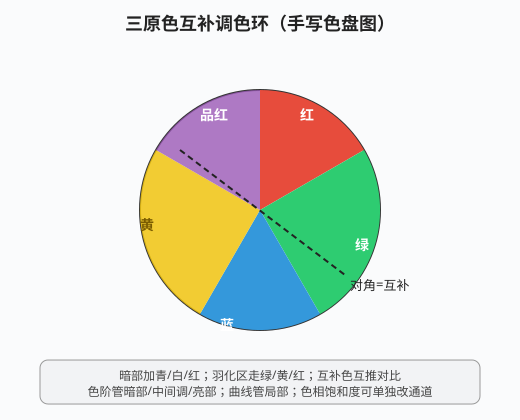

# 内置特效与调色

## 本篇导读

AE 自带效果按"功能组"收纳在 **效果和预设面板**（窗口 → 效果和预设），全部不需要另装插件。本篇整理手写笔记 p7（图层样式 + 内置特效分类）与 p8（调色体系），把"哪类效果放在哪个菜单、常用参数怎么调"列成速查表；调色部分以手写色盘图（三原色互补）为骨架。

配套：抠像类效果见 [跟踪稳定与Roto抠像.md](./跟踪稳定与Roto抠像.md)；表达式驱动动画见 [表达式入门.md](./表达式入门.md)；三维与摄像机见 [三维图层摄像机与灯光.md](../03-三维空间/三维图层摄像机与灯光.md)。

## 本篇目录

- [2026 变化概览](#2026-变化概览)
- [一、图层样式](#一图层样式)
- [二、效果分类速查（风格化/过渡/过时/抠像）](#二效果分类速查风格化过渡过时抠像)
- [三、模糊和锐化](#三模糊和锐化)
- [四、生成](#四生成)
- [五、模拟与扭曲](#五模拟与扭曲)
- [六、调色体系（色盘 + 校色效果）](#六调色体系色盘--校色效果)

## 2026 变化概览

| 变化点 | 说明 |
|---|---|
| **Quick Apply 快速应用（26.2）** | 不用在效果面板里翻菜单，直接搜索效果/预设/菜单名一键应用；属性面板与效果面板 2026-09 重新设计，导航更快 |
| 属性面板 Properties | 选中图层右侧「属性」面板集中显示常用变换/文字/效果，调参不用来回切效果控件 |
| CC 效果 | 仍全部内置（旧笔记写"CC 效果是英文版"，2026 简体中文版已同步汉化，菜单名以实际版本为准） |
| 旧版做法 | 旧工程里"效果 → 过时"组（旧亮度键、旧颜色键）是为兼容老工程保留，新工程请用「抠像」组新效果 |

---

## 一、图层样式

路径：**右键图层 → 图层样式**（Layer Styles），与 Photoshop 图层样式几乎一致：

| 样式 | 用途 | 备注 |
|---|---|---|
| 投影 | 给整个图层加投影 | 投影作用于整个图层整体，**所有样式要一起开/关** |
| 外发光 | 边缘发光 | 常用于文字/图形 |
| 斜面和浮雕 | 立体压边 | |
| 描边 | 轮廓线 | **可以打关键帧**（做描边生长动画） |

> 手写备注："一使用图层样式就贴板（常用）"——即做完样式后可预合成保存为模板复用。

## 二、效果分类速查（风格化/过渡/过时/抠像）

路径统一：**效果 → 对应组**。

| 组 | 常用效果 | 用途/要点 |
|---|---|---|
| 风格化 | 发光、查找边缘、毛边、动态拼贴 | 发光（Glow）带颜色通道控制，常**搭配外置光效插件**；查找边缘=描出轮廓；毛边=做磨损边缘；动态拼贴=重复铺满画面（做流动背景时常用） |
| 过渡 | 线性擦除、百叶窗 | 镜头转场；线性擦除靠"结束角度+擦除"做开幕 |
| 过时 | 亮度键、中间调、颜色键 | 老工程兼容用，见 [跟踪稳定与Roto抠像.md](./跟踪稳定与Roto抠像.md) |
| 抠像 | Keylight | 内置，详见上一篇 |

## 三、模糊和锐化

路径：**效果 → 模糊和锐化**。

| 效果 | 口诀/参数 |
|---|---|
| 高斯模糊 | 调**模糊度**；做大景深/柔光时勾**重复边缘像素**（Repeat Edge Pixels），否则画面四周出黑边（手写经验：曲线调通透后常叠高斯模糊+重复边缘） |
| 锐化 | 提高边缘对比，别拉过头 |
| 定向模糊 | 沿单一方向模糊（做运动拖影） |
| CC Radial Fast Blur | 径向/放射状模糊，从中心往外放射，常做"推镜冲刺"感 |
| CC Light Sweep | 扫光效果，一道光在表面扫过；手写经验：文字层上位置打 K 帧做"扫光金字" |

## 四、生成

路径：**效果 → 生成**。

| 效果 | 用途/要点 |
|---|---|
| 填充 | 给图层整体填一个纯色（手写称"滑景"，作纯色载体用） |
| 梯度渐变 | 线性/径向渐变；常与蒙版配合做"波纹渐变色" |
| 四色渐变 | 四个角各一个颜色的渐变背景 |
| 音频频谱 | 把音乐可视化成频谱线；**识别音乐的方法：新建一个纯色层加本效果，在"音频层"里选音乐层**；调绘画样式、给路径做生长动画 |
| 描边 | 沿蒙版路径描边做生长动画：先画蒙版路径（蒙版模式选"无"），本效果识别该路径，打"结束"K 帧 |
| 网格 | 纯色层 + 生成 → 网格，做科技感底纹 |

## 五、模拟与扭曲

**效果 → 模拟：**

| 效果 | 用途/要点 |
|---|---|
| CC Pixel Polly | 画面碎成多边形碎片，**无厚度**（纸片碎） |
| 碎片（Shatter） | 碎片**有厚度**，像玻璃炸开；不用自定义贴图时用一张图即可，调方向、作用力 |

**效果 → 扭曲：**

| 效果 | 用途/要点 |
|---|---|
| 贝塞尔曲线变形 | 画面边缘挂贝塞尔手柄做整体变形（手写经验：植物/装饰元素微调形状） |
| CC Page Turn | 翻页效果；注意** Render（渲染）**选项要开才出结果 |
| 波形变形 | 画面做波浪起伏（水面、飘动） |

## 六、调色体系（色盘 + 校色效果）

手写调色核心是一张色盘图：**三原色互补**——色环上对角色互为补色，互推对比。

### 调色口诀（手写原记）

- **暗部**：青 / 白 / 红；**羽化（过渡）区**：绿 / 黄 / 红；
- 互补色：红↔青、绿↔品红、蓝↔黄；
- 校色顺序：先定明暗（色阶），再拉对比（曲线），最后偏色（色相/饱和度）。

### 校色效果速查（效果 → 颜色校正）

| 效果 | 管什么 | 手写要点 |
|---|---|---|
| 色阶 | 暗部 / 中间调 / 亮部 | 直方图下三个三角黑→灰→白，分别压暗、提中间、拉亮 |
| 曲线 | 局部/中间调/暗部 | 斜向上=提亮；分通道（红/绿/蓝）曲线偏色；做"通透感"的主力 |
| 色相/饱和度 | 单通道色相、饱和度、明亮度 | 可勾**彩色化**（Colorize）把整层转单色；改某一通道不影响整体色调 |
| 颜色平衡 | 阴影 / 中间调 / 高光分别加色 | 暗部偏青、高光偏暖就是这么拉的 |
| 色调 | 黑白映射（黑→白两个颜色） | 做双色调老照片 |
| 三色调 | 暗部 / 中间调 / 亮部三色 | 多中间调的电影感调色 |
| 分形杂色 | 效果 → 杂色和颗粒 → 分形杂色 | 生成烟雾/云雾纹理，**常搭光效插件、做文字质感** |
| Lumetri 颜色 | 摄影级专业调色 | （手写原记"路视/摄影"，待核，以实际版本菜单为准） |

> 操作习惯：整体调色加在**调整图层**上（图层 → 新建 → 调整图层），不破坏原素材；曲线压暗背景、突出主体是综合案例里反复出现的手法，见 [片头与MG实战案例.md](../06-实战与工作流/片头与MG实战案例.md)。
