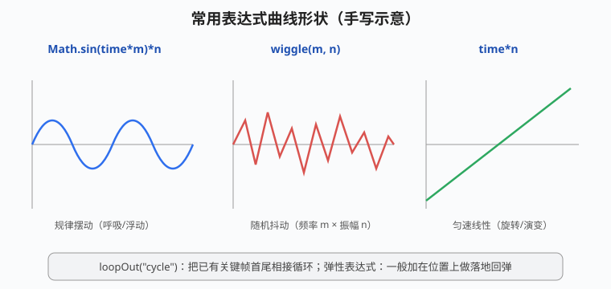
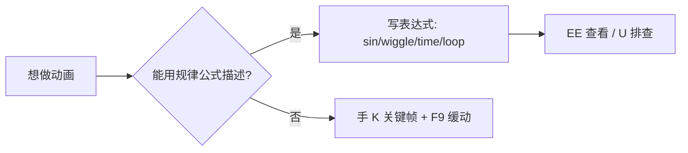

# 表达式入门

## 本篇导读

表达式是写在属性上的一小段 JavaScript 代码，用来**代替关键帧做动画**：呼吸浮动、随机抖动、匀速旋转、循环播放，几行代码就搞定，改参数还实时生效。本篇整理手写笔记 p8：加/移表达式、四个图标的含义、维度坑、五个最常用表达式。

配套：关键帧与图表编辑器见 [关键帧与时间轴动画.md](../01-基础入门/关键帧与时间轴动画.md)；用表达式驱动粒子/光效演变见 [TrapcodeParticular粒子系统.md](../05-粒子与特效插件/TrapcodeParticular粒子系统.md)。

## 本篇目录

- [2026 变化概览](#2026-变化概览)
- [一、添加与移除表达式](#一添加与移除表达式)
- [二、四个表达式图标](#二四个表达式图标)
- [三、调整图层与表达式](#三调整图层与表达式)
- [四、维度问题（最常见报错）](#四维度问题最常见报错)
- [五、五个常用表达式](#五五个常用表达式)

## 2026 变化概览

| 变化点 | 说明 |
|---|---|
| **V8 JavaScript 引擎** | 渲染期表达式求值默认走 V8（Windows），比旧 ExtendScript **快约 5 倍**；老工程可在 项目设置 → 表达式 里切回 Legacy ExtendScript 兼容 |
| **表达式编辑器增强（26.0）** | 可快速定位关键帧/标记、读取下拉菜单与文本值；帮助目录有独立「表达式编辑器」章节 |
| **AI Assistant 写表达式（2026-09 Beta）** | 可在 AE 里用自然语言让 AI 写表达式、整理工程。属云 agent 功能，**是否在大陆可用以实际版本为准**；详见 [AI工具与替代方案.md](../AI工具与替代方案.md) |

---

## 一、添加与移除表达式

**作用对象是"属性"而不是素材本身**——每个带小码表（秒表）图标的属性都能加表达式。

| 操作 | 方法 |
|---|---|
| 添加 | 选中某个属性 → 菜单 **动画 → 添加表达式**；**快捷键：Alt（Win）/Option（Mac）+ 点击小码表** |
| 移除 | 再次 Alt+点小码表；或菜单里重复"移除表达式" |
| 报错 | 表达式出错时属性变红：**关掉表达式重开**，或检查大小写/标点 |

## 二、四个表达式图标

属性左侧，表达式开启后会出现一排小图标（手写笔记原记）：

| 图标 | 名称 | 作用 |
|---|---|---|
| `=` | 开启表达式开关 | 红/绿切换；出错时关掉再重开常能刷新 |
| `≈` | 表达式曲线 | 相当于图表编辑器，**只能观察、不能改** |
| `@` | 关联器（pickwhip） | 拖到**另一个属性**上建立父子链接（注意：连的是属性，不是图层） |
| `▶` | 表达式预设 | 保存/调用常用表达式 |

## 三、调整图层与表达式

- 新建调整图层（图层 → 新建 → 调整图层），在上面加效果/表达式；
- 用 **@ 关联器**把表达式链到其他图层的属性上，实现"一层调多层、集中改参数"。

快捷键：

- **EE**（两次 E）：展开当前图层所有带表达式的属性；
- **U**：展开所有改过的属性/关键帧（排查模板工程的神器）。

## 四、维度问题（最常见报错）

写表达式最常踩的坑：**单维度表达式写到了多维度属性上**。

- 例：位置属性是 `[x, y]`（二维数组），而 `wiggle(1,20)` 单值表达式直接贴上去就不匹配；
- 解决：把属性**改"单独尺寸"**（右键属性 → 单独尺寸 Separate Dimensions），或在表达式里手动写成数组形式（如 `[wiggle(1,20)[0], wiggle(1,20)[1]]`，即"拆分 XY 属性"）；
- 书写注意：**参数用英文输入法、注意大小写**，`time` 是小写、`wiggle` 全小写驼峰。

## 五、五个常用表达式

| 需求 | 表达式 | 手写要点 |
|---|---|---|
| 规律摆动（呼吸/浮动） | `Math.sin(time*m)*n` | m=摆动速度，n=幅度；要拆 XY 属性时写进数组 |
| 随机抖动 | `wiggle(m,n)` | m=频率（每秒抖几下），n=振幅；可加在位置、不透明度上（做闪光灯效果） |
| 匀速线性变化 | `time*n` | 只用于单维度属性；随时间匀速增长，常用于旋转、演变 |
| 关键帧循环 | `loopOut("cycle")` | 打两个关键帧后写这句，首尾相接无限循环 |
| 落地弹性 | 弹性表达式（位置上写） | 一般加在**位置**属性上，做弹跳落地回弹 |

> 实战里这些表达式反复出现：民俗片头"红色三维运动弹跳"用弹性表达式、点线面案例文字"来回晃动"用 `wiggle(1,20)`、粒子"动画演变"加 `time` 表达式——见 [片头与MG实战案例.md](../06-实战与工作流/片头与MG实战案例.md)。
