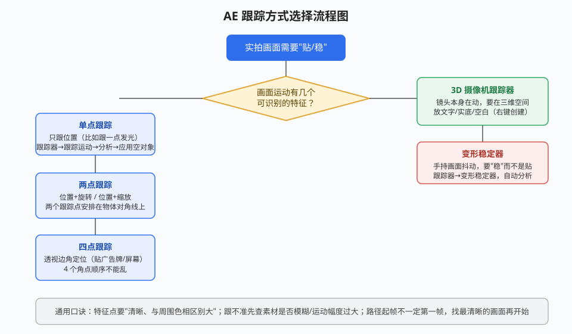
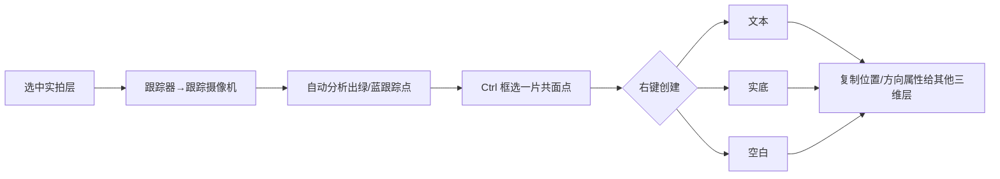
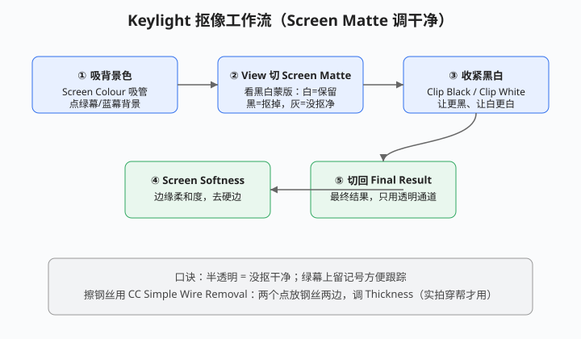

# 跟踪、稳定与 Roto 抠像

## 本篇导读

实拍素材要"贴东西、稳画面、抠人物"，AE 里靠两套系统解决：**跟踪器面板**（点跟踪 / 3D 摄像机跟踪 / 变形稳定器）负责运动数据提取；**抠像效果与 Roto 笔刷**负责把主体从背景里分离。本篇把手写笔记 p6（跟踪/抠像）与 p7（实景 Roto 抠像）整理成可照做的操作流程，并补上 2026 版的 AI 抠像变化。

配套阅读：蒙版与遮罩基础见 [蒙版轨道遮罩与预合成.md](../02-图层蒙版与文字/蒙版轨道遮罩与预合成.md)；三维摄像机与灯光见 [三维图层摄像机与灯光.md](../03-三维空间/三维图层摄像机与灯光.md)；调色部分见 [内置特效与调色.md](./内置特效与调色.md)。

## 本篇目录

- [2026 变化概览](#2026-变化概览)
- [一、跟踪器面板总览](#一跟踪器面板总览)
- [二、单点跟踪（位置跟踪）](#二单点跟踪位置跟踪)
- [三、两点跟踪（位置+旋转 / 位置+缩放）](#三两点跟踪位置旋转--位置缩放)
- [四、四点跟踪（透视边角定位）](#四四点跟踪透视边角定位)
- [五、3D 摄像机跟踪器](#五3d-摄像机跟踪器)
- [六、变形稳定器与摇摆器](#六变形稳定器与摇摆器)
- [七、内置抠像效果族](#七内置抠像效果族)
- [八、Keylight 标准抠像流程](#八keylight-标准抠像流程)
- [九、CC Simple Wire Removal 擦钢丝](#九cc-simple-wire-removal-擦钢丝)
- [十、Roto 笔刷实景抠像](#十roto-笔刷实景抠像)

## 2026 变化概览

| 变化点 | 说明 |
|---|---|
| **Roto 笔刷 3.0（Next-Gen Roto Brush）** | 选中图层后在「效果控件」面板把「版本」切到 **3.0**，由全新 AI 模型驱动，边缘精度明显高于 2.0。**免费**：订阅内本地 AI 模型，不扣 Firefly 积分（是否完全离线、大陆是否可跑，以实际版本为准） |
| **Object Matte 对象遮罩（26.2 新增）** | 工具栏选 Object Matte 工具，单击主体即自动选中、隔离并跨帧跟踪；26.5 增加结果磁盘缓存。**免费**本地 AI，不扣积分 |
| **Mask Tracker 提速约 5×（26.3）** | 蒙版路径逐帧跟踪更快，Roto 类工作流等待时间缩短 |
| **内容识别填充** | 窗口 → 内容识别填充，蒙版圈掉杆/麦克风后「生成填充图层」，本地渲染免费，大陆可用 |
| 旧版做法 | 旧版 Roto 笔刷只有 1.0/2.0，边缘一抠就"发虚"要手动画调整边缘；现在先试 3.0，不好再手修 |

> 费用口径：AI 生成视频类功能（依赖 Firefly）在中国大陆不可用；但 Roto 笔刷 3.0 / Object Matte / 内容识别填充属本地模型，不扣 Firefly 积分，详见 [AI工具与替代方案.md](../AI工具与替代方案.md)。

---

## 一、跟踪器面板总览

打开方式：**窗口 → 跟踪器**（Track 面板）。跟踪的本质是"在画面里找一个特征点，逐帧记下它的坐标，再把坐标数据交给空对象/图层"。

| 跟踪方式 | 适用场景 | 输出 |
|---|---|---|
| 跟踪运动（单点） | 只跟一个点的位置（贴光效、贴字幕） | 位置关键帧 |
| 跟踪运动（两点） | 物体有旋转/缩放（贴手机屏幕、贴标牌） | 位置+旋转 / 位置+缩放 |
| 跟踪运动（四点） | 贴在一个倾斜平面上（广告牌、地面） | 边角定位 |
| 3D 摄像机跟踪器 | 镜头本身在运动，要在"虚拟三维空间"放文字/物体 | 实底/文字/空对象 + 摄像机 |
| 变形稳定器 | 手持镜头抖动，要画面稳 | 自动变换关键帧 |

**选特征点口诀**（手写经验，保留）：

- 特征点要**清晰、与周围颜色有明显区别**（一块纯色上没法跟）；
- 跟踪框**不宜过大**；下一帧特征点没有跑出大框，就算正常；
- 路径起点**不一定在第一帧**——先拖时间指针找一段最清晰、最好认的画面再开始分析；
- 跟不准的常见原因：**素材模糊、运动幅度太大**。

---

## 二、单点跟踪（位置跟踪）

1. 选中实拍图层 → 跟踪器面板 → **跟踪运动**；
2. 合成视图里出现一个跟踪点（内部小框=特征区，外部大框=搜索区）；把它拖到明显特征点上；
3. 跟踪器面板点**向前分析**（或向后分析）；画面会自动逐帧推进，后面拉出一条跟踪路径；
4. 分析完成后：**编辑目标 → 选择新建的空对象图层**（图层 → 新建 → 空对象），让跟踪数据写进空对象；
5. 点**应用** → 应用于"仅 X 和 Y"；
6. 把要贴的特效层/文字层**设为该空对象的子级**（父子拾取），空对象走到哪，子层跟到哪。

> 手写口诀："前面自动跟踪、后面拉出路径；裁掉多余段，新建空对象记录属性；特效放在子级链接给空对象。"

## 三、两点跟踪（位置+旋转 / 位置+缩放）

1. 跟踪器 → 跟踪运动后，在**跟踪类型**下拉里同时勾选**旋转**（除默认的位置外）；
2. 画面出现两个跟踪点，**把两个点安排在被贴物体的对角线上**（比如手机的左上角和右下角）；
3. 分别拖到两个清晰特征点 → 向前分析；
4. 应用到空对象 → 贴的内容层做子级。

- 位置+缩放：同样在跟踪类型里勾选**缩放**；
- 其余步骤与单点相同。

## 四、四点跟踪（透视边角定位）

1. 跟踪器 → 跟踪运动 → **跟踪类型改为"透视边角定位"**；
2. 画面出现 4 个跟踪点，**顺序不能乱**（按 1→2→3→4，重叠点对应被贴平面的四个角）；
3. 逐帧分析后：**编辑目标 → 应用到新建空对象**；
4. 再**新建一个纯色层**（或你要贴的内容层）放到空对象子级，等价于给它加了"边角定位"效果；
5. 如果不确定要贴的东西在哪个面上：**切换合成视图（活动摄像机/自定义视图）**观察平面朝向，再决定四角贴哪。

> 手写备注：四点跟踪 ≈ 纯色层 + 边角定位（Corner Pin），好处是角点数据由画面自动算出，不用手 K。

---

## 五、3D 摄像机跟踪器

镜头运动的镜头，点跟踪只能得到二维路径，做不到"物体立在空间里"。这时用 3D 摄像机跟踪器反推出虚拟摄像机。

1. 选中实拍图层 → 跟踪器面板 → **跟踪摄像机**（效果控件里出现"3D 摄像机跟踪器"，自动分析全片）；
2. 分析完画面上铺满跟踪点：**绿色和蓝色的点相对稳定**（绿色=地面/水平面点，蓝色=垂直面点，手写笔记称"绿蓝点"），按住 Ctrl 框选一片共面的点；
3. 在选中区域**右键** → 可创建：
   - **创建文本**（直接在该平面上生成可编辑文字）；
   - **创建实底**（一个纯色面，常用作地面/贴画面）；
   - **创建空白**（空对象，便于继续挂内容）；
4. 创建出来的对象可以调大小、旋转；要把别的物体也摆到这个面上：复制该实底的**位置和方向属性**，贴给自己的图层，再打开图层的**三维开关**，按 Shift 拖父子。

## 六、变形稳定器与摇摆器

### 变形稳定器（Warp Stabilizer VFX）

- 用途：手持/运动镜头发晃，要把画面"稳"下来。
- 操作：选中抖动图层 → 跟踪器面板 → **变形稳定器**，自动分析并加稳定关键帧。
- 手写经验：**找一个画面里一定不动的东西当参照**，稳定器会以它为基准；若想贴东西，在稳定后的画面上再做跟踪，防止穿帮。

### 摇摆器（Wiggler）

让关键帧之间自动加随机抖动：

1. 给图层某个属性（如位置）K 两个关键帧（开始帧、结束帧）；
2. 窗口 → **摇摆器**；
3. 调**频率**（每秒抖动次数）和**数量级**（抖动幅度）→ 应用。

---

## 七、内置抠像效果族

路径：**效果 → 抠像**（Keying）。先判断素材类型再选工具：

| 效果 | 适用素材 | 关键参数 |
|---|---|---|
| **亮度键** | 明暗对比明显的画面（黑底发光字、白烟） | 调值、容差、薄化边缘、对比边缘；搭配遮罩做几何柔和度解边缘 |
| **差值遮罩** | 同机位拍过"空背景"的素材 | 差值图层=空背景层，自动减去两帧相同部分 |
| **颜色键** | 去掉单一纯色背景（无烟雾/半透明） | 主色吸管 + 容差；甲方素材先过一遍，不好抠别硬接、直接说重拍 |
| **Keylight** | 绿幕/蓝幕标准抠像 | 见下节 |
| **过时组** | 效果 → 过时（Obsolete）里还有旧版亮度键、中间调、颜色键 | 老工程兼容用，新工程走抠像组 |

> 手写口诀："AE 抠像本质是'合成里再调色'；明暗对比明显就上亮度键或高对比度效果；边缘用遮罩/阴影工具收，薄化边缘保留细节。"

## 八、Keylight 标准抠像流程

Keylight 是 AE **内置**效果（Foundry 开发，无需另购），路径：**效果 → 抠像 → Keylight**。

1. **Screen Colour（屏幕色）**：用吸管吸取主体以外的背景色（绿幕）；此时主体呈半透明，说明已初步抠出；
2. **View 切到 Screen Matte（屏幕蒙版）**：只看黑白蒙版——白色=保留、黑色=抠掉、**半透明/灰=没抠干净**；
3. 调 **Clip Black / Clip White**：把灰黑压得更黑、把灰白提得更白，让蒙版干净；
4. 调 **Screen Softness（屏幕柔和度）**：柔化边缘，去掉硬边；
5. **View 切回 Final Result（最终结果）**：用透明通道看最终效果；也可配合遮罩工具修黑边。

## 九、CC Simple Wire Removal 擦钢丝

实拍绿幕上常留吊钢丝/记号，用它擦除：

1. 效果 → 扭曲 → **CC Simple Wire Removal**；
2. 画面出现两个控制点，**分别放在钢丝两端**；
3. 调 **Thickness（厚度）** 覆盖钢丝宽度。

> 手写备注：绿幕拍摄时故意在钢丝位置留记号，方便对应；效果可 Ctrl+D 复制多层擦多根线；该效果只适合静态细钢丝，大幅运动视频不适用。

---

## 十、Roto 笔刷实景抠像

没有绿幕的实拍，主体和背景差异大、分辨率高时，用 Roto 笔刷"画"出轮廓让 AI/算法逐帧跟踪。手写经验是"比较卡"，所以先裁剪工作区再画。

### 2026 标准流程

1. **先裁工作区**：按 **B 键设工作区入点、N 键设出点**（相当于 PR 的 Q、W），只抠需要的那一段；右键合成 → **合成修剪至工作区域**；
2. 工具栏选 **Roto 笔刷工具**（对应"调整边缘工具"）；在图层面板里操作：
   - **Alt 拖动**调整笔刷作用范围，**Ctrl 拖鼠标**改画笔大小；
   - 在主体边缘画一圈（向前/向后各刷一下，让它跨帧延续）；
3. 2026 版：在效果控件面板把 **Roto Brush 版本切到 3.0**，边缘会更干净；不满意再用"调整边缘工具"补画头发/手指等细碎处；
4. 切回合成视图看结果。

### 旧版做法

- 旧版 Roto 笔刷（2.0 及以前）边缘容易"飘"，每几帧就要手工补关键帧；
- 新版 3.0 由 AI 模型驱动，**免费（订阅内本地 AI，不扣 Firefly 积分）**；
- 同类新工具 **Object Matte（对象遮罩）**：26.2 起在工具栏，单击主体即可自动选中+跟踪，适合"整个人物从复杂背景里拎出来"的场景。

> 配套：抠完要补背景，用 **窗口 → 内容识别填充**（免费本地渲染）生成填充层；更多 AI 替代路线见 [AI工具与替代方案.md](../AI工具与替代方案.md)。
