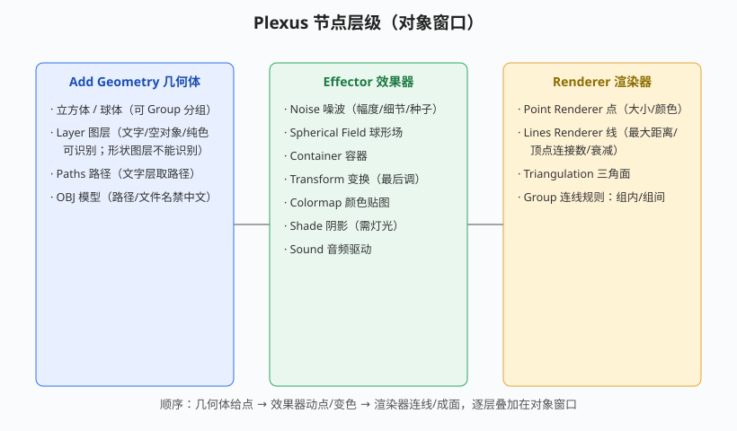

# Form 与 Plexus 点线面粒子

## 本篇导读

Particular 做"会动的粒子"，**Form 做"静止的粒子云/粒子阵列"**（可贴图、可音频驱动、可分形扰动）；**Plexus 做"点-线-面"几何网络**（科技感连线、OBJ 模型布线）。本篇整理手写笔记 p14–p19。

> **授权：Form 属商业订阅插件（Maxon Red Giant）；Plexus 为 Rowbyte 商业买断插件。**本文均不涉及价格。

配套：Particular 见 [TrapcodeParticular粒子系统.md](./TrapcodeParticular粒子系统.md)；点线面实战镜头见 [片头与MG实战案例.md](../06-实战与工作流/片头与MG实战案例.md)。

## 本篇目录

- [2026 变化概览](#2026-变化概览)
- [一、Form 基础形式](#一form-基础形式)
- [二、Form 粒子与变形](#二form-粒子与变形)
- [三、Form 贴图置换与音频驱动](#三form-贴图置换与音频驱动)
- [四、Plexus 安装与三要素](#四plexus-安装与三要素)
- [五、Plexus 几何体/渲染器/效果器](#五plexus-几何体渲染器效果器)
- [六、Group 连线规则](#六group-连线规则)

## 2026 变化概览

- Form / Plexus 均为第三方插件，按各自厂商版本兼容 AE 2026；手写笔记里"汉化包替换文件"的老办法仍可参考，但优先用官方英文版。
- 手写备注：图层混合模式异常时，3D 渲染器改回 **Classic 3D**。

---

## 一、Form 基础形式

新建纯色层 → 效果 → Trapcode → **Form**。Form 的粒子默认是"静止云"，靠贴图/场/音频驱动动起来。

| 基础形式 | 说明 |
|---|---|
| 盒形-网格 | 立方体点阵，调尺寸/数量/旋转 |
| 盒子-线条 | 拉成线阵；X 轴数量不好改时改"距离" |
| 球体-分层 | 点聚成球壳 |
| OBJ 模型 | 用 OBJ 模型替换默认形状（选 OBJ 后把原素材小眼睛关掉来识别）；粒子来自三维模型的点/线/面 |

## 二、Form 粒子与变形

- 粒子类型与 Particular 相通：羽化、尺寸随机、Size over 曲线（x 轴 Start/End）、不透明度曲线；PRESETS 可 Copy/Paste 曲线、互相转换；
- **分形场（Fractal Field）**：影响尺寸/透明度/位置置换；调分形强度、流动/流动演化、F 比例（缩放）；
- **球形场**：把平面粒子撑/压成球；
- **扭曲（Disperse）**：分散紊乱排布、分散强度曲线，像"拧麻花"。

## 三、Form 贴图置换与音频驱动

**图层/贴图（Layer Maps）**：识别一张图的颜色/亮度来驱动粒子：

| 映射 | 作用 |
|---|---|
| 颜色 & Alpha | 取图的颜色给粒子上色 |
| 置换 Displacement | 按黑白灰度做位置位移（黑/白位移方向相反，中间灰不变）；XY 位移可拆开 XY 独立；强度可调，可 K 帧/加模糊 |
| 尺寸 Size | 按灰度定大小（白受影响大、灰一半、黑为零；"分数向上"先打开） |
| 分形强度 | 给画面加数值/波形/扩散 |

> 识别黑白图的技巧：Alt 复制一层识别高亮度通道；摄像机调景深时切双视图（2 侧视图）观察。

**Kaleida 空间（万花筒）**：复制/镜像——水平/垂直镜像、旋转；行为选镜像/移除/一切。

**音频驱动（Audio React）**：音频层选音乐层；驱动器分散（打开）、分形、阈值→对比度、强度（糖曲线）、延迟方向；可叠加多个驱动器。

## 四、Plexus 安装与三要素

- 安装路径：系统盘（Windows 一般为 C 盘）下的 `Program Files\Common\Plug-ins`；不兼容版本放到 `AE 版本目录\Support Files\Plug-ins\Rowbyte`；汉化包即替换同名 Plexus 文件；
- 载体纯色层加效果后，**效果控件面板 + 对象窗口（Effects + Controls 旁边的 Plexus 面板）**两处都要操作；
- 三要素：**Add Geometry（几何体）→ Effector（效果器）→ Renderer（渲染器）**。

## 五、Plexus 几何体/渲染器/效果器

**Geometry 几何体（Primitives）：**

| 类型 | 说明 |
|---|---|
| 立方体/球体 | 基础形，可 Group 分组 |
| Layer 图层 | 文字层、空对象、纯色层可识别；**形状图层不能识别**；灯光可当点光源（点光/距离常用，聚光不常用） |
| Paths 路径 | 文字层取路径；细分遮罩去掉勾选=只在锚点上布点；每 N 个采样点设粒子数；开始/结束规模控制复制体大小 |
| OBJ | **文件路径和文件名都不能有中文** |

**Renderer 渲染器：**

| 渲染器 | 关键参数 |
|---|---|
| Point Renderer | 点大小/偏移/颜色/纹理精灵；绘制连接点边框 |
| Lines Renderer | 最大顶点搜索数（一个点最多连几条线）；最大距离（多近才连线）；淡入淡出距离（横向/纵向透明度）；计算方式：每帧计算 / 仅一帧（渲染快）/按时间间隔算一次 |
| Triangulation | 三角面：顶点最大面数 + 最大距离（多近才成面）；Facets 四边面一般不用 |

**Effector 效果器：** Noise 噪波（影响项：位置/缩放/颜色；幅度、维度、细节演变 K 帧/加表达式、Seed）；Spherical Field 球形场；Container 容器（把粒子关在一个容器里）；Transform（最后整体调）；Colormap 颜色贴图；Shade 阴影（需灯光照亮）；Sound 音频驱动。

> 手写备注：Plexus 里图层名可以在对象窗口回车改，**但不能有中文**；渲染质量影响最终出图。

## 六、Group 连线规则

多层 Plexus 时（手写"三层法"：点一层、Ctrl+D 复制出线一层、再复制出面一层），靠 Group 决定谁和谁连线：

| 规则 | 含义 |
|---|---|
| 组内 | 同组内的点互相连线 |
| 一组/一组之间 | 仅当两组之间的点满足距离才连线 |
| 两组之间 / 相同组 / 不同组 | 控制跨组/同组的连线方向 |

> 实战口诀：调点线面案例时"前期先模拟、分清哪些是光色哪些是粒子"；详细分镜见 [片头与MG实战案例.md](../06-实战与工作流/片头与MG实战案例.md)。
