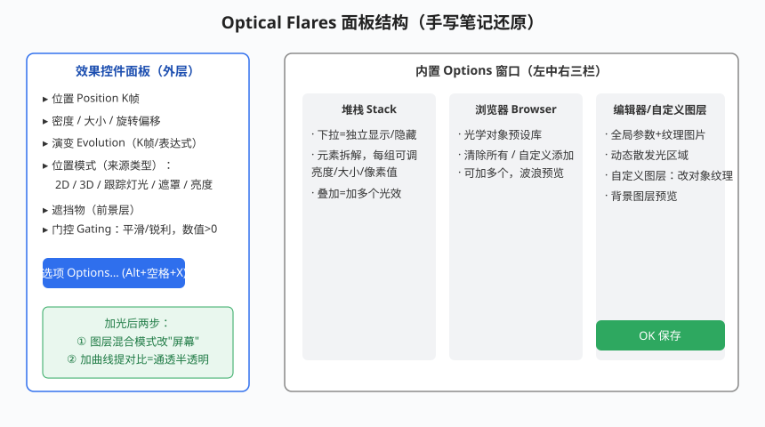

# Optical Flares 光效插件

## 本篇导读

Optical Flares（简称 OF）是 Video Copilot 出的经典 3D 镜头光晕插件，能做镜头眩光、光斑、扫光，和 AE 灯光/跟踪联动。本篇整理手写笔记 p10–p11：安装、外层参数、位置模式、遮挡与门控、内置 Options 窗口。

> **授权：商业付费插件（Video Copilot 买断制）**，需自行购买安装；本文不涉及价格。同类免费替代见 [AI工具与替代方案.md](../AI工具与替代方案.md)。

配套：OF 与 Particular 搭配做片头光效见 [片头与MG实战案例.md](../06-实战与工作流/片头与MG实战案例.md)；灯光/三维基础见 [三维图层摄像机与灯光.md](../03-三维空间/三维图层摄像机与灯光.md)。

## 本篇目录

- [2026 变化概览](#2026-变化概览)
- [一、安装与载体](#一安装与载体)
- [二、外层整体参数](#二外层整体参数)
- [三、位置模式（来源类型）](#三位置模式来源类型)
- [四、遮挡物与门控](#四遮挡物与门控)
- [五、内置 Options 窗口](#五内置-options-窗口)
- [六、加光后必做两步](#六加光后必做两步)

## 2026 变化概览

- OF 是第三方插件，**不随 AE 版本变化**；在 AE 2026（26.x）上安装对应宿主版本即可，具体版本兼容性以插件官网为准。
- 手写笔记时代"CC 效果是英文版"的问题与 OF 无关；OF 自带英文界面，网上有汉化包（手写笔记提到"汉化包"）。
- 与 AE 新 3D 渲染器（Advanced 3D）联动时若图层混合模式异常，按手写经验：渲染改回 Classic 3D。

---

## 一、安装与载体

1. 安装：把插件文件放进 AE 插件目录（Plug-ins），**选对应 AE 版本的插件版本**；
2. 载体：新建一个**纯色层**（Ctrl+Y），效果 → Video Copilot → **Optical Flares**。

## 二、外层整体参数

效果控件面板里（不进 Options 也能调）：

| 参数 | 作用 |
|---|---|
| 位置 Position | 光晕中心位置，可打 K 帧做移动光 |
| 密度 | 光的强弱 |
| 大小 | 光晕整体尺寸 |
| 旋转偏移 | 旋转 K 帧 |
| 演变 Evolution | 动画演变，可 K 帧或加 `time` 表达式做流动 |
| 颜色模式 | 一般不用改，靠纯色层/混合模式调色 |

## 三、位置模式（来源类型）

「位置模式 / 来源类型」决定光晕中心跟谁走：

| 模式 | 用法 |
|---|---|
| 2D | 纯二维位置，直接在屏幕上 K 帧 |
| 3D | 光晕进三维空间，受摄像机影响 |
| 跟踪灯光 | 新建一个 AE 灯光（**注意大小写命名**），OF 识别灯光名跟随；动作开始处用来"区分对待"，不区分则只点灯光；灯光同时影响画面光效时把"遮挡物"改为无 |
| 遮罩 | 画蒙版路径（做故事片沿路径走光），选中后复制可沿路移动；遮罩图层放在纯色层上层 |
| 亮度 | 取画面亮部位置产生光；图层混合模式改"屏幕"，亮的地方出光 |

## 四、遮挡物与门控

- **遮挡物 / 前景层**：设置前后遮挡关系，物体挡住光晕时光被"挡掉"（里外关系）；预合成时把前景层每个单独打包；
- **门控 Gating**：选平滑/锐利；数值与速度挂钩，设为"哪都有 > 0"。

## 五、内置 Options 窗口

效果控件里点 **选项 Options…**（快捷键 **Alt+空格+X**）打开内置编辑窗口：

| 栏 | 内容 |
|---|---|
| 预览面板 | 实时观看 |
| 堆栈 Stack | 下拉可独立显示/隐藏每组元素；元素拆解后每组单独调亮度、大小、像素值；叠加=同时挂多个光效 |
| 浏览器 Browser | 光学对象预设库；清除所有；可在自定义里加多个；波浪式预览挑光效 |
| 编辑器 Editor | 系统/某元素全局参数，可加纹理图片；动态散发光（画出发光区域） |
| 自定义图层 | 改对象纹理；背景图层预览 |

调好点 **OK 保存**回效果控件。

## 六、加光后必做两步

手写笔记重点批注：

1. 把 OF 纯色层**混合模式改为「屏幕」**（Screen）；
2. 再加一个**曲线**效果调整对比度，让光层变通透半透明。

> 综合案例里 OF 常和 Particular 粒子叠用：爆炸粒子 + OF 光 + 曲线压对比，见 [TrapcodeParticular粒子系统.md](../05-粒子与特效插件/TrapcodeParticular粒子系统.md) 与 [片头与MG实战案例.md](../06-实战与工作流/片头与MG实战案例.md)。
