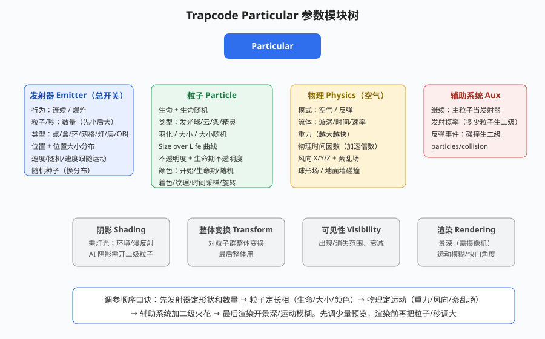

# Trapcode Particular 粒子系统

## 本篇导读

Particular 是 Red Giant（现 Maxon）旗下 Trapcode 套装里的主力 3D 粒子插件，做飞雪、火花、烟雾、光点雨都靠它。本篇把手写笔记 p11–p14 的参数全部拆成模块表：发射器 → 粒子 → 物理 → 阴影 → 辅助系统 → 渲染，最后附雪花/花瓣实战流程。

> **授权：商业订阅插件（Maxon Red Giant 订阅制）**，随 Trapcode 套装安装；本文不涉及价格。

配套：Form/Plexus 见 [Form与Plexus点线面粒子.md](./Form与Plexus点线面粒子.md)；OF 光效见 [OpticalFlares光效插件.md](./OpticalFlares光效插件.md)；表达式见 [表达式入门.md](../04-跟踪抠像与调色/表达式入门.md)。

## 本篇目录

- [2026 变化概览](#2026-变化概览)
- [一、模块总览](#一模块总览)
- [二、发射器 Emitter](#二发射器-emitter)
- [三、粒子 Particle](#三粒子-particle)
- [四、物理 Physics](#四物理-physics)
- [五、阴影 Shading](#五阴影-shading)
- [六、辅助系统 Aux](#六辅助系统-aux)
- [七、整体变换/可见性/渲染](#七整体变换可见性渲染)
- [八、实战：雪花/花瓣流程](#八实战雪花花瓣流程)

## 2026 变化概览

- Particular 为第三方订阅插件，**不随 AE 版本变化**；在 AE 2026 上安装对应 Maxon 版即可，具体版本以官网为准。
- 手写笔记时代"汉化包、不能键/序列号"的历史：现在走 Maxon 统一订阅登录，不再手动输序列号。
- 与 AE 渲染配合：多帧渲染（MFR）已成熟，粒子大图预览/渲染不再卡死。

---

## 一、模块总览

新建纯色层（Ctrl+Y）→ 效果 → Trapcode → **Particular**。六大模块按"先定形状、再定长相、后定运动"的顺序调：

## 二、发射器 Emitter（总开关）

| 参数 | 说明 |
|---|---|
| 行为 | 连续（持续发射）/ 爆炸（一次性爆开） |
| 粒子/秒 | 生成数量；**刚开始调小预览，渲染前再调大** |
| 类型（发射形状） | 点 / 盒（Box，可调发射器大小，最常用）/ 环形 / 网格（可设网格数量）/ 灯光 / 图层 / OBJ |
| 位置 | 发射中心；位置缩放分布：线性 / 平滑 / 统一 / 定向（定向用得多） |
| 发射分布 | 统一 / 定向；扩散、旋转 |
| 速度 / 发射速度 | **速度=0 时粒子原地出现**；速度不知时给位置打 K 帧会拉出一条线段 |
| 速度随机 / 速度分布 | 一般默认 |
| 速度跟随运动 | 惯性 |
| 随机种子 | 改变粒子分布状态，换一版"长相" |

**灯光发射器**：新建 AE 灯光改名为发射器名（**注意区分大小写**，与 OF 不同）；可用不同命名 A:xxx、B:xx 做多发射器；用灯光 K 帧代替发射器位置。速度=0 时初始粒子是圆的，发射器大小不生效。

**图层发射器**：选图层后该层变 3D 发射面、变换由图层控制；2D 层要改二维帧时先把类型临时改成盒子、设 2D，再改回图层；还有"图层网格"（图层+网格结合）。

**OBJ 模型**：选 OBJ 模型作发射体；识别刷新技巧：**先选"无"，再重新选一次图层**。

## 三、粒子 Particle

| 参数 | 说明 |
|---|---|
| 生命 / 生命随机 | 粒子存活时间 |
| 类型 | 发光球体/星光（无景深，不常用）、云朵（烟雾云层）、条状光线（可调数量/大小/随机种子/开始端点/结束点）、精灵（见下）、发光多边形（着色/填充） |
| 羽化 | 边缘柔化 |
| 大小 / 大小随机 | |
| Size over Life | 生命期大小曲线（Start/Time/End 三段）；PRESETS 可 Copy/Paste 曲线；Smooth/Randomize 选圆滑或随机 |
| 不透明度 / 生命期不透明度 | 与大小曲线同逻辑；有时需要和生命期大小"一致" |
| 设置颜色 | 开始颜色 / 生命期颜色 / 随机（从色块里随机抽）；着色随机 |
| 混合模式 | |

**精灵（Sprite）做法**：新建一个 100×100 或 200×200 的合成当"精灵层"→ 里面放形状/文字 → 关掉该层小眼睛；在粒子里选精灵类型、纹理里识别这个合成。时间采样选：随机-循环 / 随机-静止帧 / 单帧 / 当前时间（做漂浮感用静止帧）。旋转：随机 / 速度（1.0=360°）/ 随机速度。

## 四、物理 Physics

| 参数 | 说明 |
|---|---|
| 模式 | 空气 / 反弹 |
| 流体 | 漩涡 / 漩涡比例 / 流体时间 / 流动速率 |
| 重力 | 越大下落越快；做上升烟雾就给负值 |
| 物理时间因数 | 加速倍数，1.0=原速 |
| 风向 | X 左右、Y 上下、Z 前后 |
| 紊乱场 | 扰乱粒子轨迹（影响大小、影响位置可分别开）；**可视化区域渲染时关掉** |
| 球形场 | 把粒子撑/压成球形，强度打开提高 |

**碰撞/反弹**：新建纯色层当地板 → 物理里识别地板图层（开关）；地板模式设范围；墙图层可产生二次碰撞（3D）；碰撞值越大反弹越硬；反弹随机；滑动=反弹后沿轨迹滑。

## 五、阴影 Shading

- 前提：**场景里要有灯光**才生效；
- 用户环境：灯光与粒子有距离感；环境：必须在 3D 环境才起作用；漫反射：模拟光照到物体上的反射；
- 阴影开关：按粒子间距产生互投影，不受灯光影响；
- 调整观察：挪粒子与阴影的前后关系；
- **AI 阴影：需要开启辅助系统（二级粒子）才有效果**。

## 六、辅助系统 Aux

| 类型 | 说明 |
|---|---|
| 继续（Continue） | 以主粒子当发射器，二级粒子跟主粒子同款；发射概率=控制多少主粒子会生二级；细长粒子飞过时完全显示，数值 100 时颜色跟主粒子 |
| 反弹事件（Bounce） | 粒子撞到东西后产生二级粒子；`particles/collision`=一次碰撞生成几个 |
| 手写 BUG 备注 | 二级粒子颜色改不了时，改"生命周期颜色"；二级粒子不动=速度为 0；地面关小眼睛也能让粒子停 |

## 七、整体变换/可见性/渲染

| 模块 | 说明 |
|---|---|
| 整体变换 | 对整群粒子整体变换，**最后收尾用** |
| 可见性 | 出现/消失范围、衰减范围 |
| 渲染 | 景深需要场景里有摄像机，靠摄像机焦距控制；运动模糊：合成设置 → 高级 → 使用合成快门角度/快门相位，配合速度调 |

## 八、实战：雪花/花瓣流程

手写笔记原流程（载体纯色层）：

1. 发射器类型=盒子，盒子大小覆盖整个画面；
2. 速度=0，重力给小一点；
3. 生命调长；关掉"允许连接"；粒子/秒先调小；
4. 加力、风向（边观察边调）、随机位置、紊乱场；
5. 建"精灵"合成（100×100，3 帧），粒子选精灵、识别它；
6. 大小 + 随机大小、时间采样选静帧、旋转加随机；
7. 精灵填充纹理，粒子颜色/着色纹理。

> 调色口诀：压暗原背景突出主体，Alt 拖一层出来叠光；水晶球类镜头：下层+曲线调暗。更多综合镜头见 [片头与MG实战案例.md](../06-实战与工作流/片头与MG实战案例.md)。
