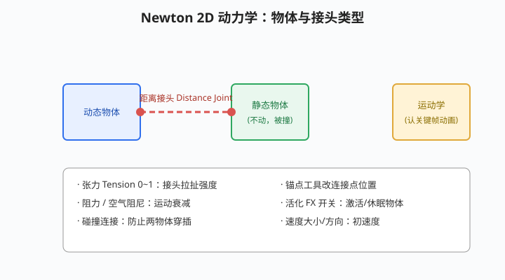

# 牛顿动力学与其他插件

## 本篇导读

手写笔记在粒子之外还记了两类实用插件：**Newton（2D 物理动力学，做落体/碰撞/摆吊动画）**和 **Saber（免费能量光效，读蒙版路径发光）**。本篇收这两个主力 + 其他插件一句话清单。

> **授权：Newton 为 Motion Boutique 商业买断插件；Saber 为 Video Copilot 免费插件。**价格以官网为准，本文不展开。

配套：综合片头里 Saber 读蒙版路径的用法见 [片头与MG实战案例.md](../06-实战与工作流/片头与MG实战案例.md)。

## 本篇目录

- [2026 变化概览](#2026-变化概览)
- [一、Newton 动力学](#一newton-动力学)
- [二、Saber 能量光效](#二saber-能量光效)
- [三、其他插件速查](#三其他插件速查)

## 2026 变化概览

- Newton / Saber 均为第三方插件，按各自版本兼容 AE 2026；菜单路径不随 AE 升级变化。
- 手写笔记时代"汉化包"的老办法仍可参考，但建议用官方英文界面避免崩溃。

---

## 一、Newton 动力学

Newton 把 AE 图层变成 2D 刚体，自动算重力、碰撞、连接。

1. 准备：把要参与物理的图层摆好位置（Newton 会识别各自中心点）；
2. 菜单 **合成 → Newton** 打开物理模拟窗口；
3. 选中物体后可设：

| 参数 | 说明 |
|---|---|
| 类型 | 静态（不动）/ 动态（受重力下落）/ 运动学（保留你手 K 的关键帧动画） |
| 速度大小/方向 | 初速度 |
| 网格阻尼 | 空气阻力，让运动慢慢停下 |
| 碰撞连接 | 防止两物体穿插 |

4. **接头（Joint）**：两个物体之间连线——

| 接头 | 作用 |
|---|---|
| 距离接头 | 保持两物体间距离（像绳子拴着）；选中线后用锚点工具改连接点 |
| 张力 | 0~1，拉扯强度 |
| 阻力 | 摆动衰减 |
| 活化（FX 开关） | 激活/休眠物体 |

## 二、Saber 能量光效

Saber 是免费插件，手写笔记把它用在民俗片头"赛博朋克 + 跟踪"镜头：

1. 新建纯色层 → 画蒙版路径 → 效果 → Video Copilot → **Saber**；
2. Saber 自动**读取蒙版路径**，沿路径显示能量光（二维插件）；
3. **开始/结束偏移**关键帧 ≈ 修剪路径生长动画；
4. 基于实底层用，配合 3D 摄像机跟踪器做实拍合成（见 [跟踪稳定与Roto抠像.md](../04-跟踪抠像与调色/跟踪稳定与Roto抠像.md)）。

## 三、其他插件速查

| 插件 | 一句话 | 授权 |
|---|---|---|
| Trapcode Particular / Form | 3D 粒子/粒子云 | 商业订阅 |
| Optical Flares | 镜头光晕 | 商业买断 |
| Plexus | 点线面几何网络 | 商业买断 |
| Newton | 2D 刚体物理 | 商业买断 |
| Saber | 路径能量光 | 免费 |
| Keylight | 绿幕抠像 | **AE 内置** |
| 国产/免费替代 | 剪映专业版、Blender、Cavalry、DaVinci Fusion 等 | 见 [AI工具与替代方案.md](../AI工具与替代方案.md) |
