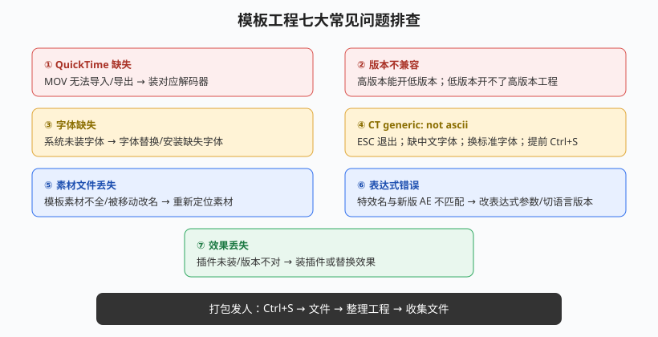

# 模板使用与常见问题排查

## 本篇导读

下载 AE 模板（片头/包装工程）是新手最快的学习方式，但打开模板常踩一堆坑：QuickTime、版本、字体、素材丢失、表达式报错、效果丢失。本篇整理手写笔记 p22 的工程结构、七大问题、收集文件打包，以及两个小案例。

配套：表达式报错语法见 [表达式入门.md](../04-跟踪抠像与调色/表达式入门.md)；插件缺失清单见 [牛顿动力学与其他插件.md](../05-粒子与特效插件/牛顿动力学与其他插件.md)。

## 本篇目录

- [2026 变化概览](#2026-变化概览)
- [一、模板工程结构](#一模板工程结构)
- [二、七大常见问题](#二七大常见问题)
- [三、收集文件打包](#三收集文件打包)
- [四、拆模板学习方法](#四拆模板学习方法)
- [五、两个小案例](#五两个小案例)

## 2026 变化概览

| 变化点 | 说明 |
|---|---|
| 原生 H.264 回归 | 文件 → 导出 → 添加到渲染队列 → 格式选 H.264 直接出 mp4，不再为导 mp4 折腾 QuickTime；MOV 透明通道仍可用 PNG 序列兜底 |
| 版本命名 | AE 2026 = 26.x；高版本能另存/导出给低版本的能力有限，**低版本打不开高版本工程** |
| 字体/语言 | 新版简体中文官方一等支持；CT generic 报错多与缺中文字体有关 |

---

## 一、模板工程结构

解压模板后通常四类内容：

| 文件夹/文件 | 内容 |
|---|---|
| Footage | 素材（图片/视频/音频） |
| AE 工程文件 | .aep 主工程 |
| 推荐网站 | 作者/素材站链接 |
| Tutorial | 预览效果 + 使用说明/问题解答 |

## 二、七大常见问题

| # | 问题 | 原因 | 解决 |
|---|---|---|---|
| 1 | 没装 QuickTime | MOV 无法导入/导出 | 装对应解码器；或用 PNG 序列透明通道兜底 |
| 2 | 版本转换 | 高→低可打开；低→高打不开 | 装对应高版本 AE，或多版本并存 |
| 3 | 字体无法解析 | 系统未装模板所用字体 | 字体替换 / 安装缺失字体 |
| 4 | CT generic: not ascii | 无法识别字体，严重直接崩溃 | ESC 退出；提前 Ctrl+S；缺电脑中文字体就装；换标准字体；在软件里切换一下版本语言；换个模板/换软件编辑 |
| 5 | 文件丢失 | 模板素材不全、素材被移动/改名 | 重新定位素材；文件替换即可 |
| 6 | 表达式错误 | 特效名与改版 AE 不匹配 | 修改表达式参数；转化语言多版本适配；AE 会报少量错误可手修 |
| 7 | 效果丢失 | 插件未安装/插件版本不对 | 安装对应插件；替换效果；参数迁移（右侧效果控件对照重设） |

> 手写经验：系统更新后也容易报错；遇到崩溃先 Ctrl+S 再动。

## 三、收集文件打包

把工程发给别人/换电脑：**Ctrl+S 先保存 → 文件 → 整理工程（Dependencies）→ 收集文件（Collect Files）**，自动把所有素材、字体引用打包到一个文件夹。

## 四、拆模板学习方法

下载模板来学习时：

- 看图层小开关（显示/锁定/三维开关）；
- 看效果控件面板加了什么效果；
- 按 **U 键**展开所有改过的属性/关键帧，看作者怎么 K 帧。

## 五、两个小案例

**上移下图（轨道遮罩）**：上形图层减少灰度信息（加曲线/对比度），下形透出内容。

**流金字**：文字层加**动态拼贴**（效果 → 风格化 → 动态拼贴）做流动效果，再加色调改动。

**P 粒子图层发射器（文字↔粒子反转）**：

- 现象：文字有、粒子无 → 反过来要"文字无、粒子有"；
- 方法：项目面板里复制一层，把文字层**反转识别**，再用粒子的图层发射器识别它；
- 节奏：从无 → 有 → 从有 → 无，全靠图层发射器的开关时序。
