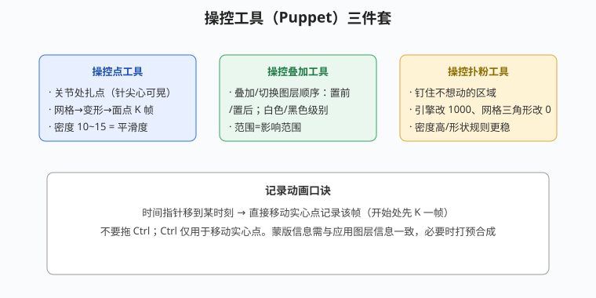

# 片头与 MG 实战案例

## 本篇导读

本篇把手写笔记里的三大实战串起来：**中国民俗主题片头**（p9）、**粒子综合案例镜头一~七**（p16）、**点线面 Plexus 案例**（p19）、**中国印象三维动画/操控工具**（p20）。核心是一套可复用的"分镜头工作流"：先定大小配色、先粗后细、镜头留长做转场。

配套：粒子参数见 [TrapcodeParticular粒子系统.md](../05-粒子与特效插件/TrapcodeParticular粒子系统.md) 与 [Form与Plexus点线面粒子.md](../05-粒子与特效插件/Form与Plexus点线面粒子.md)；Saber/OF 见 [OpticalFlares光效插件.md](../05-粒子与特效插件/OpticalFlares光效插件.md)；三维摄像机见 [三维图层摄像机与灯光.md](../03-三维空间/三维图层摄像机与灯光.md)。

## 本篇目录

- [2026 变化概览](#2026-变化概览)
- [一、分镜头工作流（总口诀）](#一分镜头工作流总口诀)
- [二、民俗主题片头：镜头一~四](#二民俗主题片头镜头一四)
- [三、综合粒子案例：镜头一~七](#三综合粒子案例镜头一七)
- [四、点线面案例（Plexus 三层法）](#四点线面案例plexus-三层法)
- [五、中国印象三维摄像机动画](#五中国印象三维摄像机动画)
- [六、操控工具（Puppet）](#六操控工具puppet)

## 2026 变化概览

- 分镜头工作流本身不变；2026 版配合多帧渲染（MFR），粒子/光效大图预览不再卡死。
- 图层混合模式异常、通道报错时，按手写经验：**3D 渲染器改回 Classic 3D**。
- AI 辅助：AI Assistant（2026-09 Beta）可自然语言写表达式/整理工程，大陆可用性以实际版本为准，见 [AI工具与替代方案.md](../AI工具与替代方案.md)。

---

## 一、分镜头工作流（总口诀）

- 先 Ctrl+I 导入素材，项目面板**新建文件夹整理素材**；
- 字用轨道遮罩（上形下底）；背景主体主次分明、蒙版羽化；
- 先粗后细，每个镜头**故意留长一点**，结尾 K 帧做过渡转场；
- 参考图层：右键 → 参考图层（导出时不渲染，或直接关小眼睛）。

## 二、民俗主题片头：镜头一~四

| 镜头 | 做法 |
|---|---|
| 镜头一 | 鱼的蒙版路径动画（复制路径、变换反向）；红色三维运动+弹跳表达式+投影；背景曲线调色；字轨道遮罩动画；波纹（形变拉长=时间重映射/解释素材；波纹渐变=梯度渐变+遮罩）；水花=填充 |
| 镜头二 | 素材在项目面板复制（要改就回原素材）；延长预合成时长在预合成里 Ctrl+K；**Saber** 读蒙版路径发光，开始/结束偏移≈修剪路径；赛博朋克+跟踪+Saber（基于实底），跟踪摄像机 |
| 镜头三 | Ctrl+Alt+F 适配竖版素材；贝塞尔曲线变形（植物）；预合成+填充整体加色（山）；山构图+弹性表达式；元素翻转、拖三维锚点 |
| 镜头四 | 右键 → 参考图层（导出不渲染） |

**小效果库**：

- 流金溶化字：文字层预合成 → 加纯色层 → 扭曲 → **CC Blobbylize**（溶化），Softness 与 Cut Away 打关键帧；纯色层溶成文字形状；
- 勾心描边：纯色层 → 生成 → 网格；钢笔画心形；生成 → 勾边（蒙版路径）路径匹配；旋转 K 帧；再加一个勾边效果加粗开头；
- 实拍合成：跟踪摄像机找平面找点（绿/蓝点），右键创建实底和摄像机，关小眼睛加效果。

## 三、综合粒子案例：镜头一~七

| 镜头 | 要点 |
|---|---|
| 镜头一 | 文字四角接贴/修边/拼贴中心；流金（预合成）+ CC Blobbylize；轨道遮罩+三色调；Form 粒子（分形场位移、F 比例流动；基础形式旋转/尺寸；摄像机追踪/光圈）；中光（爆炸盒子+速度；屏幕模式+曲线对比度+高斯模糊重复边缘；演变加 `time` 表达式）；调整图层调色+曲线；摄像机→空对象父子→空轨道 |
| 镜头二 | 复制镜头素材、改参数 |
| 镜头三 | Form 盒子线条（尺寸/位置/扭曲/旋转）；Alt 复制一层调不透明度等；再 Alt 一层盒子网格（分散/弯曲撕烂） |
| 镜头四 | 扭曲+OF 光+盒子线条+X 旋转 K 帧；主次分明、前期先模拟 |
| 镜头五 | P 粒子盒子（随机大小/紊乱）；两层 P 粒子速度不同；分开形场 |
| 镜头六 | 二级粒子：不透明度、OF 光、重力为负、高斯模糊、下落粒子 |
| 镜头七 | 反弹、随机种子 |

## 四、点线面案例（Plexus 三层法）

手写 p19 四镜头骨架：

| 镜头 | 做法 |
|---|---|
| 镜头一 | 背景渐变（规则渐变用渐变，不规则用两层绿色图层+蒙版脏）；地面噪波+演变 `time*50`、Y 轴旋转 K 帧、开景深；空中粒子（点线/立体线面/连接）；OBJ 闪烁；OF 光+曲线；文字预设模糊+`wiggle(1,20)` 来回晃 |
| 镜头二 | 前层空中粒子（点线/噪波 `time*10`/绘制连接点/时间间隔）；后层粒子（亮度/`time*70`）；人 OBJ 点/线/面；背景人脸下巴模糊改蒙版；OF 光 |
| 镜头三 | **三层 Plexus**：点一层只加点 → Ctrl+D 一层只加线（橙色）→ 再 Ctrl+D 一层只加面/贴图；颜色构图提对比、浅灰降亮度；打预合成（保留效果能识别素材）；OF 辉光 |
| 镜头四 | 背景梯度渐变+前期模糊；空中粒子 Ctrl+C/V 改大小亮度、位置 K 帧；OF 辉光 K 帧（位置/亮度）；文字位置/不透明度/填充色 K 帧；CC Light Sweep 扫光位置 K 帧 |

## 五、中国印象三维摄像机动画

1. **顶部视图**确定素材 Z 轴进出位置；摄像机位置打 K 帧；注意构图；有的素材不用开三维（不吃摄像机）；
2. 摄像机运动幅度大时：**用空对象/空轨道父子级摄像机**；同 Z 轴素材统一处理（缩放、裁时间、抠图羽化）；
3. **K 帧技巧**：保持速度一致再补关键帧；看运动路径上点的段距离；**越少 K 帧越好**；Shift 吸附；
4. 素材加速：图层模式 → 帧；素材别撞摄像机轨道，从缝隙穿过；
5. 找位置流程：分析所有素材定进出离场位置 → 放入点定 Z 轴 → 消失点给摄像机空对象 Z 轴 K 帧 → 之后只调 X/Y；素材可非等比缩放、不需要三轴都做动画；
6. **摄像机的移动速度是最关键的**。

## 六、操控工具（Puppet）

工具栏操控工具三件套：

| 工具 | 用途 |
|---|---|
| 操控点工具 | 关节处扎点（针尖心可晃）；网格→变形→面点 K 帧；密度 10~15=平滑度 |
| 操控叠加工具 | 叠加/切换图层顺序（置前/置后），白色/黑色级别；范围=影响范围 |
| 操控扑粉工具 | 钉住不想动的区域：引擎改 1000、网格三角形改 000；密度高、形状规则的区域更稳 |

**记录动画**：时间指针移到某时刻 → 直接移动实心点记录该帧（开始处先 K 一帧）；不要拖 Ctrl，Ctrl 只用来移动实心点。蒙版信息需与应用图层信息一致（例：喷墨图层素材延长好位置），必要时打预合成。
