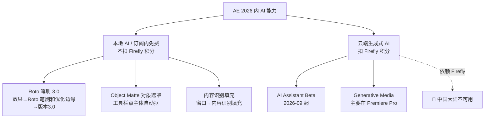

# AI 工具与替代方案（AE 2026 全景指南）

## 本篇导读

这一篇是总览：After Effects 2026 里哪些功能是 AI 做的、哪些免费、哪些扣 Firefly 积分、哪些在中国大陆用不了，以及用不了时国产/免费替代怎么选。所有费用标签只挂在 AI 功能上，传统功能不标价。

> 调研基准日：2026-10-20。价格与区域政策以 Adobe 官方最新页面为准。

## 本篇目录

- [1. AE 内置 AI 功能地图](#1-ae-内置-ai-功能地图)
- [2. 逐个讲：入口、费用、大陆可用性](#2-逐个讲入口费用大陆可用性)
- [3. Firefly 积分价目速查](#3-firefly-积分价目速查)
- [4. 🔴 中国大陆可用性与绕行路线](#4--中国大陆可用性与绕行路线)
- [5. 国产 / 免费替代工具](#5-国产--免费替代工具)
- [6. 2026 变化概览](#6-2026-变化概览)

---

## 1. AE 内置 AI 功能地图

## 2. 逐个讲：入口、费用、大陆可用性

| AI 功能 | 中文入口 | 费用 | 大陆可用性 |
|---|---|---|---|
| **AI Assistant（AI 助手）** | 2026-09-08 公开 Beta，原生内嵌 AE；自然语言整理工程、批量改名、写表达式、排查问题 | 订阅内 agent 功能，官方未明示按秒扣积分 | 依赖 Adobe 云服务，**大概率受限**（待确认） |
| **Roto 笔刷 3.0（Next-Gen Roto Brush）** | 选中图层 → 效果 → Roto 笔刷和优化边缘 → 效果控件里把「版本」切到 **3.0** | **免费**（订阅内本地 AI 模型） | 本地模型理论可用，实机待验证 |
| **Object Matte（对象遮罩）** | 26.2（2026-04）新增；工具栏选 Object Matte 工具 → 在画面里点主体，自动选中/隔离/跟踪；26.5 加磁盘缓存 | **免费**（本地 AI，不扣积分） | 同上，理论可用 |
| **内容识别填充 Content-Aware Fill** | 窗口 → 内容识别填充；蒙版圈掉杆/麦克风/人物 → 点「生成填充图层」 | **免费**（本地渲染，Sensei） | ✅ 本地功能，可用 |
| **Speech to Text 语音转写** | ⚠️ **AE 内没有**内置转写；该功能在 Premiere Pro（窗口 → 文字 → 转录） | PR 订阅内 | PR 侧部分 AI 字幕受区域限制 |
| **Generative Extend / Generative Media** | ⚠️ 主要在 **Premiere Pro**（工具栏生成式扩展/生成媒体工具），AE 内没有同名面板；PR 2026-09 还接入 Google Veo / 可灵 Kling / Runway / Luma | 扣 Firefly 积分 | 🔴 不可用 |

> 联动：AE 与 Premiere 走 Dynamic Link；Firefly Boards 的素材可一键排进 PR 序列。做「AE 合成 → PR 配音/字幕/AI 配乐」是标准流水线。

## 3. Firefly 积分价目速查

| 用途 | 消耗 |
|---|---|
| 生成视频 1080p / 24fps | **100 积分/秒** |
| 生成视频 720p / 24fps | **50 积分/秒** |
| 生成视频 540p / 24fps | **20 积分/秒** |
| PR 生成式扩展 4K / 30fps | 175 积分/秒 |
| PR 生成式扩展 1080p / 30fps | 限时免费后 125 积分/秒 |
| **AE 单应用订阅每月积分** | **25 积分/月** |

注意：500 积分/月是**全家桶 Standard/Premium 档位**，不是单应用 AE；老用户过渡政策不适用于单应用 AE（以实际账单为准）。

## 4. 🔴 中国大陆可用性与绕行路线

**官方原话**："Adobe Firefly isn't available in Russia, Belarus, and China."

结论：

- 依赖 Firefly 的功能（生成视频、Generative Media、AI Assistant 云后端）**在大陆不可用**；
- 但 **AE 本体在大陆可正常付费订阅**（2026-10 官方公告：套餐调整不影响中国用户）；
- 本地 AI（Roto 3.0、Object Matte、内容识别填充）不依赖 Firefly 区域限制，理论可用——建议实机验证。

绕行/平替路线：

1. **抠像**：Roto 3.0 / Object Matte 本地跑 → 不行就手钢笔画蒙版（见 [../02-图层蒙版与文字/蒙版轨道遮罩与预合成.md](02-图层蒙版与文字/蒙版轨道遮罩与预合成.md)）；
2. **生成视频/扩图**：改用即梦/可灵（见下节），出片后回剪映/PR 剪辑；
3. **AI 写表达式/整理工程**：先用本地编辑器手写，再试 AI Assistant 是否在你账号可用。

## 5. 国产 / 免费替代工具

| 工具 | 性质 | 一句话定位 |
|---|---|---|
| **剪映专业版** | 基础免费；SVIP / 2026-09 新上 AI Ultra 会员 | 大陆可用；AI 对话剪辑、口播删减、字幕纠错、AI 包装、数字人；承接 AE 出片后的粗剪 |
| **即梦 AI（字节）** | 积分制+会员；API 约 1 元/秒、1080p 约 0.63 元/秒 | 文生/图生视频，生成后可直接回剪映 |
| **可灵 AI（快手）** | 积分+会员；API 图生视频 720p 约 0.9 元/秒 | 大陆可用；已被 Adobe PR 列为合作模型之一 |
| **Blender** | 完全免费开源 | 三维+粒子+VFX 全能，EEVEE Next 实时引擎；替代 C4D/Particular 部分场景 |
| **Cavalry** | 免费 Starter / 付费 Pro；2.8 已加 MCP 与 AI 助手 | 2D 程序化矢量动效，MG 轻替代 |
| **达芬奇 Fusion（Resolve 内）** | 免费版即含全部 2D/3D 节点 + 20 粒子节点；Fusion Studio 买断 | 节点式合成，好莱坞工业线 |

## 6. 2026 变化概览

- **AI Assistant 进 AE**（2026-09 Beta）是今年最大信号：Adobe 把创意 agent 扩展到动效设计。
- **Roto 笔刷 3.0 + Object Matte** 是本地 AI 抠像双件套，不扣积分。
- **Firefly 区域政策不变**：大陆用户别指望生成视频类功能，路线是「AE 本体干活 + 国产 AI 出素材」。
- 相关阅读：抠像基础 → [../04-跟踪抠像与调色/跟踪稳定与Roto抠像.md](04-跟踪抠像与调色/跟踪稳定与Roto抠像.md)；三维新管线 → [../03-三维空间/三维图层摄像机与灯光.md](03-三维空间/三维图层摄像机与灯光.md)；表达式 → [../04-跟踪抠像与调色/表达式入门.md](04-跟踪抠像与调色/表达式入门.md)。
