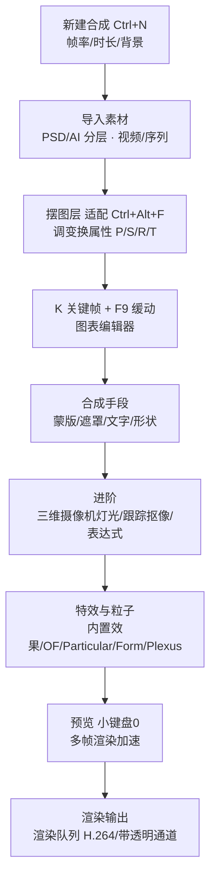

# After Effects 笔记 · 总索引（2026 版）

> 本笔记由 22 页横版手写 After Effects 课程笔记（约 43 个笔记本页面）升级、归并、去重而来，操作主线为 **Adobe After Effects 2026（v26.x，2026 年 9 月）**。
> 与平级的 `pr2026`（剪辑）、`ps2026`（修图）互为姊妹篇：PR 管"剪"、PS 管"图"、AE 管"动"（合成、特效、包装、MG、三维）。

## 目录

- [一、分类目录](#一分类目录)
- [二、建议学习顺序（五阶段）](#二建议学习顺序五阶段)
- [三、AE 一条线工作流](#三ae-一条线工作流)
- [四、费用标签与配图约定](#四费用标签与配图约定)
- [五、待确认事项](#五待确认事项)

---

## 一、分类目录

### 01-基础入门

| 文档 | 学完能做到 |
|---|---|
| [界面合成与项目设置](./01-基础入门/界面合成与项目设置.md) | 应用领域、面板布局、渲染器切换、新建合成、PSD/AI/MOV/PNG 序列导入导出、格式速查 |
| [关键帧与时间轴动画](./01-基础入门/关键帧与时间轴动画.md) | 变换属性 P/S/R/T、锚点、关键帧、F9 缓动、图表编辑器、时间轴快捷键、冻结帧、纯色层 |

### 02-图层蒙版与文字

| 文档 | 学完能做到 |
|---|---|
| [蒙版轨道遮罩与预合成](./02-图层蒙版与文字/蒙版轨道遮罩与预合成.md) | 蒙版算法、羽化扩展、轨道遮罩 Alpha/亮度、预合成、父子关系、沿路径运动 |
| [形状图层与MG图形动画](./02-图层蒙版与文字/形状图层与MG图形动画.md) | 形状属性、合并/位移/收缩/圆角/扭转/摆动/Z字形/中继器/修剪路径、24 节气国风 MG |
| [文字动画与字符段落](./02-图层蒙版与文字/文字动画与字符段落.md) | 字符/段落、源文本、路径选项、范围选择器、逐字 3D、文本预设 |

### 03-三维空间

| 文档 | 学完能做到 |
|---|---|
| [三维图层摄像机与灯光](./03-三维空间/三维图层摄像机与灯光.md) | 三维立方体、多视图、摄像机/镜头预设/景深、灯光四类、Advanced 3D 与 GLB 模型 |

### 04-跟踪抠像与调色

| 文档 | 学完能做到 |
|---|---|
| [跟踪稳定与Roto抠像](./04-跟踪抠像与调色/跟踪稳定与Roto抠像.md) | 单/两/四点跟踪、3D 摄像机跟踪、变形稳定器、Keylight、Roto 笔刷、擦钢丝 |
| [内置特效与调色](./04-跟踪抠像与调色/内置特效与调色.md) | 图层样式、模糊锐化、生成、模拟、扭曲、色阶/曲线/色相饱和度、分形杂色 |
| [表达式入门](./04-跟踪抠像与调色/表达式入门.md) | 添加/移除、关联器、维度、Math.sin/wiggle/time/loopOut/弹性 |

### 05-粒子与特效插件

| 文档 | 学完能做到 |
|---|---|
| [OpticalFlares光效插件](./05-粒子与特效插件/OpticalFlares光效插件.md) | OF 选项面板、位置模式、遮挡前景、堆栈/浏览器/编辑器、屏幕+曲线 |
| [TrapcodeParticular粒子系统](./05-粒子与特效插件/TrapcodeParticular粒子系统.md) | 发射器/粒子/物理/阴影/辅助/渲染全模块、雪花花瓣 |
| [Form与Plexus点线面粒子](./05-粒子与特效插件/Form与Plexus点线面粒子.md) | Form 形式/贴图/分形/音频、Plexus 几何/渲染/效果器/组连线 |
| [牛顿动力学与其他插件](./05-粒子与特效插件/牛顿动力学与其他插件.md) | Newton 接头/碰撞/张力、Saber 免费插件 |

### 06-实战与工作流

| 文档 | 学完能做到 |
|---|---|
| [片头与MG实战案例](./06-实战与工作流/片头与MG实战案例.md) | 民俗片头分镜头、综合案例镜头一~七、中国印象三维、操控工具 |
| [模板使用与常见问题排查](./06-实战与工作流/模板使用与常见问题排查.md) | 工程结构、七大问题、收集文件打包、流金字/图层发射器 |

### 根目录专题

| 文档 | 学完能做到 |
|---|---|
| [AI工具与替代方案](./AI工具与替代方案.md) | AI Assistant、Roto 3.0/Object Matte、Firefly 积分、大陆路线、国产替代 |

---

## 二、建议学习顺序（五阶段）

**原则：AE 是"时间轴 + 图层"的合成软件，必须先把"合成/关键帧"的时间逻辑立起来，再学"蒙版/文字/图形"这些图层手段，之后三维与跟踪是进阶的空间能力，粒子插件属于专项创作，最后用实战与工作流把它们串起来。**

### 第 1 阶段：基础合成与动画
1. [界面合成与项目设置](./01-基础入门/界面合成与项目设置.md)
2. [关键帧与时间轴动画](./01-基础入门/关键帧与时间轴动画.md)

### 第 2 阶段：蒙版、文字与图形
3. [蒙版轨道遮罩与预合成](./02-图层蒙版与文字/蒙版轨道遮罩与预合成.md)
4. [形状图层与MG图形动画](./02-图层蒙版与文字/形状图层与MG图形动画.md)
5. [文字动画与字符段落](./02-图层蒙版与文字/文字动画与字符段落.md)

### 第 3 阶段：三维空间
6. [三维图层摄像机与灯光](./03-三维空间/三维图层摄像机与灯光.md)

### 第 4 阶段：跟踪、抠像、调色与表达式
7. [跟踪稳定与Roto抠像](./04-跟踪抠像与调色/跟踪稳定与Roto抠像.md)
8. [内置特效与调色](./04-跟踪抠像与调色/内置特效与调色.md)
9. [表达式入门](./04-跟踪抠像与调色/表达式入门.md)

### 第 5 阶段：粒子插件、实战与 AI
10. [OpticalFlares光效插件](./05-粒子与特效插件/OpticalFlares光效插件.md)
11. [TrapcodeParticular粒子系统](./05-粒子与特效插件/TrapcodeParticular粒子系统.md)
12. [Form与Plexus点线面粒子](./05-粒子与特效插件/Form与Plexus点线面粒子.md)
13. [牛顿动力学与其他插件](./05-粒子与特效插件/牛顿动力学与其他插件.md)
14. [片头与MG实战案例](./06-实战与工作流/片头与MG实战案例.md)
15. [模板使用与常见问题排查](./06-实战与工作流/模板使用与常见问题排查.md)
16. [AI工具与替代方案](./AI工具与替代方案.md)（随时回看）

---

## 三、AE 一条线工作流

---

## 四、费用标签与配图约定

### AI 费用标签（只给 AI 功能）
- **免费 / 含在订阅内 / 本地 AI**：Roto Brush 3.0、Object Matte（对象遮罩）、内容感知填充、Speech to Text（与 PR 联动）。
- **消耗 Firefly 积分**：生成式视频（1080p/24fps = 100 积分/秒、720p = 50、540p = 20）；单应用 AE 订阅每月仅含 **25 积分**（500 积分档位属于全家桶）。
- **🔴 中国大陆不可用**：Firefly 及其生成式视频功能，官方原话在中国/俄罗斯/白俄罗斯不可用；AE 本体仍可在大陆订阅使用。
- 传统功能、内置特效与插件（Trapcode/Optical Flares/Plexus/Newton 等）**只写商业付费/免费，不标价**；国产替代的 AI 会员/积分在 [AI工具与替代方案](./AI工具与替代方案.md) 中简述。

### 配图约定
- 界面截图只用 **Adobe 官方帮助页真实截图**，**禁止 AI 生成假界面**；
- 流程类用 mermaid；概念示意图（面板布局、合成设置、图层变换、缓动曲线、蒙版算法、轨道遮罩、形状树、范围选择器、镜头焦距、灯光类型、3D Gizmo、跟踪流程、Keylight、表达式曲线、粒子模块树、Plexus 层级、Newton 接头、操控工具、模板问题）用手写 SVG，存各文档同名 `.assets`。

---

## 五、待确认事项

以下内容在笔记中标注"以实际版本为准 / 待确认"，未当成定论：

1. Roto Brush 3.0 / Object Matte 是否完全本地、大陆实机能否跑；
2. AI Assistant 是否扣积分、地区限制（目前为 2026-09 公开 Beta）；
3. Cinema 4D 渲染器具体版本号、FBX 导入在 26.5 是否仍 Beta；
4. 单应用 AE 老用户是否保留 500 积分过渡政策；
5. 个别简体中文菜单逐字名、操控工具密度值（10~15）；
6. Content Credentials 输出开关路径、Media Encoder 是否随 AE 自动安装。

---

> 本套笔记共 **16 篇内容文档 + 本索引**，分 6 个分类文件夹；全部链接、图片路径已校验无死链。
