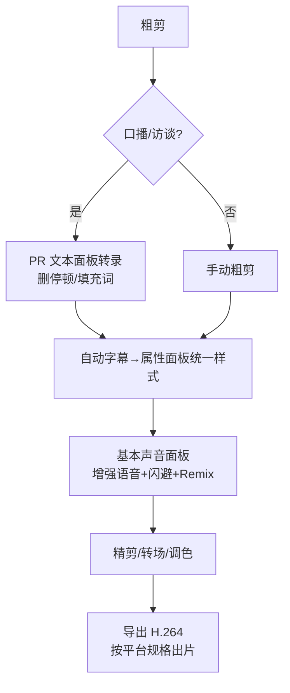

# AI 工具与第三方工作流

> 适用版本：**Adobe Premiere v26.5.2**。本文汇总 PR 内置 AI 功能清单、第三方字幕/配音/音乐工具，以及"免费 vs 付费 vs 大陆可用"的选择指南。

## 2026 变化概览

- 剪辑、转录、配音的 AI 能力已成为剪辑师日常工作流的一部分。
- 关键分界线：**Assistive AI（免费、含订阅内、大陆可用）** vs **Firefly 生成式（消耗积分、中国大陆不可用）**——选功能前先看这条线。

## 本篇目录

1. Adobe Premiere AI 功能清单（费用/可用性）
2. Firefly 积分档位速查
3. 第三方字幕/转录工具
4. AI 配音 / 音乐 / 视频生成
5. 与达芬奇等软件的工程交换
6. 国内日常工作流建议

---

## 一、Adobe Premiere AI 功能清单

| AI 功能 | 入口 | 费用 | 大陆可用 |
|---|---|---|---|
| 语音转文本（转录/自动字幕） | 文本面板 → 转录序列 | **免费**，个人无限额 | 是，语言包可离线 |
| 翻译字幕（多语言双语） | 字幕选项卡 → 翻译字幕 | 免费 | 走 Google/MS 云通道，可达性待实测 |
| 逐字（单词）字幕，26.3 | 字幕选项卡 | 免费 | 是 |
| Enhance Speech 增强语音 | 基本声音面板 → 对话 → 增强 | 免费，首次下载模型后本地运行 | 是 |
| Remix 自动重配音乐时长 | 基本声音 → 重新混合 | 免费，本地 | 是 |
| 自动闪避 Ducking | 基本声音 → 对话 → 闪避 | 免费 | 是 |
| Media Intelligence 查相似帧 | 节目监视器右键 → 查找相似帧 | 免费 | 是 |
| AI 对象遮罩，26.0 | 效果控件 → 不透明度 → 对象遮罩 | 免费 | 是 |
| Lumetri 自动调色/匹配 | Lumetri → 自动 / 比较视图匹配 | 免费 | 是 |
| Auto Reframe 自动重构竖屏 | 剪辑 → 自动重构序列 | 免费 | 是 |
| 场景编辑检测 | 片段 → 场景编辑检测 | 免费 | 是 |
| Paper Edit 文本组接序列，26.5 | 文本面板框选多行转录稿 | 免费 | 是 |
| **生成式延长 Generative Extend** | 拖剪辑边缘 | 1080p30 = 125 积分/秒 | 🔴 **否，中国大陆不可用** |
| **26.5 生成式媒体工具（文本生成视频）** | 时间线内生成式媒体工具 | 1080p24 = 100 积分/秒 | 🔴 **否，中国大陆不可用** |
| 生成音效（26.5） | 生成式媒体工具 | 10 积分/次 | 🔴 **否，中国大陆不可用** |
| 生成音轨（Firefly 网页端） | Firefly 网页 | 20 积分/分钟 | 🔴 **否，中国大陆不可用** |

---

## 二、Firefly 积分档位速查

| 计划 | 高级积分/月 |
|---|---|
| Creative Cloud Pro（原"所有应用"） | 4,000 高级 + 标准无限 |
| CC 单应用（Premiere） | 2025-06 后新订阅仅 25 标准积分 |
| Firefly Pro | 4,000 高级 |
| Firefly Pro Plus | 10,000 高级 |

> 结论：**单买 PR 订阅的国内用户，生成式延长/文本生成视频基本用不了**（服务在华不可用）；日常剪辑靠第一表里的免费 Assistive AI 就够。

---

## 三、第三方字幕/转录工具

| 工具 | 费用 | 免费额度 / 价格 | 大陆可用 |
|---|---|---|---|
| Whisper（开源模型） | 开源免费 | 本地跑、无时长限制；Windows 装 Buzz / Subtitle Edit（GUI，自带模型下载） | 是（需自备网络下一次模型） |
| 剪映专业版 | 免费 + 会员 | 基础剪辑免费；SVIP 单月 79 元 / 单年 758 元 / 连续包年 599 元；自动字幕历史上免费 | 是 |
| 讯飞听见 | 按量 + 会员 | 机器快转 0.33 元/分钟；V1 月会员 49 元含 240 分钟 | 是 |
| 飞书妙记 | 免费 + 会员 | 基础版每用户每月 **300 分钟**转文字，可导出 SRT | 是 |
| Arctime Pro | 免费 + 按量 | 基础免费；AI 语音识别 0.3 元/分钟（30 积分/分钟） | 是 |
| 必剪（B站） | 完全免费 | 自动字幕免费，桌面端可一键投稿 B 站；导出字幕为 .json 需转 SRT | 是 |
| 网易见外 | 仅 B 端 | C 端免费工作站 2020 年已停运 | 企业向 |
| Adobe Podcast | 免费档 | 每天最多 1 小时、单文件 ≤30 分钟 | 🔴 官方明示排除中国大陆 |

> 国内零成本转录路径：**Buzz 或 Subtitle Edit（本地 Whisper）** 或 **飞书妙记（网页传文件导出 SRT）**，再把 SRT 拖进 PR 对齐。

---

## 四、AI 配音 / 音乐 / 视频生成

| 工具 | 费用标签 | 免费额度 | 大陆可用 |
|---|---|---|---|
| 剪映 AI 配音（文本朗读）/ AI 音乐 | 免费 + SVIP | 基础音色免费；高级音色/音色克隆随 SVIP | 是 |
| ElevenLabs（AI 配音） | 免费 + 订阅 | 10,000 字符/月；US$6/月起 | 注册/支付需海外网络 |
| Suno（AI 音乐） | 免费 + 订阅 | 50 积分/天，免费档无商用权；US$10/月起 | 需自备网络 |
| 可灵 AI（快手） | 免费 + 订阅 | 每日 66 积分（带水印） | 是，国内直连 |
| 即梦 AI（字节 Dreamina） | 免费 + 订阅 | 每日 66 积分 | 是，国内直连 |
| Runway | 免费试用 + 订阅 | 入门试用额度 | 需自备网络 |

---

## 五、与达芬奇等软件的工程交换

- PR ↔ 达芬奇（DaVinci Resolve 21）**不能直接互开工程**，交换靠中间格式：
  - PR → 达芬奇：导出 **FCP XML / AAF**；
  - 达芬奇 → PR：达芬奇导出 XML 再导入 PR；
  - 特效/字幕/调色不随 XML 100% 翻译，属于"粗剪时间线"级往返。
- PR 26.0 起支持 **OTIO** 导入/导出，跨软件交换更通用。
- Media Encoder：随 PR 安装、不单独售卖；后台队列导出的官方工具。

---

## 六、国内日常工作流建议

1. **转录字幕**：优先 PR 自带（免费离线）；量大/要本地隐私用 Buzz/Whisper；开会类素材飞书妙记直接出 SRT。
2. **人声修复**：PR 基本声音 → 增强（免费本地），别用网页版 Adobe Podcast（大陆不可用）。
3. **音乐**：Remix 自动对齐时长（免费本地）；生成音乐（Suno/剪映 AI 音乐）按需。
4. **竖屏版**：Auto Reframe 一键出 9:16（免费）。
5. **生成式 AI 功能**：国内用户现阶段绕开 Firefly 系，等官方政策；以上表免费功能组合已覆盖 90% 日常。

---

## 相关文档

- 字幕操作细节：[字幕与文字工作流](./字幕与文字工作流.md)
- 音频 Enhance Speech / Remix / 闪避细节：[音频处理与混音实战](../02-音频与声音/音频处理与混音实战.md)
- 达芬奇调色工作流：[达芬奇调色-节点工作流入门与进阶](../03-调色/达芬奇调色-节点工作流入门与进阶.md)
- 生成式延长的操作与限制：[变速与慢动作](./变速与慢动作.md)
