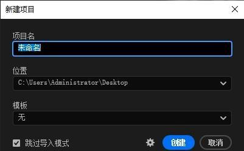
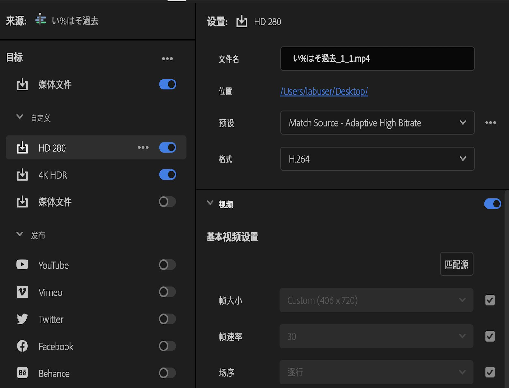

# PR 基础操作与项目设置

> 适用版本：**Adobe Premiere v26.5.2（2026 大版本，2026-09 维护版）**。界面语言：简体中文。
> 菜单写法为「菜单 → 子菜单 → 按钮」，可直接照着点。

## 2026 变化概览

- 软件已从 "Premiere Pro" 更名为 **Adobe Premiere**（覆盖桌面端 + iPhone 移动端的应用家族），桌面端功能不变；帮助中心路径已迁移至 helpx.adobe.com/cn/premiere/。
- **新建项目对话框**自 v25.0 起改版：项目名称、位置、暂存盘（Scratch Disks）在同一页设置，可直接勾选「收录」开启代理/转码流程。
- v26.0（2026-01）起原生支持 **Windows on ARM (ARM64)**；支持 OTIO 交换格式导入/导出。
- 多人协作项目改用「制作项目（Productions）」：菜单「文件 → 新建 → 制作项目」。

## 本篇目录

1. 新建项目与暂存盘
2. 新建序列与序列设置
3. 工作区与首选项
4. 素材导入与 PSD 图层导入
5. 节目监视器：安全框与网格
6. 导出与项目打包
7. 常见坑

---

## 一、新建项目与暂存盘

### 1. 新建项目

1. 启动 Adobe Premiere → 首页点击「新建项目」，或菜单 **「文件 → 新建 → 项目」**（快捷键 `Ctrl+Alt+N`）。
2. 在对话框中填写：
   - **名称**：项目名（建议带日期，如 `20261020_探店v3`）。
   - **位置**：选择**已提前在硬盘建好的工程文件夹**（不要选 C 盘桌面，路径不要含中文空格也尽量避免）。
   - **暂存盘**：默认与项目相同；素材量大、盘够快时可把「视频预览 / 音频预播 / 自动保存」指到一块高速盘。
3. 如需边导素材边生成代理/转码，勾选「收录设置」（详见 [代理剪辑与素材管理](./代理剪辑与素材管理.md)）。
4. 点「创建」。



> 个人实操经验：项目文件夹内部固定结构如下，后期打包不丢东西：
>
> ```
> 项目根目录/
> ├── Project_Archived/   ← .prproj 工程文件（自动保存也落这里）
> ├── Footage/            ← 原始素材（相机/手机拷贝进来）
> ├── Audio/              ← 音乐、音效、配音
> ├── Graphics/           ← 字幕工程、PSD、MOGRT
> ├── Proxy/              ← 自动生成的代理（不要手动整理）
> └── Export/             ← 成片导出
> ```

### 2. 暂存盘改路径

菜单 **「文件 → 项目设置 → 暂存盘」**，逐行把「视频捕获 / 音频捕获 / 自动保存 / 视频预览 / 音频预播」改到目标盘，确定后**重启 PR 生效**。

---

## 二、新建序列与序列设置

### 1. 新建序列

- 快捷键 `Ctrl+N`，或菜单 **「文件 → 新建 → 序列」**。
- 常用预设：「序列预设 → 自定义」里自己填，对照拍摄素材参数：

| 素材规格 | 序列应设 |
|---|---|
| 手机/相机 1080p | 帧大小 1920×1080，帧率 25/30，像素方形 |
| 竖屏短视频 | 帧大小 1080×1920，帧率 30（详见 [剪辑工作流-粗剪精剪与多轨道](./剪辑工作流-粗剪精剪与多轨道.md) 平台规格表） |
| 相机 4K | 3840×2160，帧率 25/30 |

> 偷懒做法：把一段素材直接拖到项目面板下方的「新建项」图标上，PR 会按素材参数自动生成匹配序列。

### 2. 建好之后改序列设置

（课程笔记要点保留）
- 菜单 **「序列 → 序列设置」**；
- 或在项目面板里**右键该序列 → 序列设置**；
- 项目窗口里也可右键序列做同样修改。

> 注意：改帧大小/帧率会让已有剪辑重新渲染，正式剪完后不要动这些参数。

---

## 三、工作区与首选项

### 1. 保存工作区

界面调到顺手的面板布局后，菜单 **「窗口 → 工作区 → 另存为工作区」**，起个名字（如「剪辑」「调色」），之后在顶部工作区栏一键切换。

### 2. 自动保存

菜单 **「编辑 → 首选项 → 自动保存」**：
- 勾选「自动保存项目」；
- 自动保存时间间隔建议 **10~15 分钟**；
- 「最大项目版本数」设 20+，崩溃后可在自动保存目录里回退。

### 3. 其他常用首选项

- **「编辑 → 首选项 → 外观」**：深色/浅色主题（v25.0 起新现代 UI）。
- **「编辑 → 首选项 → 媒体缓存」**：缓存盘满时点「删除未使用的媒体缓存文件」。

---

## 四、素材导入与 PSD 图层导入

### 1. 普通导入

- 快捷键 `Ctrl+I`，或项目面板空白处双击；
- 视频/音频/图片直接拖进项目面板。

### 2. PSD 文件导入方式（课程笔记要点）

选中 PSD 文件点「导入」后，弹窗里四个选项对应四种用法：

| 导入方式 | 效果 | 适用场景 |
|---|---|---|
| 合并所有图层 | 整个 PSD 合并为**一张图片** | 一张完整设计稿直接用 |
| 合并的图层 | 只把**选中的图层**合并为一张图片 | 拆局部用 |
| 各个图层 | **每一层单独一张图片**导入项目面板 | 分层动画、逐层出字 |
| 序列 | 每个图层按层堆叠**自动排成一条序列** | 直接做 KV 出场动画 |

---

## 五、节目监视器：安全框与网格

节目监视器底部点**扳手（扳手形设置图标）**，可勾选调出：
- **安全边距 / 安全框**（字幕安全框、动作安全框）——老电视时代防裁切，现在做电视/线下屏仍要看；
- **字幕安全网格**——对齐字幕时打开。

源监视器同样有扳手，可设字幕显示标准（CEA-608/708），详见 [字幕与文字工作流](./字幕与文字工作流.md)。

---

## 六、导出与项目打包

### 1. 导出文件格式对照（课程笔记整理）

| 目标用途 | 格式/封装 | 编码器/说明 |
|---|---|---|
| 在线发布（抖音/B站/视频号） | **.mp4** | H.264，预设选「匹配源 - 自适应高比特率」 |
| 进达芬奇/其他软件交换 | .mov | QuickTime（ProRes 等） |
| 不压画质的母版存档 | .avi | 无损编码，文件巨大，只存母版 |
| 音效/配乐单独出 | .mp3 / .wav | wav 进混音，mp3 交付 |

导出入口：菜单 **「文件 → 导出 → 媒体」**（快捷键 `Ctrl+M`），或点顶部「导出」标签页。2026 版导出界面为三段式：左侧目标栏（媒体文件 / 发布 / 云 / FTP）→ 中间设置栏 → 右侧预览面板；右下角「发送到 Media Encoder」可转后台队列。



> 注意：内置直传平台只有 Behance / Facebook / TikTok / Vimeo / X / YouTube，**没有抖音、B站、视频号**——国内平台一律先导出本地 mp4 再手动上传。

### 2. 项目打包（课程笔记要点）

菜单 **「文件 → 项目管理」**：
- 打包内容：把工程所用素材、缓存、项目环境文件收集起来；
- 位置：打包后放到新目标路径；
- 设置：勾选「收集文件并复制到新位置」，选好目标路径；
- **「排除未使用剪辑」默认不勾**（自己确认哪些素材确实不用再勾）。

### 3. 体积压缩

成片太大、平台/客户有大小限制时，可用第三方小丸工具箱做二次压缩（非 Adobe 插件，免费工具，按需要自行下载）；PR 内则在导出设置里手动降码率。

---

## 七、常见坑

1. **打开工程提示脱机文件**：素材被移动/改名 → 右键脱机素材 →「链接媒体」，指到新位置即可。
2. **保存位置乱**：首选项自动保存目录跟项目目录不一致，换电脑后自动保存找不到 → 第一步就把暂存盘指对。
3. **序列和素材参数对不上**：画面被拉伸/黑边 → 检查序列帧大小与帧率（见第二节对照表）。
4. **项目路径带中文/空格**：老版本易崩，2026 版已好转，但仍建议英文路径。

---

## 相关文档

- 剪辑的完整流程：[剪辑工作流-粗剪精剪与多轨道](./剪辑工作流-粗剪精剪与多轨道.md)
- 快捷键速查：[快捷键与高效编辑](./快捷键与高效编辑.md)
- 代理与素材归档：[代理剪辑与素材管理](./代理剪辑与素材管理.md)
- 竖屏改写与平台规格：[AI工具与第三方工作流](./AI工具与第三方工作流.md)
