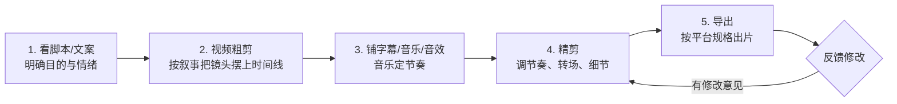
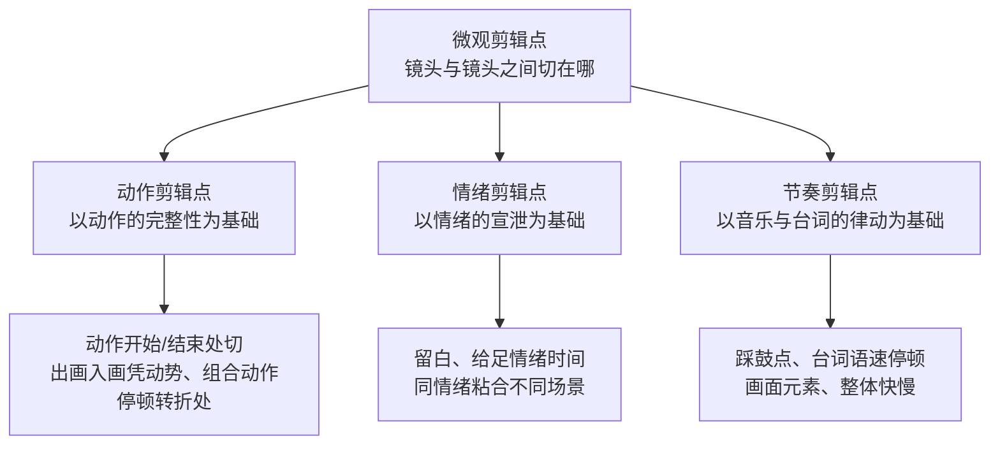
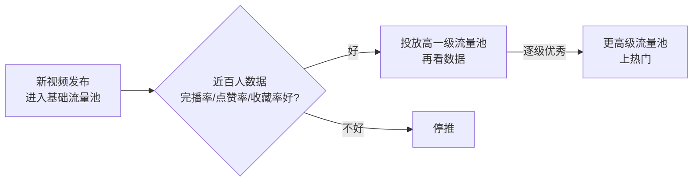

# 剪辑工作流：粗剪、精剪与多轨道

> 适用版本：**Adobe Premiere v26.5.2**。本文是一套从接素材到交付的完整工作流，结合课程笔记的「五步法」与广告片/宣传片实战流程整理。

## 2026 变化概览

- **Paper Edit（26.5，2026-09）**：在文本面板的转录稿里**框选多行文字**直接组接成一条序列，口播类视频粗剪速度翻倍。
- **序列索引面板（26.2）**：电子表格样式、可搜索全序列的剪辑清单，找镜头/改时长不用盯时间线。
- **场景编辑检测**：菜单「片段 → 场景编辑检测」，长素材自动按机位切换点切段。
- **自动重构（Auto Reframe）**：菜单「剪辑 → 自动重构序列」，横屏成片一键出 9:16 竖屏版（免费，Assistive AI）。

## 本篇目录

1. 总流程五步法
2. 准备阶段：看素材、定情绪、配音乐
3. 粗剪：素材箱分类与上轨
4. 字幕、音乐、音效铺底
5. 精剪：节奏与转场
6. 多轨道管理
7. 平台导出规格
8. 广告片/宣传片实战节奏
9. 微观剪辑心法：动作 / 情绪 / 节奏三类剪辑点
10. 商单实战：沟通三要素与火锅 / 马拉松案例
11. 短视频创作：爆款逻辑、流量池与百万赞案例

---

## 一、总流程五步法

（旧版流程要点保留）



1. **看脚本**：先弄清这条片子是给谁看、要什么情绪、时长多少。
2. **粗剪**：不管细节，把镜头按叙事顺序摆上时间线。
3. **字幕/音乐/音效**：音乐是节奏骨架，先把音乐铺上。
4. **精剪**：按节奏点细修。
5. **导出、调整**：出样片，收集反馈再改。

> **2026 提速（免费 AI 已织进五步法）**：粗剪先用「片段 → 场景编辑检测」自动切段；字幕用「窗口 → 文本」自动转录生成（免费 AI、个人使用无限额，语音语言包可离线下载）；横屏出竖屏分发用「剪辑 → 自动重构序列（Auto Reframe）」；需要局部跟踪人物/物体做局部特效时，用 **AI 对象遮罩**自动生成蒙版（见 [效果-蒙版与抠像](./效果-蒙版与抠像.md)），不必逐帧手抠。以上均为内置 Assistive AI，不另收 Firefly 积分。

---

## 二、准备阶段（接活后第一天做什么）

（综合课程要点整理）

1. **观察素材、理解前期提供的信息**：拍摄前的方案、分镜、客户 brief 全部读一遍，别上来就拖素材。
2. **吃透文案**：标记出「写在前面的目的」——哪些镜头是交代、哪些是过渡、哪些是重头戏（情绪点）。
3. **分段定情绪**：把片子按段落拆开，每段先定**情绪**（开头/铺垫/高潮/第二次高潮/结束）。
4. **找音乐**：每段情绪匹配对应节奏的音乐，再根据音乐结构安排画面（高潮对应重点镜头）。
5. **控制变量**：前期素材不够用时，取舍原则是——**选取有抖动、无绿意（待核：疑为"无意义"）、运镜稳定的镜头组**；一个动作要用**两个以上景别**才能组成镜头组（详见 [镜头视听语言-景别构图运镜角度](../04-视听语言与剪辑理论/镜头视听语言-景别构图运镜角度.md)）。

> 实战心法：抽丝剥茧地读参考片——一格一格地反复看，同时分析记录下它的内容、场面调度、运镜、景别、剪辑、声音、画面、表演，最后总结规律。

---

## 三、粗剪

### 1. 素材箱分类

项目面板新建素材箱（`Ctrl+/`），按用途分：

```
项目面板/
├── 01_采访口播/
├── 02_空镜B-roll/
├── 03_动作特写/
├── 04_音乐音效/
├── 05_图形字幕/
└── 06_成品序列/
```

### 2. 上轨

- 按叙事顺序把素材拖上时间线；
- 长采访/长素材先用「片段 → 场景编辑检测」自动切段，再挑能用的句子；
- 口播类：用「窗口 → 文本 → 转录序列」先出转录稿，在稿子里删废话/停顿（筛选器漏斗图标：填充词、屏蔽词、暂停），同步完成粗剪。详见 [字幕与文字工作流](./字幕与文字工作流.md)。
- 不满意的镜头先别删，右键 →「移除」前先拉到素材箱「_废弃」里留着。

---

## 四、字幕、音乐、音效铺底

- **字幕**：优先用「窗口 → 文本」**自动转录**生成字幕（免费 AI、个人使用无限额，语音语言包可离线下载），自动识别停顿并分段，再逐句微调；逐字硬打是备选。样式在属性面板调（见 [字幕与文字工作流](./字幕与文字工作流.md)）。
- **音乐**：先铺满整条时间线，按鼓点 `M` 打标记，粗剪时只保证大结构。
- **音效/环境音**：铺一层底噪让画面"有人味"；人声和音乐用基本声音面板做闪避，见 [音频处理与混音实战](../02-音频与声音/音频处理与混音实战.md)。

---

## 五、精剪

1. **对节奏点**：音乐鼓点 `M` 标记处切画面，视频上 `F` 标记节奏点，卡鼓点前后 ±2 帧微调。
2. **调情绪曲线**：慢段拖长留白，快段多切；长时间同一种情绪观众会疲，要有快慢切换。
3. **加转场**：能用硬切就别加特效转场；需要转场时优先声音转场（J-cut/L-cut）与匹配转场，见 [转场创意与混剪实战](./转场创意与混剪实战.md)。
4. **画面节奏检查**：两倍速看一遍时间线，拖沓的段落一眼就现形。

---

## 六、多轨道管理

### 1. 轨道结构（推荐）

| 轨道 | 放什么 |
|---|---|
| V1 | 主叙事画面（采访/主镜头） |
| V2 | B-roll、空镜、特写叠在主画面上 |
| V3 | 字幕条、图形、MOGRT |
| A1 | 人声（同期声/配音） |
| A2 | 背景音乐 |
| A3 | 音效、环境音 |

### 2. 轨道操作

- **加轨道**：项目面板/时间线轨道头右键 →「添加轨道」，选数量。
- **锁定/隐藏轨道**：轨道头「小锁」锁防误拖；「小眼睛」隐藏该轨。
- **目标轨道选定**：点轨道头点亮，插入/覆盖（`,` / `.`）才知道插到哪；向前选择轨道工具 `A`、向后选择 `Shift+A`。
- **时间轴平移**：`Alt + 滚轮`；缩放：`Alt + 左右拖动`，或 `=` / `-`，整屏 `~`。
- **素材上下层关系**：V2 自动盖住 V1，需要透明度/混合模式时到效果控件里调，见 [效果-蒙版与抠像](./效果-蒙版与抠像.md)。

---

## 七、平台导出规格

| 项目 | 抖音 | B站 | 微信视频号 |
|---|---|---|---|
| 推荐分辨率 | 竖屏 1080×1920（9:16）；横屏 1920×1080 | 1920×1080 / 1080×1920（最高 4K） | 1080×1920 / 1920×1080 |
| 帧率 | 30fps（运动画面 60fps） | 24/25/30/50/60（别用 29.97 非标） | 30fps 常见 |
| 编码 | H.264 MP4 | H.264 MP4 | H.264 MP4 |
| 码率 | ≥8Mbps（横屏实践 10–15Mbps） | 1080p60 ≤15Mbps；4K ≈20Mbps | 10Mbps 以内（实践 3–8） |
| 音频 | AAC | AAC | AAC 128kbps+，48kHz |
| 上限 | ≤4GB（>300MB 分片） | ≤8GB | 单条约 1GB、≤30 分钟 |

PR 里操作：导出 → 格式 H.264 → 预设「匹配源 - 自适应高比特率」后手动改分辨率/码率；横转竖用「剪辑 → 自动重构序列」选 9:16。

> **2026 分发与流量口径**：抖音 / B站 / 视频号均按「**完播率 → 点赞率 → 收藏率 → 评论/转发率**」逐级推荐（流量池机制见第十一节）。导出先按上表码率达标；内容侧——**AI 自动字幕**显著提升静音刷视频人群的完播率，**卡鼓点剪辑 + 亮点前置**同样直接拉完播率，这两项是 2026 短视频剪辑的基本功。

---

## 八、广告片/宣传片实战节奏

1. **音乐结构对照**：前奏 → 铺垫 → 高潮 → 副歌高潮 → 结束；画面在「开始、高潮、第二次高潮、结束」四个点给重点镜头。
2. **前音乐去重**：曲子里重复的结构要剪掉，保持段落过渡清晰。
3. **动作顺接**：衔接流畅、快慢结合；画面节奏 = 容量大小关系（待核）。
4. **遮当/转场只在需要时用**：硬切为主，转场是调味。
5. **交付前自检**：内容、场面调度、运镜、景别、剪辑、声音、画面、表演逐条过一遍。

---

## 九、微观剪辑心法：动作 / 情绪 / 节奏三类剪辑点

丝滑流畅的剪辑 = **剪辑点 × 镜头组接**。按规模分三层：**宏观**蒙太奇管整片谋篇布局，**中观**蒙太奇（转场）管段落与段落的衔接，**微观**蒙太奇管镜头与镜头之间的这一刀。（Tips：帧是镜头的单位，镜头是视频的单位。）



### 1. 动作剪辑点

以**动作的完整性**为基础下刀：在动作的开始/结束处切（动作中途剪，三七开/五五开/四六开以实际观感为准）；出画入画凭动势衔接，有出画动势即可接下一画面，不一定要真走出去；组合动作在重要动作的**停顿、转折处**切。同场景同景别、机位不动可做 zooming 剪辑魔术；不同人靠**动势承接**（混剪）。→ 完整组合表（同场景不同景别 / 不同场景相同景别 / 不同场景不同景别 / 男巫式剪辑等）见 [转场创意与混剪实战](./转场创意与混剪实战.md)「动作剪辑点 / 不同镜头组合」，此处不重复展开。

### 2. 情绪剪辑点

以**情绪的宣泄**为基础，核心是**留白**——画面里实实在在的留白，是剪辑师留给观众的情绪时间，不追求信息量、休息量。其余四条（情绪积累要给足时间、情绪是最好的粘合剂、久处同一种情绪会疲惫、BGM/回忆杀烘托强化情绪）与 [转场创意与混剪实战](./转场创意与混剪实战.md)「混剪实战·情绪剪辑点」一致，参见该节。

### 3. 节奏剪辑点

- **踩鼓点**：画面卡在音乐重拍上；
- **台词语速、停顿和内容**也影响节奏——剪辑时可有意识强化对话节奏，剪掉说话前的思考停顿；
- **画面元素**的运动方向 / 速度成为切点依据；
- **快慢是整体讲究**：一段快切之后必须有慢段呼吸。

> 2026 提速：**场景编辑检测 + 媒体智能**会先给出一批候选切点（机位切换点、相似/重复帧），人工在候选上再定动作 / 情绪点，不用从零肉眼找切点（AI 工具详见 [转场创意与混剪实战](./转场创意与混剪实战.md) 第七节）。

---

## 十、商单实战：从沟通到成片

### 1. 接活先充分沟通（三要素）

1. **成片风格**：找参考视频给甲方看，用片子定风格；
2. **期待效果**：明确甲方想要的观感；
3. **特别要求**：逐条记录硬性需求。

### 2. 案例：火锅店开业宣传（不二班火锅）

- 风格定位：**酷炫、快节奏**；
- 新店开业这类固定场景片子的出彩点 = **前期运镜拍摄** + **后期踩点剪辑**。

### 3. 案例：马拉松赛事片

- **开头**：白噪音 / 环境音开场代入；音乐里打击乐 + 音效切换节奏；前奏太拖沓就把**重音提前**；
- **高潮时长不够**：用重复节奏法——把第二段更久的高潮移前；小高潮提前收尾；
- **骤停处**：用环境音 / 氛围音过渡，别让音乐戛然而止；后半段大段持续高潮用重拍衔接法接住，自然提前收尾；
- **音效**：用真实环境音（海边风声、波浪声、海鸥声）；
- **片尾**：音乐里的音效重复利用、做**指数淡化**；配合空镜头铺垫（发令枪 + 大远景俯瞰赛道），做到**音效首尾呼应**。

---

## 十一、短视频创作：爆款逻辑与运营

### 1. 爆款三要素

**有趣、有用、有共鸣**——落到内容形态：心动（帅哥美女）、萌（萌娃萌宠）、美好事物、搞笑内容、技术流。技术流的实力在于成功调动观众情绪：把自己带入观众视角，想清楚痛点。

### 2. 流量池机制与完播率



- **亮点放开头**、压缩时长、加快节奏 → 拉**完播率**；
- 核心数据指标：完播率、点赞率、收藏率。

### 3. 运营引导话术（每种引导对应一个指标）

| 话术 | 拉动指标 |
|---|---|
| 勇敢大声求赞 | 点赞量 |
| 暗示一键三连 | 投币量 |
| 在"有用"层面下功夫 | 收藏量 |
| 输出有用干货 | 转发量 |
| 放彩蛋、给流量扶持（手写待核） | 评论数 |
| "请把一打在公屏上" | 弹幕数 |

### 4. 百万赞视频剪辑要点

- **动作剪辑点防穿帮**：避免逻辑出错（如左手拿起、右手放下），观察动势给切点；
- 加**白噪音**增加代入感；
- **加字幕**：`Ctrl+D` 做出场消失感 / 缓出，标题可用 PS 排版；
- **卡音乐对拍**；
- **交叉蒙太奇**做时空错位；
- 戏剧高潮处：加速缩放 → 推拉镜头、适当点停；制造**情绪延迟**时间，插入表达情绪的无关画面 + 音效，既防穿帮又放大情绪。

### 5. 真实向短片

- 利用四周现成事物、**汽车鸣笛声代替音效**；
- **声音留空**，用留白衬托高潮，更有冲击力；
- 缺声音就**补录**；
- 关键镜头用**慢动作升格**。

---

## 相关文档

- 转场手法大全：[转场创意与混剪实战](./转场创意与混剪实战.md)
- 快捷键提速：[快捷键与高效编辑](./快捷键与高效编辑.md)
- 音频流程：[音频处理与混音实战](../02-音频与声音/音频处理与混音实战.md)
- 拉片学习：[拉片方法与镜头调度](../04-视听语言与剪辑理论/拉片方法与镜头调度.md)
