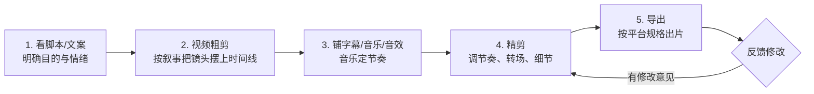

# 剪辑工作流：粗剪、精剪与多轨道

> 适用版本：**Adobe Premiere v26.5.2**。本文是一套从接素材到交付的完整工作流，结合课程笔记的「五步法」与广告片/宣传片实战流程整理。

## 2026 变化概览

- **Paper Edit（26.5，2026-09）**：在文本面板的转录稿里**框选多行文字**直接组接成一条序列，口播类视频粗剪速度翻倍。
- **序列索引面板（26.2）**：电子表格样式、可搜索全序列的剪辑清单，找镜头/改时长不用盯时间线。
- **场景编辑检测**：菜单「片段 → 场景编辑检测」，长素材自动按机位切换点切段。
- **自动重构（Auto Reframe）**：菜单「剪辑 → 自动重构序列」，横屏成片一键出 9:16 竖屏版（免费，Assistive AI）。

## 本篇目录

1. 总流程五步法
2. 准备阶段：看素材、定情绪、配音乐
3. 粗剪：素材箱分类与上轨
4. 字幕、音乐、音效铺底
5. 精剪：节奏与转场
6. 多轨道管理
7. 平台导出规格
8. 广告片/宣传片实战节奏

---

## 一、总流程五步法

（旧版流程要点保留）



1. **看脚本**：先弄清这条片子是给谁看、要什么情绪、时长多少。
2. **粗剪**：不管细节，把镜头按叙事顺序摆上时间线。
3. **字幕/音乐/音效**：音乐是节奏骨架，先把音乐铺上。
4. **精剪**：按节奏点细修。
5. **导出、调整**：出样片，收集反馈再改。

---

## 二、准备阶段（接活后第一天做什么）

（综合课程要点整理）

1. **观察素材、理解前期提供的信息**：拍摄前的方案、分镜、客户 brief 全部读一遍，别上来就拖素材。
2. **吃透文案**：标记出「写在前面的目的」——哪些镜头是交代、哪些是过渡、哪些是重头戏（情绪点）。
3. **分段定情绪**：把片子按段落拆开，每段先定**情绪**（开头/铺垫/高潮/第二次高潮/结束）。
4. **找音乐**：每段情绪匹配对应节奏的音乐，再根据音乐结构安排画面（高潮对应重点镜头）。
5. **控制变量**：前期素材不够用时，取舍原则是——**选取有抖动、无绿意（待核：疑为"无意义"）、运镜稳定的镜头组**；一个动作要用**两个以上景别**才能组成镜头组（详见 [镜头视听语言-景别构图运镜角度](../04-视听语言与剪辑理论/镜头视听语言-景别构图运镜角度.md)）。

> 实战心法：抽丝剥茧地读参考片——一格一格地反复看，同时分析记录下它的内容、场面调度、运镜、景别、剪辑、声音、画面、表演，最后总结规律。

---

## 三、粗剪

### 1. 素材箱分类

项目面板新建素材箱（`Ctrl+/`），按用途分：

```
项目面板/
├── 01_采访口播/
├── 02_空镜B-roll/
├── 03_动作特写/
├── 04_音乐音效/
├── 05_图形字幕/
└── 06_成品序列/
```

### 2. 上轨

- 按叙事顺序把素材拖上时间线；
- 长采访/长素材先用「片段 → 场景编辑检测」自动切段，再挑能用的句子；
- 口播类：用「窗口 → 文本 → 转录序列」先出转录稿，在稿子里删废话/停顿（筛选器漏斗图标：填充词、屏蔽词、暂停），同步完成粗剪。详见 [字幕与文字工作流](./字幕与文字工作流.md)。
- 不满意的镜头先别删，右键 →「移除」前先拉到素材箱「_废弃」里留着。

---

## 四、字幕、音乐、音效铺底

- **字幕**：文字工具 `T` 直接打，或自动转录生成，样式在属性面板调（见 [字幕与文字工作流](./字幕与文字工作流.md)）。
- **音乐**：先铺满整条时间线，按鼓点 `M` 打标记，粗剪时只保证大结构。
- **音效/环境音**：铺一层底噪让画面"有人味"；人声和音乐用基本声音面板做闪避，见 [音频处理与混音实战](../02-音频与声音/音频处理与混音实战.md)。

---

## 五、精剪

1. **对节奏点**：音乐鼓点 `M` 标记处切画面，视频上 `F` 标记节奏点，卡鼓点前后 ±2 帧微调。
2. **调情绪曲线**：慢段拖长留白，快段多切；长时间同一种情绪观众会疲，要有快慢切换。
3. **加转场**：能用硬切就别加特效转场；需要转场时优先声音转场（J-cut/L-cut）与匹配转场，见 [转场创意与混剪实战](./转场创意与混剪实战.md)。
4. **画面节奏检查**：两倍速看一遍时间线，拖沓的段落一眼就现形。

---

## 六、多轨道管理

### 1. 轨道结构（推荐）

| 轨道 | 放什么 |
|---|---|
| V1 | 主叙事画面（采访/主镜头） |
| V2 | B-roll、空镜、特写叠在主画面上 |
| V3 | 字幕条、图形、MOGRT |
| A1 | 人声（同期声/配音） |
| A2 | 背景音乐 |
| A3 | 音效、环境音 |

### 2. 轨道操作

- **加轨道**：项目面板/时间线轨道头右键 →「添加轨道」，选数量。
- **锁定/隐藏轨道**：轨道头「小锁」锁防误拖；「小眼睛」隐藏该轨。
- **目标轨道选定**：点轨道头点亮，插入/覆盖（`,` / `.`）才知道插到哪；向前选择轨道工具 `A`、向后选择 `Shift+A`。
- **时间轴平移**：`Alt + 滚轮`；缩放：`Alt + 左右拖动`，或 `=` / `-`，整屏 `~`。
- **素材上下层关系**：V2 自动盖住 V1，需要透明度/混合模式时到效果控件里调，见 [效果-蒙版与抠像](./效果-蒙版与抠像.md)。

---

## 七、平台导出规格

| 项目 | 抖音 | B站 | 微信视频号 |
|---|---|---|---|
| 推荐分辨率 | 竖屏 1080×1920（9:16）；横屏 1920×1080 | 1920×1080 / 1080×1920（最高 4K） | 1080×1920 / 1920×1080 |
| 帧率 | 30fps（运动画面 60fps） | 24/25/30/50/60（别用 29.97 非标） | 30fps 常见 |
| 编码 | H.264 MP4 | H.264 MP4 | H.264 MP4 |
| 码率 | ≥8Mbps（横屏实践 10–15Mbps） | 1080p60 ≤15Mbps；4K ≈20Mbps | 10Mbps 以内（实践 3–8） |
| 音频 | AAC | AAC | AAC 128kbps+，48kHz |
| 上限 | ≤4GB（>300MB 分片） | ≤8GB | 单条约 1GB、≤30 分钟 |

PR 里操作：导出 → 格式 H.264 → 预设「匹配源 - 自适应高比特率」后手动改分辨率/码率；横转竖用「剪辑 → 自动重构序列」选 9:16。

---

## 八、广告片/宣传片实战节奏

1. **音乐结构对照**：前奏 → 铺垫 → 高潮 → 副歌高潮 → 结束；画面在「开始、高潮、第二次高潮、结束」四个点给重点镜头。
2. **前音乐去重**：曲子里重复的结构要剪掉，保持段落过渡清晰。
3. **动作顺接**：衔接流畅、快慢结合；画面节奏 = 容量大小关系（待核）。
4. **遮当/转场只在需要时用**：硬切为主，转场是调味。
5. **交付前自检**：内容、场面调度、运镜、景别、剪辑、声音、画面、表演逐条过一遍。

---

## 相关文档

- 转场手法大全：[转场创意与混剪实战](./转场创意与混剪实战.md)
- 快捷键提速：[快捷键与高效编辑](./快捷键与高效编辑.md)
- 音频流程：[音频处理与混音实战](../02-音频与声音/音频处理与混音实战.md)
- 拉片学习：[拉片方法与镜头调度](../04-视听语言与剪辑理论/拉片方法与镜头调度.md)
