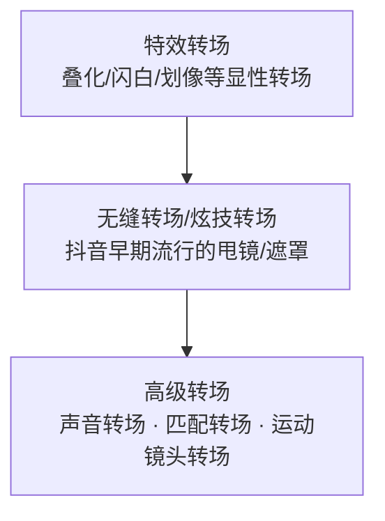
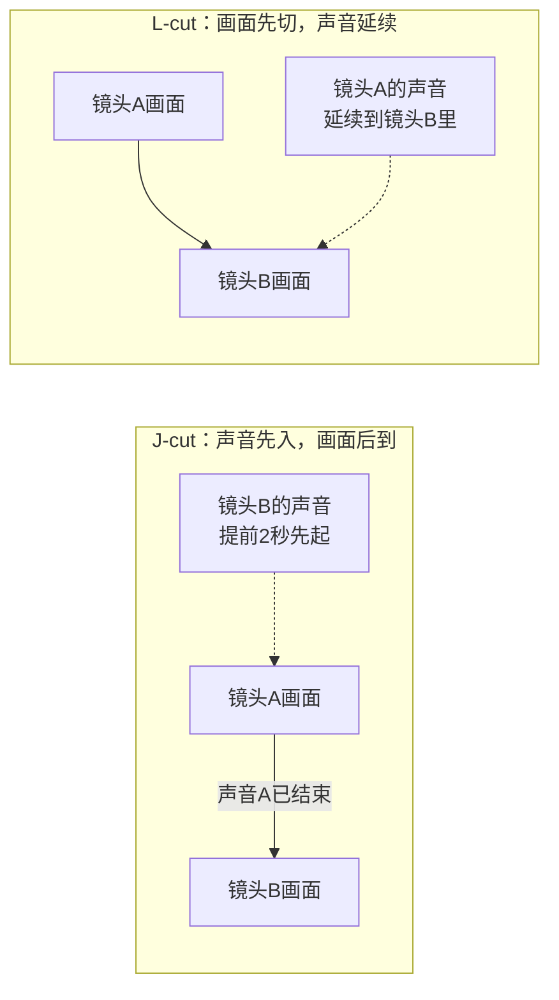

# 转场创意与混剪实战

> 适用版本：**Adobe Premiere v26.5.2**。本文汇总 PR 转场基础、匹配转场（动作剪辑点/J-cut/L-cut）、风格化转场效果与混剪实战。

## 2026 变化概览

- v26.0 起，时间线上**直接拖拽剪辑边缘的过渡手柄**即可加/调转场，不再必须开效果面板。
- v26.3 新增**形状溶解转场**；v26.2 引入 Film Impact 现代效果/过渡集；v25.5 起 90+ 现代实时效果/过渡支持 GPU 加速。
- v25.4 起支持**多重转场**（同一点叠多个过渡）。

---

## 一、转场的层级观念

课上核心观点：**好的转场 = 观众察觉不到转场**——转场做到家，观众根本意识不到画面被切开过。

剪辑思维总纲的三大目标：① **讲好故事**；② **渲染情绪**；③ **把握节奏**。一切转场手法都为这三件事服务。



原则：**能硬切就不转场**；必须转时，优先用观众察觉不到的声音/匹配转场。

---

## 二、PR 内置转场操作

### 1. 加转场（v26.0 起优先拖手柄）

- **现行做法（v26.0+）**：时间线上直接拖拽剪辑边缘的**过渡手柄**即可加/调转场，不必开效果面板。
- **经典做法（效果面板）**：

1. 打开**效果面板**（窗口 → 效果）；
2. 展开「视频过渡」（溶解 / 划像 / 擦除 / 滑动 / 缩放 / 页面剥落等）；
3. 把效果**拖到两段素材的连接处**；
4. 双击连接处的转场块，在弹出的设置里调时长、对齐方式。

### 2. 默认转场快捷键

| 快捷键 | 作用 |
|---|---|
| `Ctrl+D` | 给选中剪辑点加默认**视频**转场（默认「交叉溶解」） |
| `Ctrl+Shift+D` | 加默认**音频**转场（默认「恒定功率」音频淡入淡出） |

默认转场时长：菜单「编辑 → 首选项 → 时间轴」里改「视频过渡默认持续时间」（帧）。

### 3. 常用转场清单

| 转场 | 做法 | 用途 |
|---|---|---|
| 淡入淡出 | 透明度关键帧 0→100 / 100→0 | 片头片尾 |
| 闪白 / 闪黑 | 加白场/黑场素材叠 4~8 帧 | 情绪爆点、时间跳跃 |
| 叠化（交叉溶解） | 默认视频转场 | 温和的时间流逝 |
| 黑场视频 | 项目面板「新建项 → 黑场视频」 | 段落之间的呼吸 |
| 径向阴影（电子相册） | 图片加「径向阴影」效果 + 投影，做相框边框 | 电子相册/婚礼成片 |

---

## 三、声音转场：J-cut / L-cut



- **J-cut**：下一个镜头的声音先于画面 1~2 秒出来（先听见门铃声，再切到开门画面）——勾着观众往下看。片例：《星际穿越》火箭倒计时声响起，一个声音转场直接省略了造火箭的整个过程。
- **L-cut**：画面切走了，上一个镜头的声音还留在新画面上（对话戏里最常用）。片例：《隐秘的角落》。
- **声音桥转场**：《隐秘的角落》从古惑仔段落切到下一段落（手写待核：接续段落的人名），用一段**汽车鸣笛声**贯穿两场。
- 两者**可以同时使用**：既烘托气氛又推进剧情。
- 操作：把 A1/A2 音频视频取消链接（右键 → 取消链接），拖音频边缘往前/往后错开即可。

---

## 四、匹配转场（高级篇）

| 匹配类型 | 做法 | 适用 |
|---|---|---|
| **声音相似匹配** | 上一个镜头的音效/音乐音调和下一个镜头的声音接上（如关门声接鼓声） | 音效、音乐层面 |
| **形状匹配** | 上镜头的圆形物（月亮）叠化到下镜头的圆形物（盘子） | Vlog/宣传片，炫技 |
| **动作匹配 · 同一主体** | 同一个动作连续剪（挥手动作从全景切到特写） | 旅拍/Vlog |
| **动作匹配 · 不同主体** | A 人抬手 → 切 B 人抬手（动作承接） | **混剪/MV 核心手法** |
| **景别匹配** | 同场景用不同景别组接出层次感（如全景→中景→特写递进） | 叙事片 |
| **颜色匹配** | 把颜色相近的画面接在一起，视觉更舒服 | 情绪片 |
| **心理匹配** | 一个转场承载人物心理关系与情感变化，把两个人的故事讲清楚 | 情感片 |

**片例**：
- **声音匹配**：《波西米亚狂想曲》（音效层面、音乐层面的声音相接）；
- **形状匹配**：《泰坦尼克号》用形状相似完成时空跨越；《功夫》里一根棒棒糖勾起回忆、串联现实；
- **心理匹配**：《美丽人生》一个转场就把两个人相恋的故事交代得明明白白。

### 动作剪辑点（在哪一刀下去）

1. **动作中途剪**：同一个动作做到 **30% 和 70%** 的位置切（三七开、五五开都可试），比动作起讫点硬剪顺得多。
2. **出画/入画剪辑**：上一镜头人物走出画 → 下一镜头人物走入画，关键是**上镜头留足出画动势、下镜头有入画动势**。
3. **组合动作**：重要动作的**停顿、转折处**才剪；哪处开始剪是有讲究的。

### 不同镜头组合的剪辑效果

| 组合 | 效果 |
|---|---|
| 同场景不同景别 | 层次感（叙事主力） |
| 不同场景相同景别 | 辅助叙事（一个人走路，场景左切换） |
| 不同场景不同景别 | 炫技 |
| 同场景同景别（机位不动） | "男巫视频"式剪辑魔术 |
| 不同人同场景同景别 | 动势承接 |
| 不同人不同场景不同景别 | 动势承接 = **混剪** |

---

## 五、其他无技巧转场

- **空镜头转场**：承上启下，让观众喘口气。
- **遮挡转场**：利用镜头前一晃而过的东西（走过的人/车）遮住画面瞬间切走（片例：《穿普拉达的女王》）；后期可用全黑画面切合镜头，或遮罩逐帧跟踪抠图实现。
- **运镜甩动转场**：破绽在于快门速度——动态模糊越明显，两个甩镜接起来越无缝；拍摄时甩动速度保持一致，三脚架平稳"刹车"。
- **出画入画转场**：主体左进右出、进门出门。
- **跳跃剪辑（反差感）**：硬切出反差，制造情绪；片例：电影主人公从噩梦中醒来，前后动作的强烈反差。
- **两极镜头转场**：相差很大的景别（大全景→大特写）直接组接，冲击感强。
- **相似性剪辑**：按人物、颜色、形状、景别、动作找相似点接（课上反复强调）。

---

## 六、混剪实战流程

### 1. 先听懂一首音乐

```
前奏 → 铺垫（铺埋） → 高潮 → 重复一遍
```

### 2. 打点

- 音乐轨上听到鼓点按 `M` 打标记；升降调/副歌位置也标；
- 视频轨上 `F` 标记节奏点，画面卡在鼓点前 ±2 帧最准。

### 3. 组素材

- 「创建子剪辑」分类观众素材：在源监视器里挑好用的片段，直接拖到素材窗口（快捷键法）；
- 用 `Shift+E` 临时禁用不用的素材，不用删。

### 4. 组接节奏

- 高潮段落给**最有冲击力的镜头组**（特写+动势+颜色高饱和）；
- 铺垫段落用空镜、慢镜头缓节奏；
- 快慢结合：一段快切之后一定要接一个慢镜头呼吸；
- 动作承接混剪：不同主体做同一个动作时接镜（见第四节表）。

### 5. 情绪剪辑点

- 情绪是需要积累的——给角色留足情绪时间，观众才会共鸣，对话戏尤其要舍得留白；
- 情绪是最好的粘合剂：**同情绪粘合不同场景、不同角色**（混剪/MV 的核心逻辑）；
- 长时间同一种情绪会让人疲惫，好作品情绪是丰富的；
- 剪辑可以烘托和强化情绪（BGM、回忆杀慢放几秒）。

---

## 七、2026：AI 辅助找切点与无缝转场

2026 选型原则：**能让 AI 先做粗分工，人只做情绪判断**——切点先用 AI 找候选，无缝衔接能自动就别手动叠特效。

### 1. 场景编辑检测（免费 AI）

- 选中长素材 → 菜单「**片段 → 场景编辑检测**」，AI 自动按机位切换点把一整段切成一个个镜头；
- 适合：机内连续拍的大段素材、采访 raw 素材，先自动切段再挑；
- 免费（内置 Assistive AI，订阅/本地即可用），不另收 Firefly 积分。

### 2. 媒体智能（Media Intelligence，免费 AI）

- 给素材做智能分析后，可按画面内容**搜镜头、找相似/重复帧**；
- 混剪找"同动作不同主体"的匹配素材时，比肉眼翻素材快得多。

### 3. Morph Cut 变形器（说话头无缝，免费 AI）

- 效果面板搜「**Morph Cut**」，拖到两段**同一机位、同一人物的对话剪辑点**上；
- AI 自动修掉说话人剪辑时的跳帧/微表情跳变，比硬切自然，又不用叠化；
- 适合口播、访谈的"气口"剪辑点。

> 选型一句话：粗切点交给场景编辑检测 + 媒体智能给候选，说话头用 Morph Cut 无缝；**人只保留动作 / 情绪 / 节奏三类剪辑点的最终判断**（见 [剪辑工作流-粗剪精剪与多轨道](./剪辑工作流-粗剪精剪与多轨道.md) 第九节）。

---

## 八、相关文档

- 转场背后的视听语言：[镜头视听语言-景别构图运镜角度](../04-视听语言与剪辑理论/镜头视听语言-景别构图运镜角度.md)、[蒙太奇原理与剪辑手法](../04-视听语言与剪辑理论/蒙太奇原理与剪辑手法.md)
- J/L-cut 的声音设计原理：[声音设计与音乐音效](../02-音频与声音/声音设计与音乐音效.md)
- 变速配合转场：[变速与慢动作](./变速与慢动作.md)
- 粗剪流程：[剪辑工作流-粗剪精剪与多轨道](./剪辑工作流-粗剪精剪与多轨道.md)
