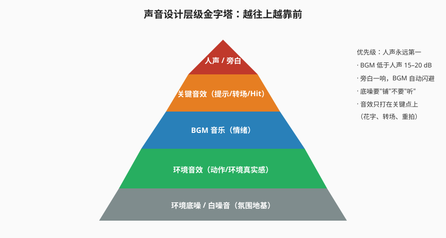
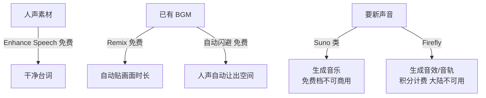

# 声音设计与音乐音效

> **本篇导读**：本篇讲声音的**艺术层**——怎么选音乐、怎么剪音乐、怎么配音效、怎么处理声画关系。降噪/EQ/压缩/响度标准等**技术层**操作统一放在《音频处理与混音实战》，本篇只在需要处给一句话+链接。

## 本篇目录

1. [声音的作用与分类](#一声音的作用与分类)
2. [怎么找到合适的 BGM](#二怎么找到合适的-bgm)
3. [一首歌的结构与节奏改造五法](#三一首歌的结构与节奏改造五法)
4. [多首音乐的衔接](#四多首音乐的衔接)
5. [免版权音乐平台选型](#五免版权音乐平台选型)
6. [常用音乐风格 × 适用片型](#六常用音乐风格--适用片型)
7. [音效：真实感与氛围感](#七音效真实感与氛围感)
8. [五种常用补充音效](#八五种常用补充音效)
9. [声画关系四种](#九声画关系四种)
10. [J-cut / L-cut](#十j-cut--l-cut)
11. [实操案例：旅拍 vlog 声音设计](#十一实操案例旅拍-vlog-声音设计)
12. [声音设计七步：拆解与重新组合](#十二声音设计七步拆解与重新组合)
13. [商单实战：马拉松赛事声音设计](#十三商单实战马拉松赛事声音设计)
14. [AI 在声音中的应用（2026，按费用标注）](#十四ai-在声音中的应用2026按费用标注)

---

## 一、声音的作用与分类

### 1.1 音乐的三个作用

1. **提前调动观众情绪**（音乐先于情绪到）；
2. **表达人物内心、升华主题**；
3. **铺垫氛围**。

> 案例：《黄金三镖客》的配乐——配乐本身就是角色，这是"音乐为叙事服务"的样板。

### 1.2 声音三分类

| 大类 | 包含 | 来源 |
|---|---|---|
| 人声 | 对白、独白、旁白 | 同期声 / 配音 |
| 音乐 | BGM、主题曲 | 曲库挑选 |
| 音效 | 环境声、动作声、特效声 | 现场收录 / 素材库 / 拟音 |

---

## 二、怎么找到合适的 BGM

### 2.1 找歌方法

- **平时收藏**：听到的好 BGM 立刻存下来，建自己的素材库（课程笔记强调"可单独建个免费曲库"）。
- **三路搜索**：按**场景 / 情感**分类去找 → 浏览**歌单** → 用**关键词**搜。
- **三步定位**：先定音乐方向 → 搜感觉 → 细化——旁白片可以配纯音乐；宣传片找关键词。
- 心法两条：**懂版权**（免版权协议看清楚）+ **审美积累**（听片拉片时顺手摘配乐）。
- **商单特别注意**：商配片子里用网易云等平台的热门流行歌是**需要版权**的，不能直接垫。

### 2.2 常用歌单分类参考（按使用场景挂歌）

| 歌单类型 | 适用 |
|---|---|
| 抒情向（宇宙后摇 / 后摇纯音 / 电影与后摇） | 情感升华、哲理性思考段落 |
| 节奏向（混剪必备 / 动感快节奏 / 快闪鼓点） | 混剪、卡点、快剪 |
| 积极向上（情感升华 / 航拍 / 宣传片） | 宣传片、航拍大全景 |
| 自然音效歌单（环境音） | 铺底环境声 |
| 出字幕转场音效歌单 | 转场、字幕动效 |
| 独白、旁白、对白歌单 | 人物内心段落 |
| 复古向（8bit / 复古片剪辑） | 复古时尚感片子 |

> 商用底线：用 CC0 / 免版权协议的曲子，别拿热门流行歌直接垫。

---

## 三、一首歌的结构与节奏改造五法

**一首歌 ≈ 前奏 + 高潮 + 间奏 + 高潮**。剪音乐就是把这四段重新排布去贴画面。

| 方法 | 做法 | 适用 |
|---|---|---|
| 1. 预判节奏法（起伏节奏预判） | 起伏节奏预判：**起势、落幅、接高潮、铺垫**四段分别对位画面 | 先定音乐再剪画面 |
| 2. 重复节奏法 | 前奏 + 高潮再接一遍（前奏 + 高潮 + 前奏 + 高潮）；技巧：**两段音频波形对比**，波形峰值对上剪辑点 | 高潮时长不够、需要强烈卡点 |
| 3. 重拍衔接法 | 让音乐高潮**开始 / 持续下去**，为配合画面服务 | 大段持续高潮、画面正好需要情绪顶上去 |
| 4. 骤停衔接法 | 高潮处声音突然降下来，**底鼓留一些**垫着 | 画面急停、安静的戏剧性段落 |
| 5. AU（Audition）辅助法 | 在音频软件里去口声、降噪、改时长，把人声版改成干净伴奏 | 选中带唱的歌时 |

> 去口声 / 降噪 / 改时长的具体操作（基本声音面板、Enhance Speech、采样率位深）见[《音频处理与混音实战》](./音频处理与混音实战.md)。

---

## 四、多首音乐的衔接

### 4.1 两首节奏相差大的音乐

1. 让它们**自然开始、自然结束**——不能在高潮处切断音乐，要从**柔缓处**衔接；
2. 可以**拉大空隙**（中间留白或铺环境声）；
3. 加音效过渡（whoosh 等），让两首歌切换不生硬。

### 4.2 两首节奏相差不大的音乐

1. 自然衔接；
2. 首尾**一点点重合**（交叉淡化叠 0.5–1 秒）；
3. 高潮处不能打断、切断——**除非刻意营造一种反差感、戏剧效果**（那是故意的声画对立，见第九节）。

---

## 五、免版权音乐平台选型

| 平台 | 授权模式 | 价格（以官网为准） | 水印 / 特点 |
|---|---|---|---|
| YouTube Audio Library | 免费 | 0 元 | 全库免费可商用，部分曲目需署名，YouTube 生态内使用最方便 |
| Epidemic Sound | 订阅制 | 月费订阅（个人档起步，具体以官网为准；全部音乐免费） | 订阅期内下载的曲目可商用，曲库大、更新快；试听无水印 |
| AudioJungle（Envato） | 单曲购买 | 按曲定价、一首一授权 | **未购买的试听预览带人声 logo 水印**；买后按授权协议商用 |
| Pond5 | 单曲购买 / 订阅 | 素材库量大、按授权分级计价 | **世界最大音视频素材库**，素材大而全，商业版权可用；预览带水印，购买后去水印 |
| PremiumBeat | 单曲买断 | 按标准/企业授权档买断 | 试听无水印，买断后可商用，广告片常用 |
| Musicbed | 订阅制 | 月费订阅（以官网为准） | 曲库精、各种品牌广告都在这买，无水印 |

> 原则：能订阅不买单曲（长期更新），能买断不订阅（一次付清），**任何曲子商用前都读清楚授权范围（自媒体/广告/电视）**。只想要某一首曲子 → 去作曲人个人网站、邮箱联系走单曲授权。

---

## 六、常用音乐风格 × 适用片型

| 风格 | 适用片型 |
|---|---|
| Jazz | 节奏短片、广告、电影感片段 |
| 电子音乐 | 商业片、科技感 |
| Trip-Hop | 慵懒、时尚、都市夜晚 |
| Lofi / Hiphop | 生活化、高级感 vlog |
| 世界音乐 | 旅游片 |
| Funk | 广告短片、节奏欢快 |
| Techno | T 台走秀、时尚发布 |
| 史诗音乐 | 大场面、混剪 |
| Berlin School | 安静、神秘、电影感 |

---

## 七、音效：真实感与氛围感

### 7.1 后期加声音的总顺序

① 先找背景音乐（定情绪、节奏——前奏/高潮落在哪）→ ② 确定画面节奏 → ③ 加音效。

### 7.2 音效两类

| 类 | 包含 | 例子 |
|---|---|---|
| **真实感** | 动作音效、环境音效 | 车流、风、雨、脚步、关门 |
| **氛围感（情绪）** | 提示音效、转场音效 | 花字弹出音、甩镜 whoosh |

按内容分，笔记里把音效细分成四类：

| 类 | 包含 | 例子 |
|---|---|---|
| **动作音效** | 人物 / 物体动作发出的声 | 脚步、关门、拿东西 |
| **环境音效** | 所处环境的底噪 | 车流、风、雨 |
| **气氛音效** | 拍摄时并不真实存在、靠夸张手法造出来的情绪音 | 强烈视听冲击；恐怖诡异氛围——专门做这种声音的乐器叫**水琴** |
| **转场音效** | 转场、镜头快速甩动时 | 无人机起飞 / 消逝；**音效加在前后镜头之间** |

### 7.3 三条纪律

1. **拍摄时注意动作音效的收录**（同期声质量决定后期上限）；
2. 素材用 **CC0 许可 + 协议**（免版权），别随便扒；
3. 找不到想要的声音时，**用拟音**（自己造）。

### 7.4 真实感做法

分析画面里**会出声的元素**：行人说话声由远到近、自行车由近到远、远处的鸣笛……音量大小按**近大远小**的原则后期处理——声音跟着镜头距离走，画面才"活"。

### 7.5 氛围感做法

- **提示音效**：花字 / 信息弹出时伴随提示音效——强烈的视听冲击；
- **转场音效**：镜头快速甩动时；无人机起飞/滑翔时；《土耳其瞭望塔》式镜头用来把控节奏；角色噩梦惊醒、拉回现实。

---

## 八、五种常用补充音效

| 音效 | 用途 |
|---|---|
| **Riser（上升）** | 塑造人物紧张的情绪、制造悬念，垫在高潮前 2–4 秒 |
| **Whoosh（呼呼声）** | 常配合转场镜头使用，或表现力量感、速度感 |
| **Slow Motion（慢动作音）** | 常与 whoosh 组合使用；空灵感镜头用慢镜头配合声音回响 |
| **Drone（嗡嗡低音）** | 底层氛围音；可表现焦虑、悬疑、神秘、紧张的氛围 |
| **Hit（打击）** | 吸引观众注意力；压在片中关键镜头上，强调动作落点 |

---

## 九、声画关系四种

| 关系 | 定义 | 要点 / 案例 |
|---|---|---|
| **声画同步** | 声音的情绪和画面的情绪保持一致 | 契合整体的剧情、节奏，最基本用法 |
| **声画对位（对立）** | 声音、画面分别表现不同内容，分头并进、殊途同归 | 案例《辛德勒的名单》：欢快的音乐 + 屠杀的画面（辛德勒骑马在高处看），音乐**反衬**情绪；情绪相反、对比突出主题 |
| **声画并行（平行）** | 声音与画面分头并进 | 情绪**不是完全对立**——有点冲突但不完全冲突，互补但不喧宾夺主 |
| **声画分离** | 声音来自画外 | 最典型：**内心独白** |

> 声画关系本质是一种蒙太奇思维，分类与手法详见[《蒙太奇原理与剪辑手法》](../04-视听语言与剪辑理论/蒙太奇原理与剪辑手法.md)。

---

## 十、J-cut / L-cut

| 手法 | 形态 | 作用 |
|---|---|---|
| **J-cut** | 声音先入，画面后到（下一镜头的声音提前 1–2 秒进来，像字母 J 的竖线） | 引导观众注意力、让下一场"预告"给观众，转场顺 |
| **L-cut** | 画面先切，声音延续（上一镜头的声音拖进下一镜头，像字母 L） | 掩盖跳切、让动作/情绪不断 |

> 实操：电瓶车旅拍案例中"剪剪过渡 J-cut"就是用它让段落之间不断气。

---

## 十一、实操案例：旅拍 vlog 声音设计（广告 + 旅拍）

案例思路：**分段剪辑**——镜头衔接、音乐衔接、段落层次、故事情绪四条线并行。

### 11.1 准备阶段

1. 先确定找**几首音乐**、定风格；
2. **吃透素材、理解文案**（要有画面感），不要流水账：文案用颜色标记，写清每句话的目的；理清情感——本案例结构：个人介绍 → 过渡 → 骑车（→ 植入语）→ 夜晚；
3. 音乐要**段落感、层次感**（不同段落用不同情绪、不同音乐组）。

### 11.2 开端（室内）

1. 音乐先渲染氛围，再将旁白放上去；
2. 交代背景用远 / 全景，色彩过渡要自然；
3. 一段素材剪多长拿不准时，**根据音乐节奏剪**（看波形、看峰值、卡拍）；
4. 忽快忽慢、有松有紧、要有节奏感；
5. 挑镜头：避免抖动镜头、无意的镜头转动；
6. 人物眼睛出画面时切镜头；
7. 一套动作：开始 → 发生中 → 结束，干净利索；
8. 把控节奏：快 → 快 → 慢下来。

### 11.3 第二段（室外）

1. 人物出画入画规律：**左出右进、右出左进**；
2. 音乐结构：开始 → 正歌 → 高潮 → 副歌（→ 次高潮 →）结束；根据音乐结构配合情绪、帮助叙事；节奏、音调不同部分承载不同情绪；理清逻辑（安静 → 乱窜 → 重点）；
3. 文案匹配音乐结构，音乐段匹配画面段；
4. 升格镜头（坡度变速）配高潮段；
5. 广告插入：广告关键词配合镜头、服务整体叙事；插完再跟音乐剪"逛逛"这一段（画面色彩丰富）。

### 11.4 夜晚（光效过渡、叙事流）

1. 边听音乐边想象画面；
2. 镜头组：动作一套、停车，干净利落；
3. **音乐避开人声**（此段旁白/同期声为主）。

---

## 十二、声音设计七步：拆解与重新组合

1. **确定环境音氛围**（片子一开始就定调）；
2. **观察画面内能发出声音的元素**：底噪声、白噪音（下雨、脚步）烘托环境氛围；
3. **呼吸声**：适当夸张和放大声音以突出和强调，让声音更有层次感；
4. **同期声**：加入具有当地特点的声音元素（旅拍原味）；
5. **音乐**：想体现旅拍原生态，风格上建议用后摇 / New Age / 民族乐 / 当地特色弦乐；
6. **由无声到有声**：眨眼、呼吸、空气流动……（与空气/速度有关的画面 + whoosh 声）；
7. **拟音**：通过想象力代替声音——例：眨眼 → 配塑料声。

---

## 十三、商单实战：马拉松赛事声音设计

与第十一节旅拍案例互补：这是一首音乐为主轴的赛事快剪，节奏改造五法几乎全用上。

| 环节 | 手法 | 具体做法 |
|---|---|---|
| 开场 | **白噪音 / 环境音开场** | 先铺城市环境底噪定调；音乐里打击乐节点配音效切画面、切换节奏 |
| 前奏太拖 | **重音提前** | 前奏太长拖沓，把重音提前进 |
| 高潮不够长 | **重复节奏法** | 把第二段更长的高潮移到前面；小高潮提前收尾 |
| 高潮之间衔接 | **重拍衔接法** | 大段持续高潮用来接结尾、自然提前收尾；重新进高潮时后部重音提前一点，再接一段较弱的高潮部分上来 |
| 骤停点 | 骤停用其他音效过渡 | 用环境音、氛围音垫过去，不留白尴尬 |
| 真实环境音 | 现场收音增强代入 | 例：海边——风声、波浪声、海鸥声；配城市白噪音、森林白噪音 |
| 片尾 | 音效重复利用 + **指数淡化** | 片尾音量指数级淡出；音乐里的音效重复利用 |
| 首尾呼应 | 音效配合空镜头铺垫 | 发令枪 + 大远景，赛道声音随俯瞰镜头铺开；音效首尾呼应 |

> 「噩梦将醒、拉回现实」这类节奏点，也是用音效把控的（见 7.5 转场音效）。

---

## 十四、AI 在声音中的应用（2026，按费用标注）

| 工具 | 干什么 | 费用 |
|---|---|---|
| **Enhance Speech** | 一键修复人声底噪、把糊台词修干净 | **免费**，首次下载模型后本地处理 |
| **Remix** | 让已有 BGM 自动拉伸 / 剪接到你要的精确时长，省去手动重复节奏法 | **免费** |
| **自动闪避（Auto Duck）** | BGM 检测到有人声就自动压低、人走了再顶上来 | **免费** |
| **生成式音效（Firefly）** | 文字 prompt 直接生成要的音效 | **10 积分 / 次**，🔴 大陆不可用 |
| **生成式音轨（Firefly）** | 文字 prompt 生成整段背景音乐 | **20 积分 / 分钟**，🔴 大陆不可用 |
| **Suno 类 AI 音乐** | 描述风格直接生成一整首歌 | 免费档**无商用权**（商用要付费档）；大陆可用 |

> 用法：**免费三件套（修复人声 / Remix / 闪避）日常直接用**；生成式按预算和网络条件选，商用前看清授权；生成出来的声音仍要按本篇的节奏、声画关系原则人工挑剪。

---

> 降噪、EQ、压缩、响度 LUFS 标准、混音流程等技术操作，统一见[《音频处理与混音实战》](./音频处理与混音实战.md)。
