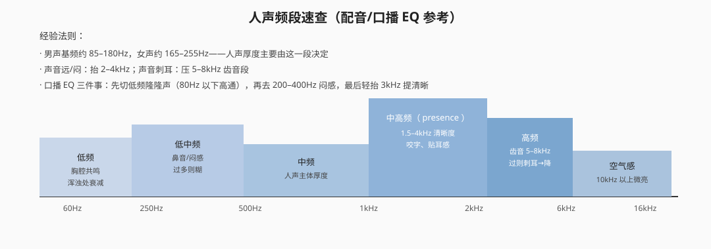
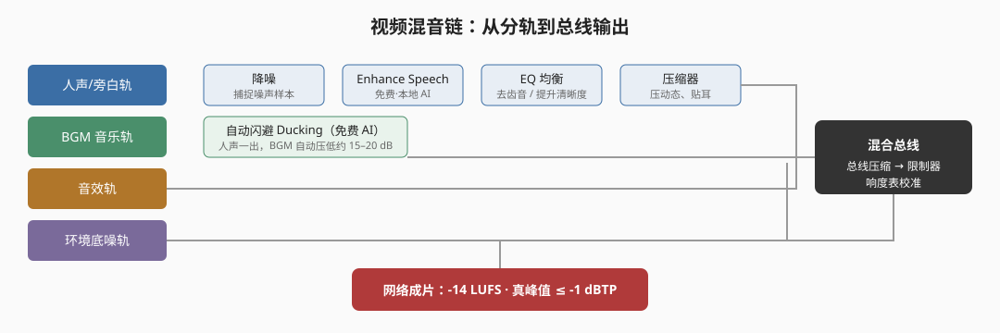

# 音频处理与混音实战

> **2026 变化概览（Adobe Premiere v26.x）**
> - **Enhance Speech（增强语音）**：免费、含在订阅内，首次使用自动下载模型后**完全本地处理**，中国大陆账号可用
> - **Remix（重新混合）**：免费、本地 AI，自动把音乐剪到指定时长，中国大陆账号可用
> - **自动闪避（Ducking）**：免费，随基本声音面板一键启用
> - **26.5 生成式媒体工具**可文本生成音效（10 积分/次）——由 Firefly 提供，**中国大陆账号不可用**
> - 降噪 / EQ / 压缩 / 混响 / 限制器等传统效果为 PR 内置，非 AI 功能，不另收费

## 本篇目录

1. [音频基础操作](#一音频基础操作)
2. [基本声音面板](#二基本声音面板对话音乐音效环境)
3. [AI 音频功能与费用](#三ai-音频功能费用标签)
4. [传统音频效果](#四传统音频效果非-ai内置)
5. [采样率与位深](#五采样率与位深)
6. [人声频段速查](#六人声频段速查)
7. [响度标准：LUFS](#七响度标准lufs)
8. [混音流程](#八混音流程)

---

## 一、音频基础操作

### 1.1 相关面板（菜单路径）

| 操作 | 菜单路径 |
|---|---|
| 打开基本声音面板 | 窗口 → 基本声音 |
| 打开音频剪辑混合器 | 窗口 → 音频剪辑混合器（推子逐条剪辑调音量） |
| 打开音频轨道混合器 | 窗口 → 音频轨道混合器（按轨道推子混音） |
| 调单条素材音量 | 右键素材 → 音频增益 |
| 改声道配置 | 右键音频 → 音频声道 → 更改 |
| 音频转场 | 效果面板 → 音频过渡 → 交叉淡化（快捷键 Ctrl+Shift+D） |

### 1.2 音量关键帧自动化

- **快速加关键帧**：按住 `Ctrl` 点击音频素材中间的音量线，点点之间拉动即可做淡入淡出。
- 进阶：素材右键 → 显示剪辑关键帧 → 音频 → 音量，可逐帧画自动化包络。
- **交叉淡化三种**：恒定功率（最常用，自然）、恒定增益（线性，硬）、指数淡化（渐入渐出最柔和）。

### 1.3 其他基础

- 音视频分离：右键素材 → 取消链接。
- 同步：画面与声音对不齐时，右键素材 → 同步（按波形/入点）。
- 立体声像：轨道混合器上的声像（Pan）旋钮，把人声放中间、效果声左右摆。

---

## 二、基本声音面板（对话/音乐/音效/环境）

**窗口 → 基本声音** 打开面板，选中时间线上的音频片段，先在面板左上角给它指定一个类型，面板会按类型给出对应工具：

| 类型 | 典型素材 | 面板重点 |
|---|---|---|
| 对话（Dialogue） | 人声、旁白、采访 | 修复（降噪、消除混响）、**增强（Enhance）**、语音清晰度 |
| 音乐（Music） | BGM | **重新混合（Remix）**、闪避、淡入淡出 |
| 音效（SFX） | 动作/转场音效 | 响度修整、淡入淡出 |
| 环境（Ambience） | 环境底噪 | 持续、均匀处理 |

> 基本声音面板是 2026 版音频工作的主入口：先分轨标类型，再谈处理。

---

## 三、AI 音频功能（费用标签）

| 功能 | 入口 | 费用 | 中国大陆可用 |
|---|---|---|---|
| Enhance Speech 增强语音 | 基本声音面板 → 对话 → 勾选「增强」，「混合量」滑块调原声/增强比例 | **免费**（含订阅；首次下载模型后本地处理） | 是 |
| Remix 重新混合音乐 | 基本声音面板 → 音乐 → 重新混合：设**目标持续时间 / 段数 / 变体**；或工具栏选「重新混合工具」直接拖音乐剪辑边缘 | **免费**（本地处理） | 是 |
| 自动闪避 Ducking | 基本声音面板 → 音乐 → 闪避，目标轨道选「对话」 | **免费**（Assistive AI） | 是 |
| 生成音效（26.5 生成式媒体工具） | 时间线内用文本提示生成音效片段 | **10 积分/次** | **否（Firefly 服务大陆不可用）** |
| 生成音轨（AI 音乐生成） | Firefly 网页端 | 20 积分/分钟 | **否** |
| 生成式延长（音频端补帧） | 拖音频剪辑边缘 | 按秒扣高级积分（1080p30 约 125 积分/秒，音频按同档计） | **否** |
| Adobe Podcast 网页版 | podcast.adobe.com | 免费档：单文件 ≤30 分钟、每天 ≤1 小时 | **否（官方明示排除中国大陆）** |

要点：**口播片主力用 Enhance Speech + 闪避，全部免费且本地跑**；文本生成音效这类高级玩法对大陆账号关闭，不要指望。

---

## 四、传统音频效果（非 AI，内置）

入口：**效果面板 → 音频效果**，拖到片段后在效果控件面板调参。

| 效果 | 路径 | 作用 | 实操要点 |
|---|---|---|---|
| 降噪 | 音频效果 → 降噪 | 去底噪 | 先**捕捉噪声样本**（选中一段纯底噪分析），再调降噪量；别开太大，否则人声发闷发"水下感" |
| EQ 均衡 | 音频效果 → 滤波与均衡 | 调低/中/高频音色 | 人声先高通切 80Hz 以下隆隆声，再按第六节频段表修饰 |
| 压缩器 | 音频效果 → 振幅与压限 → 动态 → 压缩器 | 压平动态，人声贴耳 | 参数：阈值（Threshold）、比率（Ratio）、启动（Attack）、释放（Release） |
| 限制器 | 响度组 | 堵住最后的峰值防削波 | 输出上限设在真峰值目标处（见第七节） |
| 混响 | 音频效果 → 混响 | 空间感 | 房间 / 室内 / 大厅三档；口播片少用，别让人声在浴室里 |
| 延迟 | 音频效果 → 延迟 | 简单回声特效 | 只做特效，不做混音 |

---

## 五、采样率与位深

| 项目 | 常见规格 | 说明 |
|---|---|---|
| 采样率 | 44.1 kHz（CD）/ **48 kHz（视频行业默认）** / 96 kHz（高解析母带） | 视频工程统一用 48 kHz；导入 44.1k 素材让 PR 自动重采样即可，但尽量别混用 |
| 位深 | 16 bit（交付）/ **24 bit（制作期）** | 制作期保留更多动态余量，导出时再降到 16 bit/AAC |

经验：建序列时定好 48 kHz，后面所有录音、配音、音效素材都按 48 kHz 收。

---

## 六、人声频段速查

| 频段 | 听感 | 操作 |
|---|---|---|
| 80 Hz 以下 | 桌碰、空调隆隆 | 高通切掉 |
| 200–400 Hz | 闷、鼻音、糊 | 过多则衰减 |
| 1–4 kHz | 咬字、清晰度 | 缺了就略抬，人声才"贴耳" |
| 5–8 kHz | 齿音（嘶嘶声） | 过则刺耳，压一点 |
| 10 kHz 以上 | 空气感、明亮 | 微抬即可，别贪多 |

---

## 七、响度标准（LUFS）

响度不是"推到顶大"，而是按发布平台校准：

| 发布平台 | 目标响度 | 真峰值上限 |
|---|---|---|
| 网络视频（YouTube / B站 / 抖音等） | **-14 LUFS** | ≤ **-1 dBTP** |
| 电视广播（EBU R128） | -23 LUFS | ≤ -1 dBTP |
| 电影（影院） | -27 LKFS | — |

实操两条铁律：

1. **BGM 低于人声约 15–20 dB**——人声一响，音乐就是垫子。
2. 总线最后过一道限制器，用电表（响度雷达表）读到目标 LUFS 为准，不凭耳朵"觉得够响"。

---

## 八、混音流程

按这个顺序走，一遍过：

1. **分轨整理**：人声/旁白轨、BGM 轨、音效轨、环境轨，一条轨一类事。
2. **人声清理**：降噪 → Enhance Speech（免费 AI）→ EQ 去齿音、提清晰度 → 压缩压动态。
3. **对齐画面**：旁白与口型/画面节奏对齐，这步先于一切音乐处理。
4. **铺 BGM**：拖入音乐，开自动闪避（或手动画音量关键帧），保证人声段 BGM 退 15–20 dB。
5. **补音效与环境声**：动作音效、环境底噪垫底（做法与清单见《声音设计与音乐音效》）。
6. **总线处理**：总线上一道轻压缩 + 限制器，响度表校准到 -14 LUFS、真峰值 ≤ -1 dBTP。
7. **全程戴监听耳机/音箱检查一遍**：小音量下人声是否仍然清楚——清楚才算合格。

> 音乐挑选、节奏改造、音效清单、声画关系见姊妹篇[《声音设计与音乐音效》](./声音设计与音乐音效.md)；AI 功能全量费用表另见[《AI工具与第三方工作流》](../01-Premiere操作/AI工具与第三方工作流.md)。
