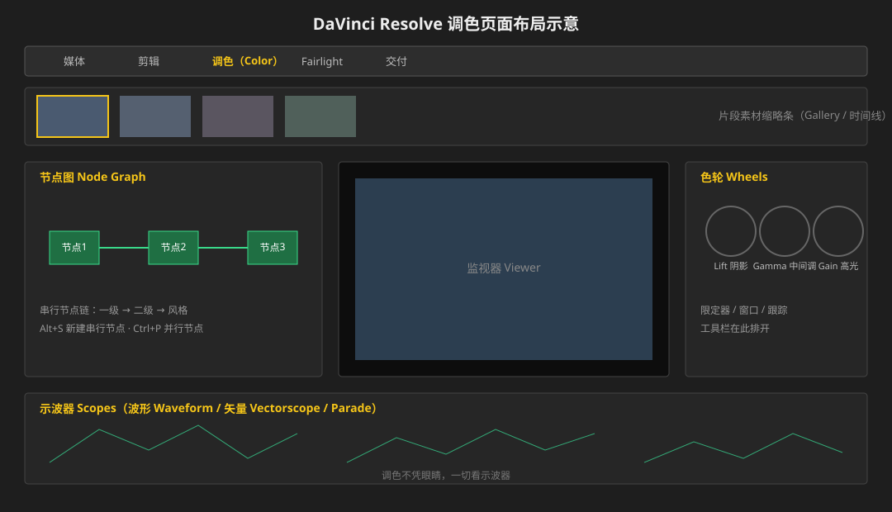
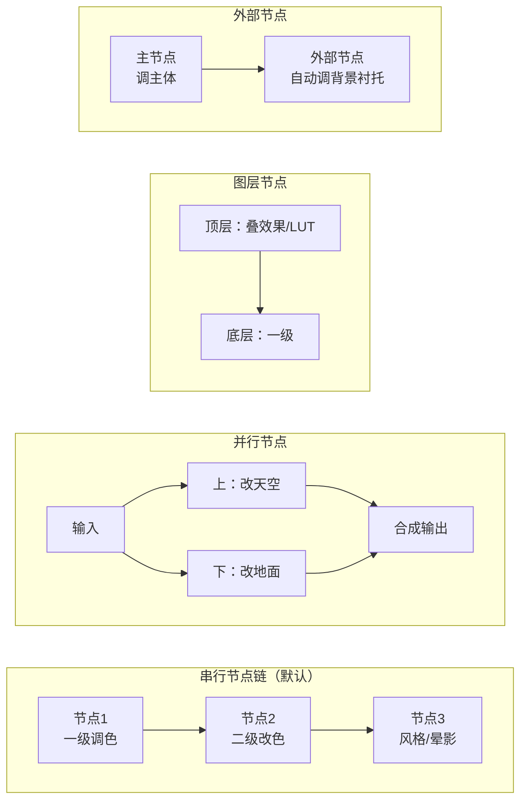

# 达芬奇调色：节点工作流入门与进阶

> **2026 变化概览（DaVinci Resolve 21.1）**
> - 当前大版本 **DaVinci Resolve 21.1**（2026-09 发布），免费版官网直接下载即用
> - **Studio 版一次性买断 RMB 2,500**（大版本免费升级，20→21 不另收钱）
> - **Magic Mask 神奇遮罩、DaVinci Neural Engine AI、时域/空域 AI 降噪、基于文本的剪辑，均为 Studio 专属**
> - DaVinci Resolve Speed Editor 键盘（RMB 3,300）随附 Studio 授权

## 本篇目录

1. [版本与免费版 / Studio 对比](#一版本与免费版--studio-对比)
2. [页面布局](#二页面布局)
3. [准备：导入与项目设置](#三准备导入与项目设置)
4. [一级调色](#四一级调色)
5. [二级调色](#五二级调色)
6. [节点类型（核心）](#六节点类型核心)
7. [肤色处理](#七肤色处理)
8. [曲线](#八曲线)
9. [示波器](#九示波器)
10. [色彩匹配](#十色彩匹配)
11. [与 Premiere 工程往返](#十一与-premiere-工程往返)

---

## 一、版本与免费版 / Studio 对比

| 维度 | 免费版 | Studio（RMB 2,500 买断） |
|---|---|---|
| 费用 | 完全免费 | 一次性买断，大版本免费升级 |
| 编码上限 | 8bit、最高 60fps、4K | 上至 120fps 的 10bit、分辨率可高于 4K |
| **DaVinci Neural Engine（AI）** | 无 | **有**：面部识别、物体检测、智能重构、超级放大、自动调色/色彩匹配等 |
| **Magic Mask 神奇遮罩** | 无 | **有**（官方明确列为 Studio 专属） |
| AI 时域 / 空域降噪 | 无 | 有 |
| 基于文本的剪辑（文字剪口播） | 无 | 有 |
| Resolve FX 数量 | 基础集 | 额外数十项（模糊、灯光、画面修复、胶片颗粒等） |
| 多用户协作 / HDR | 免费版即包含 | 包含 |

> 结论：只做普通网络视频调色，免费版足够入门；要 Magic Mask 精准隔离人像、AI 降噪、文本剪口播，再上 Studio。

---

## 二、页面布局

顶部五个页面（工作区）：**媒体 → 剪辑 → 调色 → Fairlight → 交付**。

「调色（Color）」页面三区：

- **上方**：片段缩略条（Gallery 片段 + 时间线）；
- **左下**：**节点图（Node Graph）**——达芬奇调色的核心；
- **中间**：监视器；
- **右侧**：**色轮 + 限定器 / 窗口 / 跟踪**工具栏；
- **底部**：**示波器（Scopes）**。

---

## 三、准备：导入与项目设置

1. 媒体页面：导入素材；
2. 项目设置：先定好色彩空间（Log 素材先正确识别伽马）；
3. 切到调色页面，逐镜头开始。

---

## 四、一级调色

一级 = 整个镜头的基调，全部在色轮上完成：

| 控件 | 作用 |
|---|---|
| **Lift** | 阴影：暗部亮度与偏色 |
| **Gamma** | 中间调：主体亮度与偏色 |
| **Gain** | 高光：亮部亮度与偏色 |
| 对比度 | 整体反差 |
| 饱和度 | 全局鲜艳度 |
| 对数 vs 偏移模式 | 对数色轮更细腻，偏移（Offset）整体染色 |

心法：先拉曝光明暗（示波器波形贴到 0–1023 不超不欠），再在三个色轮上定色调倾向，最后补对比度、饱和度。

---

## 五、二级调色

一级改"整个镜头"，二级改"镜头里的某块"。三件工具：

| 工具 | 用法 |
|---|---|
| **HSL 限定器** | 取色器点选目标颜色，调 H（色相）/S（饱和度）/L（明度）圈定区域，只改这块颜色 |
| **窗口（Power Window）** | 圆形 / 线性 / 曲线窗口，圈定空间区域（比如只调人物脸） |
| **跟踪（Tracker）** | 窗口圈好后点跟踪，让选区跟着运动主体走 |

二级调色 = 限定器选颜色 or 窗口选区域 + 跟踪锁死 + 在新节点上改色。

---

## 六、节点类型（核心）

达芬奇调色 = 一串节点流水线。不同节点拓扑决定"先改什么、后改什么、改哪里"。

| 节点类型 | 结构 | 用途 |
|---|---|---|
| **串行节点** | 一个接一个串成链 | 默认流程：一级 → 二级 → 风格，一步接一步 |
| **并行节点** | 一路分两路同时处理再汇合 | 左右/上下区域同时改（天空 vs 地面），互不打架 |
| **图层节点** | 上下叠层，上层效果压在下层上 | 叠加 LUT、叠胶片颗粒等效果层 |
| **外部节点** | 主节点选中主体，自动生成"外围"节点 | 调完人物，一个节点自动压暗/柔化背景 |

> 新手记忆：**Alt+S 加串行节点**；改哪块就单独起一个节点，别把所有效果堆在一个节点上——后期要回退某一步时，单独旁路（Bypass）那个节点就行。

---

## 七、肤色处理

1. **矢量示波器（Vectorscope）**上有一条斜向"肤色线（Flesh Tone Line）"——肤色应该落在这条线上；
2. 偏色了用 HSL 限定器单独圈肤色区校正；
3. 调色时**先保护肤色**：压背景颜色之前，先确认肤色节点没被影响。

---

## 八、曲线

| 曲线 | 用途 |
|---|---|
| RGB 曲线 | 整体反差（S 形） |
| 色相 vs 色相 | 换某颜色的色相 |
| 色相 vs 饱和度 | 单独提/压某颜色鲜艳度 |

与 PR 的曲线是同一套思路，区别只是这里每条曲线建在独立节点上。

---

## 九、示波器

**调色不凭眼睛，一切看示波器。**

| 示波器 | 看什么 |
|---|---|
| 波形（Waveform） | 亮度分布：暗部贴 0、亮部不顶死 1023 |
| 矢量（Vectorscope） | 色彩方向与饱和度；肤色对肤色线 |
| RGB 并列（Parade） | RGB 三通道分别看，判断偏色 |

---

## 十、色彩匹配

- **色彩卡**：镜头前放标准色卡（X-Rite 类），软件自动读取生成校色；
- **镜头匹配**：选一个参考镜头，一键把当前镜头的色彩匹配过去（Studio Neural Engine 能力）；
- 同场景镜头先匹配再精修，效率最高。

---

## 十一、与 Premiere 工程往返

- 达芬奇**不能直接打开 PR 的 .prproj 工程**；
- 往返靠中间格式：PR 侧导出 **Final Cut Pro XML / AAF** → 达芬奇导入；达芬奇侧改完导出 XML → PR 再导入；
- 注意：特效、字幕、调色不随 XML 100% 翻译，属于**粗剪时间线级**往返。

> PR 内置 Lumetri 的操作（基本校正 / 创意 / HSL 辅助 / LUT / 色彩管理）见[《Premiere调色-Lumetri与色彩管理》](./Premiere调色-Lumetri与色彩管理.md)。
