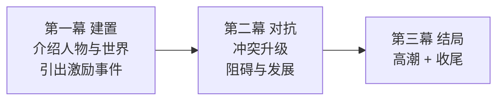

# 剧本写作与故事结构

> 本篇导读：剪辑是二度创作，但故事的底子在剧本 / 文案阶段就定了。本篇分两部分：**通用故事写作**（剧本格式、三幕式结构、人物、冲突、禁忌）和**短片文案实战**（广告片 / 宣传片 / 微电影 / Vlog 各自的文案要点）。
>
> 相关篇：怎么拆解别人的故事见 [《拉片方法与镜头调度》](./拉片方法与镜头调度.md)，镜头怎么服务故事见 [《镜头视听语言：景别·构图·运镜·角度》](./镜头视听语言-景别构图运镜角度.md)，粗剪到精剪的工作流见 [《剪辑工作流：粗剪·精剪与多轨道》](../01-Premiere操作/剪辑工作流-粗剪精剪与多轨道.md)。

## 本篇目录

- [一、剧本格式](#一剧本格式)
- [二、故事结构：三幕式与起承转合](#二故事结构三幕式与起承转合)
- [三、人物设计](#三人物设计)
- [四、写作要点：主题·冲突·伏笔·高潮](#四写作要点主题冲突伏笔高潮)
- [五、写作禁忌](#五写作禁忌)
- [六、短片文案实战：广告片 / 宣传片 / 微电影](#六短片文案实战广告片--宣传片--微电影)

---

## 一、剧本格式

一份标准剧本 / 分场大纲包含：

- **场景号 + 场景 + 时间 + 内外景**（内 / 外，日 / 夜）
- **人物**：谁在场
- **台词**：说什么
- **动作 / 情绪**：人物做什么、什么状态

写短片文案时，不用追求标准剧本那么严格，但脑子里要有这几列：这场戏在哪、谁、说什么、情绪走向。

---

## 二、故事结构：三幕式与起承转合

| 结构 | 对应段落 | 任务 |
|---|---|---|
| **三幕式** | 建置 → 对抗 → 结局 | 第一幕立人物、抛问题；第二幕把问题越闹越大；第三幕高潮解决 |
| **起承转合** | 起（开场）→ 承（发展）→ 转（转折）→ 合（收尾） | 东方叙事结构，短片、Vlog 文案同样适用 |

**类型片基调**：动作、喜剧、爱情、悬疑、恐怖、科幻——不同类型的开场节奏、情绪曲线、结尾方式都不一样，写之前先定类型。

---

## 三、人物设计

- **人物构成**：主角、配角、反派。
- **人物弧光**：人物要在故事中成长 / 改变，不能从头到尾一个样。
- 人物关系要通过**动作和对话**交代，而不是靠旁白硬说。

---

## 四、写作要点：主题·冲突·伏笔·高潮

1. **主题**：一句话说清这个故事想说什么。
2. **冲突**：没有冲突就没有戏，人和人、人和环境、人和自己的矛盾。
3. **伏笔与铺垫**：前面埋的东西，后面要回收（呼应、复现）。
4. **高潮与结局**：情绪累积到最高点爆发，然后收束。

---

## 五、写作禁忌

| 禁忌 | 问题 |
|---|---|
| **台词说教** | 人物变成作者传声筒，讲道理而不是演故事 |
| **人物扁平** | 角色没有欲望、没有变化，工具人 |
| **节奏拖沓** | 铺垫过长、没有冲突推进，观众走神 |

---

## 六、短片文案实战：广告片 / 宣传片 / 微电影

短片文案（口播、旁白、字幕脚本）的通用工作顺序：

1. **先吃透素材、理解内容**——先有画面感，别上来就写华丽辞藻；包括「流水账」式的原始素材也要先过一遍。
2. **想清楚每句话的目的**：这句文案是为了什么？多做排比、写好过渡句、安排点题段、插白。
3. **理清叙事线**：个人线 → 过渡 → 点题（植入），一条主线串下来。

### 6.1 不同短片类型的文案 / 结构特点

| 类型 | 结构特点 | 文案要点 |
|---|---|---|
| **企业宣传片** | 常用远景 + 旁白开场，先展示规模、气势，再落到人物与业务 | 旁白为主、词偏大气稳重；先环境后主体（递进式景别） |
| **广告片** | 后退式开场：开头用特写/强钩子先抓住观众，再逐步放大景别交代人物、环境 | 前 3 秒必须抓人；卖点前置，节奏快，结尾落产品/品牌 |
| **微电影 / 叙事短片** | 可颠倒式开场：把最有戏剧冲突的片段挪到开头，倒叙引人入胜 | 重人物弧光与情绪，台词生活化，靠故事带品牌 |
| **Vlog / 个人短片** | 递进式：从环境到人物到正在发生的事；开头足够有趣才能留住人 | 口语化、真实感；节奏要有快慢起伏，别全程一个调 |

> 景别与结构的搭配详见 [《镜头视听语言》](./镜头视听语言-景别构图运镜角度.md) 第七节「景别组接的 4 种结构」——宣传片用递进式、广告片用后退式、强冲击用两极式、精致短片用环形首尾呼应。

### 6.2 文案与声音的配合

- 文案节奏跟着音乐走：踩鼓点、断句贴合音乐情绪。
- 用好 J-cut / L-cut：声音先入或声音滞后，让旁白和画面「咬住」而不是贴死——见 [《声音设计与音乐音效》](../02-音频与声音/声音设计与音乐音效.md)。
- 留白也是文案：画面中实实在在的留白、剪辑师给到的情绪时间，都在替文案说话；别让旁白填满每一秒。

---

## 附：开写前的 5 个问题

1. 这个故事的主题一句话是什么？
2. 主角想要什么？谁在阻止他？（冲突）
3. 开场第一幕多久内抛出激励事件？
4. 伏笔在哪埋、在哪回收？
5. 结尾高潮让观众记住的一个画面 / 一句话是什么？
