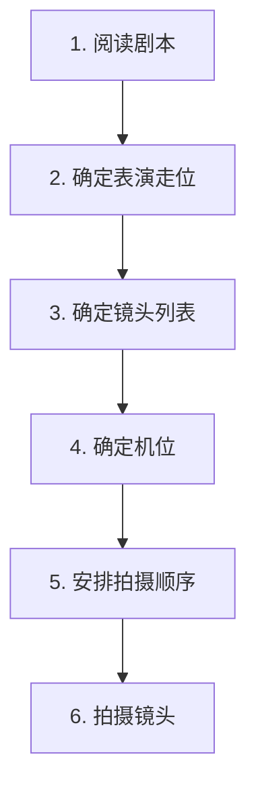
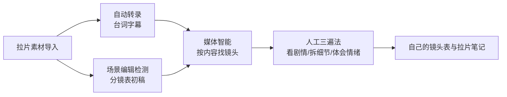

# 拉片方法与镜头调度

> 本篇导读：拉片是把一部好片子「拆开看」——不是看热闹，而是像导演、剪辑师、摄影师那样，逐格研究它怎么用镜头讲故事。本篇给你一套可执行的拉片流程：看片三遍法 → 片段分析五要素 → 记录清单，以及实拍侧的镜头调度知识（主镜头 / 切分镜头 / 复杂调度镜头）和「怎么列出一个场景的镜头表」。
>
> 相关篇：单个镜头语言见 [《镜头视听语言：景别·构图·运镜·角度》](./镜头视听语言-景别构图运镜角度.md)，镜头之间怎么组接见 [《蒙太奇原理与剪辑手法》](./蒙太奇原理与剪辑手法.md)，写剧本侧的故事结构见 [《剧本写作与故事结构》](./剧本写作与故事结构.md)。

## 本篇目录

- [一、拉片的本质](#一拉片的本质)
- [二、看片三遍法](#二看片三遍法)
- [三、拉片分析框架](#三拉片分析框架)
- [四、拉片记录清单（边看边记什么）](#四拉片记录清单边看边记什么)
- [五、镜头调度：一个场景怎么拍](#五镜头调度一个场景怎么拍)
- [六、怎么列出一个场景的镜头表](#六怎么列出一个场景的镜头表)
- [七、视点镜头（主观视角）与拉片案例拆解](#七视点镜头主观视角与拉片案例拆解)
- [八、用 AI 高效拉片（2026 工作流）](#八用-ai-高效拉片2026-工作流)

---

## 一、拉片的本质

导演、剪辑师、摄影师做的事，就是在**灯光、布景、构图**方面做好，来**辅助叙事**，把观众的注意力把控到主体信息上。拉片就是去反推：他为什么这么做？

抓住五个关键词去看：**动静、明暗、躁动中的悠扬、镜头运动、冷暖**——它们是情绪的五个旋钮。

> 课程笔记的说法：拉片就是「抽丝剥茧地读电影」，一格一格反复看；同时在纸上记录每个镜头，把场面调度、运镜、景别、剪辑、声音、画面、表演、机位都拆出来，最后总结规律。

---

## 二、看片三遍法

一部电影至少看三遍，每遍任务不同：

| 遍数 | 任务 | 目标 |
|---|---|---|
| **第一遍** | 看剧情 | 不带分析地沉浸，搞清故事讲了什么、人物是谁 |
| **第二遍** | 看细节 | 跳出来观察视听手法、节奏、声音 |
| **第三遍** | 针对某一主题 / 某一临段反复观看、反复拉片 | 选定一个片段，逐镜拆解 |

> 三遍之外还有一层「体感」：剪辑/拉片时务必把自己**置身于剧情之中**，去体会导演在这个片段里希望表达的情绪和氛围；实拍合作时要及时跟导演沟通、确认他要的感觉。

> 2026 提效：**第一遍**可以先扫一遍 AI 自动转录的台词和分镜表建立全局印象，再沉浸看片；但**第二、三遍的细节拆解和情绪体会仍然只能人工**，AI 替代不了体感（见第八节）。

---

## 三、拉片分析框架

### 3.1 第一层：整体分析

1. **故事情节**：讲了什么？
2. **人物**：有哪些角色？他们的关系和弧光是什么？
3. **故事讲了什么**：主题是什么？

### 3.2 第二层：选取片段做五要素分析

挑一个（或几个）关键片段，逐片段分析：

| # | 要素 | 要回答的问题 |
|---|---|---|
| 1 | **矛盾冲突点** | 这个片段的冲突是什么？ |
| 2 | **出场人物** | 谁在场？谁的视角？ |
| 3 | **发生什么事** | 这段戏的动作/事件是什么？ |
| 4 | **结果如何** | 戏剧状态怎么被改变的？ |
| 5 | **导演想表达什么** | 这场戏的用意、主题落点是什么？ |

---

## 四、拉片记录清单（边看边记什么）

拉片时按下面这张清单逐项记录，每换一个镜头记一行：

- **镜头切换与转场**：切点在哪里？用了什么转场？
- **音乐与音效**：什么时候进音乐？音效在哪里起作用？
- **色调与构图**：冷暖、明暗、主体放在画面哪里？
- **剪辑点与节奏**：动作剪还是情绪剪？快慢节奏怎么安排？
- **景别 / 运镜 / 角度**：远景还是特写？推还是拉？仰还是俯？

> 记录格式建议做一张表：镜号 | 时长 | 景别 | 运镜 | 角度 | 内容 | 声音 | 剪辑点。拉完一个片段，这张表就是你自己的「镜头列表」，也是你实拍时的分镜参考。

---

## 五、镜头调度：一个场景怎么拍

镜头调度（场面调度）指：一个多人物场景，摄影机从哪些位置、用哪些镜头去覆盖。笔记把一个场景的镜头分成四类：

| 镜头类型 | 说明 | 作用 |
|---|---|---|
| **1. 复杂调度镜头** | 一镜到底内调度演员走位与摄影机运动 | 长镜头、沉浸式、一镜完成复杂场面 |
| **2. 主镜头（Master Shot / 主机位全景）** | 一个交代整个场景全貌的全景镜头作为「母带」 | 先把整场戏完整拍一条保底，后面所有切分镜头都在它的时间轴上找位置 |
| **3. 切分镜头** | 围绕主镜头补拍的近景、特写、反应镜头 | 在主镜头基础上切到人物表情、细节，推动情绪 |
| **4. 其他镜头** | 空镜、插入镜头、特写细节等 | 补信息、做转场、调节奏 |

**实例（一段三人对话场景）**：一个场景里往往就是 1 个主机位全景 + 若干切分近景/特写，排列组合下来大约能列出 7 个左右的镜头——这就是「镜头列表」。拍摄时还要注意**拍摄方向 / 轴线**（180° 轴线），机位始终保持在轴线同一侧，避免人物视线方向跳反。

---

## 六、怎么列出一个场景的镜头表

实拍前，确定镜头列表的六步流程：

| 步骤 | 做什么 |
|---|---|
| 1. 阅读剧本 | 搞清这场戏的冲突、情绪、信息点 |
| 2. 确定表演走位 | 演员从哪走到哪、谁站谁坐 |
| 3. 确定镜头列表 | 列出需要哪些景别、哪些镜头（主机位 + 切分镜头） |
| 4. 确定机位 | 每个镜头的摄影机高度、方向、焦段，守住轴线 |
| 5. 安排拍摄顺序 | 按机位/场景效率排，不按剧本顺序拍 |
| 6. 拍摄镜头 | 按列表逐条拍，每条打板场记 |

> 拉片学会了之后，反过来就是你自己的分镜能力：看到一个好片段，能拆出它的镜头表；拍自己的片子时，也能先列镜头表再开机。

---

## 七、视点镜头（主观视角）与拉片案例拆解

### 7.1 视点镜头 / 主观视角

- **视点镜头 = 第一视角（主观视角）镜头**：让观众「成为」角色。做法是在角色镜头里**插入一个他所看到的画面，或他的反应镜头**。
- **模拟眼睛效果**：黑场 + Lumetri 颜色加晕影，打关键帧做出来，模拟人眼视物的暗角感。
- **虚焦人物当背景板**：把前景人物虚焦当衬底，在虚焦背景里补充信息、交代环境。

### 7.2 案例：医院布景与「复活」段落

一段不靠台词、靠布景和调度讲故事的片段——病床上的人复活、起身、走出医院：

| 手法 | 做法 | 作用 |
|---|---|---|
| **布景明暗** | 光线鲜亮 → 暗示病情好转；光线压抑 → 暗示病情严重 | 用灯光直接写病情，辅助叙事 |
| **角度随心理走** | 病床上复活、坐起后用平视/斜拍：**正拍 = 客观稳定；斜拍 = 不安**，表现人物内心活动剧烈 | 角度即情绪 |
| **约两分钟长镜头** | 复活者走出医院用了约一个两分钟镜头，最后回到正拍（仰拍） | 情绪从紧张震惊 → 平静接受 |
| **节奏放缓 + 摇镜头** | 动作缓下来、进背景音乐，摇镜头展示画面内事物 | 情绪落地、环视空间 |
| **心理蒙太奇 360° 绕拍** | 绕着复活者拍特写，加类似回忆的背景 | 外化内心恍惚感 |
| **拉镜头「一合拉」** | 拉镜头中间插入其他镜头，最后一合拉揭示；仰拍揭示环境与人物关系 | 揭示人与环境的关系 |

> 该段落还用出画入画转场衔接相邻镜头；俯拍时人物落在画面三角关系构图里。

---

## 八、用 AI 高效拉片（2026 工作流）

拉片最耗时的是「找」和「记」，这几块现在 AI 都能先出初稿：

| AI 功能 | 给你什么 | 费用 |
|---|---|---|
| **自动转录** | 全片台词 / 字幕一键导出，拉片时边看边对照台词，按关键词定位片段 | **免费**，个人无限额，语言包可离线 |
| **场景编辑检测** | 自动按切点把整片拆成镜头，直接生成一版「镜头表」初稿（镜号 / 时长 / 内容） | **免费** |
| **媒体智能（按内容搜镜头）** | 查相似镜头、查调度重复、统计某类镜头出现几次，复现式意象一眼看到 | **免费** |
| **AI 检索视点 / 主观镜头** | 快速把第一视角、反应镜头这类主观段落筛出来 | **免费** |

**分工原则**：AI 负责出初稿——转录、拆段、检索、列表；人负责审美判断——这个镜头为什么这么摆、情绪是怎么推上去的、哪一刀值得学。AI 给的分镜表漏镜头、切错点时人工补正，别照单全收。

---

## 附：拉片自检问题单

拉完一个片段，问自己：

1. 这个片段的矛盾冲突是什么？
2. 景别怎么从远到近推进的？为什么这里切特写？
3. 运镜是在强调什么情绪？
4. 声音在哪里领先于画面（J-cut）或滞后（L-cut）？
5. 导演想让我感受到什么？我下次怎么用这个手法？
