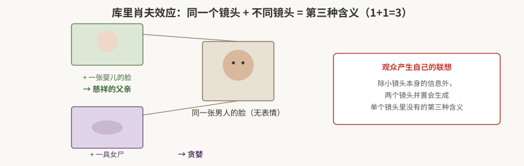
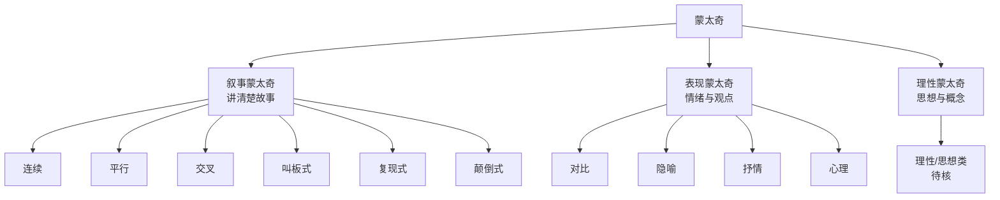

# 蒙太奇原理与剪辑手法

> 本篇导读：蒙太奇（Montage）是剪辑的底层思维——**两个镜头放在一起，会产生第三个含义**。本篇从库里肖夫效应讲起，把蒙太奇分成「叙事 / 表现 / 理性」三大类，逐类给出结构条件、作用和电影案例，做成可直接复习的分类表。
>
> 相关篇：单个镜头怎么拍见 [《镜头视听语言：景别·构图·运镜·角度》](./镜头视听语言-景别构图运镜角度.md)，用蒙太奇思维拆解一部片子见 [《拉片方法与镜头调度》](./拉片方法与镜头调度.md)，混剪实操见 [《转场创意与混剪实战》](../01-Premiere操作/转场创意与混剪实战.md)。

## 本篇目录

- [一、什么是蒙太奇：库里肖夫效应](#一什么是蒙太奇库里肖夫效应)
- [二、蒙太奇三大类总览](#二蒙太奇三大类总览)
- [三、叙事蒙太奇](#三叙事蒙太奇)
- [四、表现蒙太奇](#四表现蒙太奇)
- [五、理性蒙太奇](#五理性蒙太奇)
- [六、混剪中的蒙太奇节奏](#六混剪中的蒙太奇节奏)

---

## 一、什么是蒙太奇：库里肖夫效应

蒙太奇的本质可以用两个公式理解：

- **1 + 1 = 3**：除了每个小镜头本身的信息之外，观众还会在两个镜头的并置中**产生自己的联想**，生出第三个镜头里没有的含义。
- **1 - 0.5 = 3**：通过载剪构图、片段截取的方法，可以**改变原意**（甚至恶搞出完全不同的意思）。

经典实验：同一张男人毫无表情的脸——

- 接一张**婴儿的脸** → 观众读出「慈祥的父亲」；
- 接一具**女尸** → 观众读出「贪婪」。

脸本身没变，变的是相邻镜头带来的语境。这就是剪辑的魔力：**意义不在单个镜头里，而在镜头与镜头的关系里。**

---

## 二、蒙太奇三大类总览

- **叙事蒙太奇**：按时间或逻辑顺序组接，目的是把故事讲清楚。
- **表现蒙太奇**：不追求线性叙事，侧重情绪营造和观点表达。
- **理性蒙太奇**：通过镜头并置让观众生出抽象概念与思想。

---

## 三、叙事蒙太奇

| 类型 | 结构 | 成立条件 / 特点 | 作用 | 案例 / 适用 |
|---|---|---|---|---|
| **连续蒙太奇** | 单线叙事，一个事件接一个事件按时间走 | 单一主线，顺着时间连续推进 | 最自然、最基本的叙事方式 | 常规剧情片主线 |
| **平行蒙太奇** | 两条线 **A B A B** 交替出现 | 三个条件：① 同一时间不同地点；② 同一地点不同时间；③ 必须是**相互关联**的故事。两条线从片段看似乎无关联、看似互不影响，实则暗中呼应 | 同时展开两条线，扩大信息量、互相映衬 | 双线叙事、群像片 |
| **交叉蒙太奇** | 同一时间、不同空间的两条动作**交叉剪接**，且互相影响 | A、B 两线相互交叉、互相推动（区别于平行）；可三条以上故事线 | 构成紧张气氛和强烈节奏感，造成惊险的戏剧效果；引起悬念、制造紧张气氛、加强矛盾冲突的尖锐性 | 诺兰《敦刻尔克》：陆上 1 周 / 海上 1 天 / 空中 1 小时三条时间线交叉呈现、最终交汇；Vlog 多线叙事、混剪整活 |
| **叫板式蒙太奇** | 两条故事线之间**利用声音**来串联呼应（错位镜头） | 一问一答形成呼应；靠声音把两条线「叫」到一起 | 串联场景、推动剧情；转场不生硬 | 悬疑剧、B站鬼畜、跨服聊天；混剪不能生硬硬切时用它过渡 |
| **复现式蒙太奇** | 有一定寓意的线索在影片中**重复出现** | 同一个视觉动机（物件、动作、台词）多次复现 | 造成强调、对比、呼应、渲染等艺术效果 | 《阿甘正传》开头结尾的**羽毛** |
| **颠倒式蒙太奇** | 把倒叙、闪回挪到开头 | 挪到开头的东西一般都有戏剧冲突，引发观众好奇心 | 倒叙、引人入胜 | 《调音师》；Vlog 开头足够有趣、吸引观众长时间观看 |

### 平行 vs 交叉：怎么区分？

- **平行**：两条线只是**平行展示**，暂时不发生关系（A B A B）。
- **交叉**：两条线**互相影响、越靠越近**，最终交汇到同一个事件上（如最后一分钟营救、敦刻尔克三线汇合）。

---

## 四、表现蒙太奇

表现蒙太奇**侧重情绪营造和观点表达**，不承担线性叙事任务。

| 类型 | 做法 | 作用 |
|---|---|---|
| **对比蒙太奇** | 把两个反差强烈的画面并置（一贫一富、一静一动、一冷一暖） | 产生相互强调、相互冲突的作用；表达创作者的某种寓意，强化表现内容、情绪和思想 |
| **隐喻蒙太奇** | 把看似不相干的事物剪在一起 | 用 A 比喻 B，折射人物内心的状态 |
| **抒情蒙太奇** | 一般在一段叙事之后，插入象征情绪的空镜头（天空、流水、空镜） | 抒发情感、渲染情绪氛围 |
| **心理蒙太奇** | 插入回忆杀、思维混乱的画面 | 表现人物内心所想的画面；是展现人物内心的重要方式，**并非真实发生**（想象中的） |

---

## 五、理性蒙太奇

理性蒙太奇通过镜头的对列，让观众在情绪之外生出抽象的概念与思想（苏联蒙太奇学派，爱森斯坦一路）。笔记中该类下的细分名称（待核，此处不臆造）大致包括：思想蒙太奇、反射蒙太奇等方向——即用具体物象的并置（如雕像、军火、屠宰的对列）推导出一个理性判断。

> 待核：本类下细分小类名称原笔记字迹潦草，仅保留大类「理性蒙太奇」概念，具体子类型名待回看原笔记核对后补全。

---

## 六、混剪中的蒙太奇节奏

- 好的混剪作品都要有**一定的节奏起伏**，可以通过声音切换营造不同的节奏氛围。
- 但**不能直接生硬地硬切**——这时就用叫板式蒙太奇（声音先把下一段「叫」出来），让转场顺滑。
- 情绪是最好的粘合剂：**同一种情绪可以粘合不同场景、不同角色**的镜头，这就是混剪、MV 的底层逻辑。

---

## 附：本篇速查表

| 你想要的效果 | 用哪种蒙太奇 |
|---|---|
| 同时讲两件相关的事、暂时不交汇 | 平行蒙太奇 |
| 紧张、悬念、两线最终汇合 | 交叉蒙太奇 |
| 转场不想硬切、用声音带一下 | 叫板式蒙太奇 |
| 一个物件反复出现、点题 | 复现式蒙太奇 |
| 开头就倒叙、勾住观众 | 颠倒式蒙太奇 |
| 两个东西反差出观点 | 对比 / 隐喻蒙太奇 |
| 叙事完了来个空镜抒情 | 抒情蒙太奇 |
| 表现人物回忆、内心活动 | 心理蒙太奇 |
