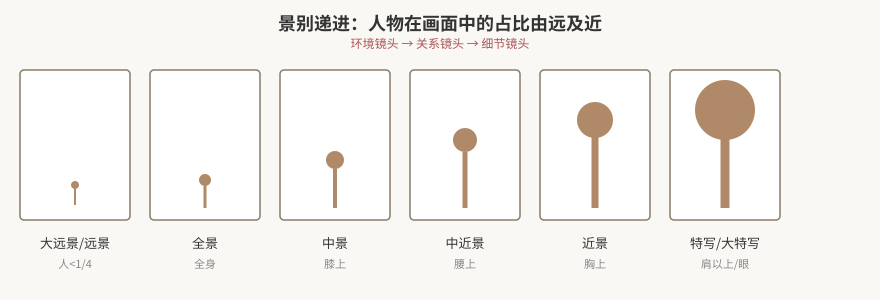
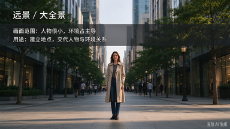
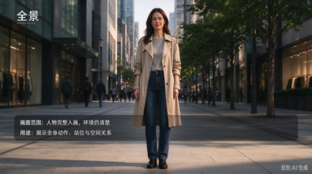
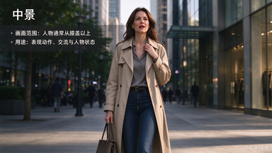
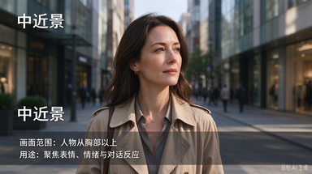
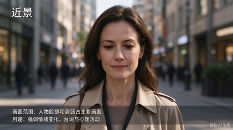
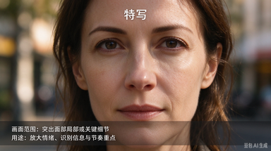
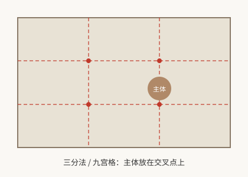
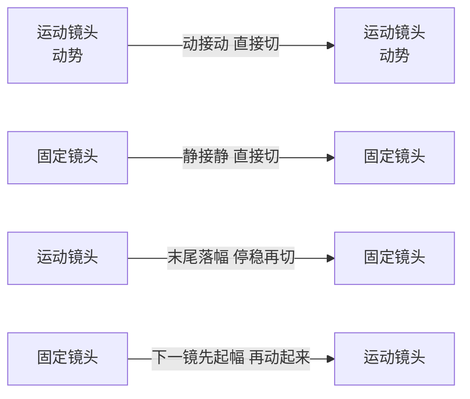
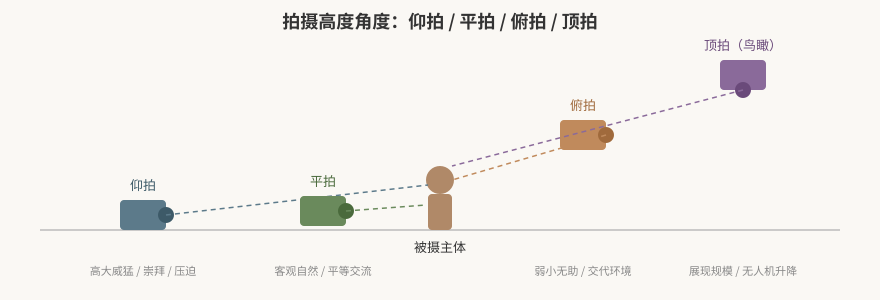

# 镜头视听语言：景别·构图·运镜·角度

> 本篇导读：视听语言是导演、摄影师、剪辑师的共同语言——在灯光、布景、构图上下功夫来辅助叙事，把观众的注意力引导到主体信息上。本篇把镜头语言拆成六张速查表：**景别、构图、运镜、焦距与景深、拍摄角度、景别组接**，每条手法给「作用 / 适用场景」，可直接照着复习、照着拍。
>
> 本篇与姊妹篇配合食用：剪辑组接原理见 [《蒙太奇原理与剪辑手法》](./蒙太奇原理与剪辑手法.md)，如何拉片拆解别人的镜头见 [《拉片方法与镜头调度》](./拉片方法与镜头调度.md)，具体转场特效与混剪见 [《转场创意与混剪实战》](../01-Premiere操作/转场创意与混剪实战.md)。

## 本篇目录

- [一、镜头语言总览](#一镜头语言总览)
- [二、景别体系](#二景别体系)
- [三、构图：10 种构图法 + 画面六要素](#三构图10-种构图法--画面六要素)
- [四、运镜：推·拉·摇·移·跟·升·降·甩](#四运镜推拉摇移跟升降甩)
- [五、焦距与景深](#五焦距与景深)
- [六、拍摄角度：高度 + 方向](#六拍摄角度高度--方向)
- [七、景别组接的 4 种结构](#七景别组接的-4-种结构)
- [八、转场与组接常识速查](#八转场与组接常识速查)

---

## 一、镜头语言总览

镜头语言 = **景别 + 构图 + 运镜 + 焦距 + 拍摄角度 + 主观镜头 + 转场 + 组接**，是这 8 个元素构成的组合游戏。拍和剪时，每一个画面都在同时回答四个问题：

1. **离多远拍？**（景别）
2. **主体放画面哪里？**（构图）
3. **镜头动不动、怎么动？**（运镜）
4. **从什么高度、什么方向拍？**（角度）

> 辅助叙事的五个关键词：**动静、明暗、躁动中的悠扬、镜头运动、冷暖**——它们共同决定观众的情绪走向。

---

## 二、景别体系

景别口诀：**远、全、中、近、特**；细分九档：大远景 → 远景 → 大全 → 全景 → 中景 → 中近景 → 近景 → 特写 → 大特写。按功能可分成三组：**环境镜头（远）、关系镜头（全/中）、细节镜头（近/特）**。

| 景别 | 人物在画面中的比例 | 功能分组 | 作用 | 适用场景 / 案例 |
|---|---|---|---|---|
| **大远景 / 远景** | 人 < 1/4 ~ 1/2，人很小 | 环境镜头 | ① 交代时间、地点、人物所处环境；② 渲染环境氛围、为影片定基调；③ 展现场景规模、宏大大气；④ 以广袤自然反衬人物的渺小与孤独；⑤ 适合放在**开头 / 结尾 / 场景转换过渡** | 企业宣传片开场（远景 + 旁白）、风光片、孤独感桥段；叙事性差，不宜连续用 |
| **全景 / 大全景** | 人物全身可见 | 关系镜头 | ① 交代环境与人、人与人的关系；② 展现人物整体形象与动作；③ 交代事物的发展；④ 相比大全景，人物着装与动作看得更清楚、人物魅力更明显，适合人少的场面 | 动作场面、旁观者视角、人物出场亮相 |
| **中景** | 膝盖以上 | 关系镜头 | ① 展现人物神情与上肢体动作；② **最适合叙事的景别**，推进剧情发展；③ 通过人物交流交代人物关系 | 对话戏、新闻采访、常用客观叙述视角 |
| **中近景** | 腰部以上，头顶留白 | 关系镜头 | 同中景，更靠近主体，交流感更强 | 对话、访谈、vlog 口播 |
| **近景** | 胸部以上，头顶留白 | 细节镜头 | ① 展现人物表情；② 塑造人物性格；③ 更侧重叙事与人物塑造 | 新闻采访、情绪戏、聊天感画面 |
| **特写 / 大特写** | 肩部以上 / 只拍眼睛、局部 | 细节镜头 | ① 强烈表达情绪、展现内心活动；② 展示重点信息；③ 埋下伏笔；④ 是人物内心外化的镜头，放大细节给观众情绪冲击；大特写表达情绪的力度最强 | 悬疑片、恐怖片、产品细节、结尾点题；名例《巴顿将军》开场大特写立人物 |

**景别使用要点：**

- 剪辑时把不同景别放在合适位置出现，本身就有助于**氛围铺垫、调性确立、人物情绪渲染**。
- 交代清楚一件事，**至少需要两种以上景别的镜头成组出现**（远 + 全 + 中 + 近 + 特配合），单一景别会让画面单调、信息扁平。
- 后期可以「二次构图」（放大裁切画面），**剪辑师可拿摄影师给的素材二次构图矫正景别**；但不要在剪辑时强行改变景别关系、打乱镜头成组关系。
- 从大远景直接切到大特写：信息量**由多到少**、画面节奏**从舒缓到压迫**，人物从次要推到重要——冲击力极强（见「七、两极式」）。
- **客观性片子不要切头**：宣传片、新闻采访这类客观叙述的片子，人物头顶要留空，别直接切到头顶/脖子。
- 远景中主体是环境、陪体是人物；全景中主体是人物、陪体是环境——主次别搞反。

### 2.1 景别实拍图例（同一人物·同一街头）

下面用**同一人物、同一街头场景**，从远景到特写连续排列，直观对比镜头距离变化（每张只标景别名、画面范围、主要用途）：

> **核心判断方法：景别看被摄主体在画面中占多大比例，而不是绝对距离。** 人物越小、环境越多，景别越"远"；人物越大、细节越突出，景别越"近"。

### 2.2 AI 辅助二次构图与拆段（2026 工作流）

手动放大裁切二次构图费眼力，现在两个 AI 功能可以把粗活先干了：

| 功能 | 位置 | 干什么 | 费用 |
|---|---|---|---|
| **自动重构序列（Auto Reframe）** | 剪辑 → 自动重构序列 | AI 自动识别画面主体、**始终把它框在新画幅里**，一键把横屏素材重构成竖屏 / 方形，自动跟主体走位，省掉逐段手裁 | **免费** AI 功能 |
| **场景编辑检测** | 右键素材 → 场景编辑检测 | 自动按镜头切点把长素材拆成一段段镜头，辅助按景别 / 场次粗拆，再人工细挑 | **免费** |

> 用法：AI 出的重构 / 拆段是**初稿**——横竖屏安全边距、双人对话谁该在画面里，仍要人工过一遍确认；AI 把主体跟丢、跟错对象时手动补关键帧即可。纯手裁二次构图作为兜底旧法保留。

---

## 三、构图：10 种构图法 + 画面六要素

### 3.1 为什么要构图

构图的四个目的：

1. **挑选和处理素材**——决定什么进画面、什么出画面；
2. 让画面更美观、看着舒服；
3. **引导观众视线**到主体上；
4. 为剧情服务、暗示主题。

### 3.2 10 种构图法速查

| # | 构图法 | 做法 | 作用 / 适用场景 |
|---|---|---|---|
| ① | **中心构图** | 主体放画面正中央 | 强调主体；但画面容易显得单调、呆板、没新意 |
| ② | **对称构图** | 左右/上下镜像对称 | 稳定、庄重、仪式感；可后期裁成对称构图 |
| ③ | **三分法 / 九宫格** | 主体放在四条分割线的交叉点上（PR 里可调出参考线） | 最常用、最稳妥；主体丢在一侧会显空、失去平衡 → **找陪体放到另一侧交叉点上配重**；人物朝哪边看，人就放在相反一侧（视线前方留白） |
| ③+ | **黄金分割（斐波那契螺旋）** | 主体放在螺旋收敛点上 | 比三分法更具美感 |
| ④ | **对角线构图** | 主体沿斜线安排 | 斜线产生不稳定感，带来速度感、方向感，增强画面冲击力 |
| ⑤ | **引导线构图** | 利用道路、栏杆、河流等线条把视线引向主体 | 近大远小的透视产生自然线条与层次感 |
| ⑥ | **曲线构图** | S 型道路、河流 | 优雅、别致，柔化画面 |
| ⑦ | **前景构图** | 在主体与镜头之间加一层前景 | 增加层次感、真实感、画面信息量；主体背景怎么拍都单调时，加一层前景立刻解决 |
| ⑧ | **框架构图** | 用门窗、洞口、树枝把主体框住 | 把观众视野约束在小范围内突出主体，产生较强空间感、层次感 |
| ⑨ | **对比构图** | 大小对比、冷暖对比、明暗对比、虚实对比 | 重点突出主体的某一特征 |
| ⑩ | **留白** | 主体周围留大面积空白 | 小清新、意境、呼吸感；给视线留出运动空间 |

### 3.3 画面六要素

一个画面由六个要素构成：**主体、陪体、背景、前景、色调、线条**。检查一张构图是否合格，就按这六项逐项过一遍：主体是否突出？陪体是否抢戏？背景是否干净？前景是否加分？色调是否统一？线条是否引导视线？

| 要素 | 作用 | 案例 / 用法 |
|---|---|---|
| **主体** | 画面核心，最重要的视觉重心 | 《布达佩斯大饭店》的人物造型即主体 |
| **陪体** | 协助主体暗示主题、均衡画面、烘托气氛 | 主体放一侧显空时，用陪体补另一侧交叉点配重 |
| **背景** | 交代主体所处环境、渲染氛围、交代身份特征、暗示主题（隐喻） | 人物置于画面边缘两侧 → 暗示人物之间疏远、有隔阂 |
| **前景** | 靠近镜头、处于主体之前的人或物；增加层次感、与背景融合、让观众有空间感；**快速掠过的前景**营造速度感、刺激感 | 主体背景怎么拍都单调时，加一层前景立刻加分 |
| **色调** | 画面整体色彩基调；影响主题表达、形成画面美感。橙 = 温暖；紫 = 浪漫；蓝 = 忧郁；绿 = 自然健康、希望、和平 | 《布达佩斯大饭店》：大面积粉色基调 = 旧时代欧洲浪漫主义；越狱逃跑路上用蓝色调 = 落魄无奈；结尾黑白色调 = 暗示主角死亡的悲剧结局 |
| **线条** | 形式感；画面中总有直线 / 曲线等线条引导视线 | 引导线、S 形曲线（见构图法 ⑤⑥） |

**构图位置与情绪的小规律：**

- 观众**最佳眼睛转动区只有 10°~20°**——重要信息别压到画面最边上，落在舒适区内观众才看得舒服。
- 人物放画面**上方** → 居高临下的威严感；放**下方** → 渺小无助感。
- 人物看向左，就把人放在右侧（视线方向留白）；有时人为营造压抑、无奈的氛围。
- 正常构图保持水平；**故意斜着拍（荷兰角）** → 不安、紧张。

---

## 四、运镜：推·拉·摇·移·跟·升·降·甩

运镜口诀：**推、拉、移、摇、跟、升降**，以及各种组合运镜。

| 运镜 | 做法 | 作用 / 情绪 | 适用场景 |
|---|---|---|---|
| **推镜头** | 从大景别 → 小景别，向主体靠近 | 强调、突出、展现细节；制造「进入感」 | 段落开场、情绪聚焦、发现细节 |
| **拉镜头** | 从小景别 → 大景别，远离主体 | 揭示信息、强化人与环境的关系、揭示悬念；情绪升华 | 段落结尾、收尾、揭示全貌 |
| **摇镜头** | 机位不动，镜头方向左右/上下摇动 | 展现众多人物事物，让观众逐一观察 | 展示环境全貌、跟随人物视线 |
| **甩镜头** | 快速摇镜头，造成模糊拉伸的画面 | 速度感、转场感；前一个镜头甩出去、后一个镜头甩进来，后期拼在一起相当于运动镜头转场 | 快节奏、炫技；模糊感也可用坡度变速（加速甩动）在同一镜头内实现 |
| **移镜头** | 按一定轨迹移动摄像机（横移、跟移） | 各种运动形态的组合；身临其境、创造主观视感 | 跟随行走、穿越空间 |
| **跟镜头** | 画面始终跟随被摄主体拍摄 | 观众注意力始终集中在被摄主体上 | 跟拍人物运动、追逐 |
| **升降镜头** | 上下移动拍摄（可借助升降装置）；分垂直升降、弧形升降、不规则升降 | 表现事物局部、展现场景规模 | 开场/结尾大场面、气势镜头 |

### 4.1 推拉效果的两种实现方式

| 方式 | 做法 | 视觉效果 |
|---|---|---|
| **移动机位** | 摄像机真的推近/拉远，焦距不变 | 主体与背景的**透视关系**发生变化（背景真的后退/前进） |
| **变焦推拉** | 机位不动，扭动变焦环（广角 ↔ 长焦） | 景深变化幅度大、不符合人眼直观感受；**少用**，容易显得假 |

> 变焦镜头用得好可以**营造紧张刺激的氛围**（缓慢推变焦 = 压迫感）；但日常推拉效果仍以移动机位为正路。

### 4.2 希区柯克变焦（Dolly Zoom / 滑动变焦）

机位移动 + 变焦环反向扭动同时进行：

- **推（大→小）+ 变焦环（长焦→广角）**
- **拉（小→大）+ 变焦环（广角→长焦）**

主体大小基本不变，但背景透视剧烈压缩/拉伸，制造人物内心恍惚、紧张、震惊的心理效果。

### 4.3 后期模拟推镜头（无推拉设备时）

用 4K 素材做后期推：取最后一帧位置 → 缩放关键帧 → 把 Alt 层拖到第一帧、改为半透明 → 让第一帧的主体与 Alt 层大小位置重叠 → 删除 Alt 层。这样可以在固定机位素材上模拟缓慢推近。

### 4.4 动静衔接与起落幅

运动镜头和固定镜头相接时，切在哪一刀决定顺不顺：

| 接法 | 要求 | 说明 |
|---|---|---|
| **动接动** | 直接切，不要起落幅 | 一个运动镜头接下一个运动镜头，动势不断 |
| **静接静** | 直接切，不要起落幅 | 固定镜头接固定镜头，本来就稳 |
| **动接静** | 运动镜头末尾先**落幅** | 动镜头慢慢停下来（动势 ↓），停稳后再切到固定镜头 |
| **静接动** | 运动镜头开头要**起幅** | 固定镜头切过来后，运动镜头先从静止慢慢动起来（动势 ↑），再进入运动 |

**三种不用起落幅的情况**：① **时间线 / 故事线切换**；② **环境嘈杂、镜头本身不稳定**（虽然固定但在抖动）；③ **节奏踩点**，为整体节奏服务。

---

## 五、焦距与景深

| 概念 | 规律 | 用法 |
|---|---|---|
| **光圈大**（如 F2.0） | 背景虚化、突出中心 | 拍人像、产品、需要把主体从环境中剥离时 |
| **光圈小**（如 F11） | 前后都清晰 | 拍远景、风光、需要环境信息全清楚时 |
| **景深** | 光圈越大（数值越小），背景越模糊；光圈数值越大，背景越清晰 | 景深控制的就是「背景糊不糊」 |

> 注意：手机主摄光圈物理固定，光线差时快门、光圈作用不大，主要靠拉高 ISO（代价是噪点变多）——详见 [《摄影入门：构图·光线·曝光与器材》](../05-拍摄基础/摄影入门-构图光线曝光与器材.md)。

---

## 六、拍摄角度：高度 + 方向

角度 = 摄像机相对于被摄主体的角度，**代表了导演的观点，引导观众的感受**。分两个维度：**拍摄高度**（仰/平/俯/顶）和**拍摄方向**（正/斜侧/反侧/侧/背）。

### 6.1 拍摄高度

| 高度 | 视觉感受 | 具体用法 |
|---|---|---|
| **仰拍** | 高大威猛 | 正面角色 → 崇拜感、仰慕；反派 → 压迫感、邪恶感；拍景物 → 雄伟磅礴气势；拍跳跃/腾空动作 → 夸大速度感与视觉冲击 |
| **平拍** | 客观自然 | 平等、中立、纪录片式叙述 |
| **俯拍** | 弱小无助 | 交代人物所处环境、人物的渺小 |
| **顶拍（鸟瞰）** | 上帝视角 | 拍高楼大厦、大好河山，展现雄伟；常用无人机、升降机架 |

### 6.2 拍摄方向

| 方向 | 特点 / 作用 |
|---|---|
| **正面** | 形状感 > 立体感；被摄主体与镜头之间有直接交流感（对着观众说话） |
| **斜侧** | 勾勒人物脸庞轮廓、五官立体；视角引导；人物对话常用 |
| **反侧（背斜侧）** | 从人物背后斜侧方向拍；视角引导、制造反转效果 |
| **侧面** | 单一主体 → 运动感、速度感；多个主体 → 对立关系 |
| **背面** | 引起观众想象，抽象表达情绪、设置悬疑感 |

---

## 七、景别组接的 4 种结构

一组镜头按景别由大到小或由小到大排列，就是「组接结构」。四种经典结构：

| 结构 | 景别走向 | 作用 | 适用 |
|---|---|---|---|
| **递进式** | 大 → 小（远 → 近） | 逐步交代环境、人物、正在发生的事 | Vlog、日常视频创作 |
| **后退式** | 小 → 大（近 → 远） | 开头用特写吸引观众，再逐步放大景别交代人物、环境、叙事 | 广告片、宣传片开场 |
| **两极式** | 最大远景 ↔ 最小特写 直接对切 | 形成反差感、惊悚感、强烈刺激 | 关键事物转场、恐怖片、强冲击段落 |
| **环形结构** | 开头与结尾景别一致 | 形成闭环、氛围感、细节呼应 | 设计难度高，处理不好会信息冗余；首尾呼应的精致短片 |

> **组接纪律**：一般按远 → 全 → 中 → 近 → 特推进，**相邻两个镜头之间最好隔一个景别**（如全景别直接接特写别，中间先过一个中景别），同景别硬切会跳。两极式除外——它就是故意用最大跨度直切制造反差、快速快感和强刺激。

---

## 八、转场与组接常识速查

> 完整转场体系（特效转场 → 无缝转场 → 声音/匹配/运动镜头转场）与剪辑点选择，在本系列中分两处详述：操作与混剪见 [《转场创意与混剪实战》](../01-Premiere操作/转场创意与混剪实战.md)，声音剪辑见 [《声音设计与音乐音效》](../02-音频与声音/声音设计与音乐音效.md)。

- **好的转场 = 让观众察觉不到转场。**
- **J-cut / L-cut**：J-cut 声音先入、画面后到；L-cut 画面先切、声音延续；二者常同时使用，用于烘托气氛、推进剧情。
- **匹配转场**：声音相似匹配（音效、音乐层面）、形状匹配（炫技，高阶可推进剧情）、动作匹配（同一主体动作连续；不同主体动作承接 → 混剪）。
- **动作剪辑点**：① 动作的开始或结束处，或动作中途剪辑；同一动作在 30% 和 70% 处切（三七开、五五开、四六开）；② 出画入画：有出画动势接下一画面的入画动势；③ 重要动作的停顿和转折处剪辑。
- **情绪剪辑点**：情绪需要积累，要给角色（尤其对话戏）留足情绪时间；情绪是最好的粘合剂，可用同一情绪粘合不同场景、不同角色（混剪、MV）；长时间同一种情绪会让人疲惫，好作品情绪要丰富；剪辑可以烘托和强化情绪。
- **节奏剪辑点**：踩音乐鼓点；台词语速、语调、内容影响节奏；画面元素；快慢剪辑整体考虑。

---

## 附：本篇速记口诀

> 景别：远全中近特，环境—关系—细节。
> 构图：主体要突出，六要素齐备，三分法兜底。
> 运镜：推近强调、拉远升华、摇展环境、移跟代入、升降展规模、甩做转场。
> 角度：仰高大、俯渺小、平客观；正面交流、斜侧立体、背面悬疑。
> 组接：递进叙事、后退开头抓眼、两极冲击、环形闭环。
