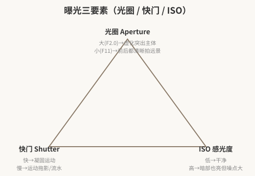
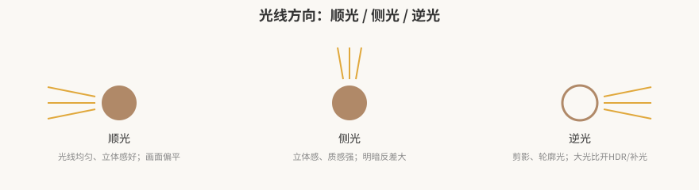

# 摄影入门：构图·光线·曝光与器材

> 本篇导读：从零开始拍好一张照片的入门笔记。围绕三个问题展开：**一张好照片的标准是什么？怎么构图？怎么用光、控制曝光？** 全程以手机/入门相机可操作的方法为主，含对焦、虚化、曝光三要素、HDR、白平衡、光线方向、拍摄角度、焦段和室内器材。
>
> 相关篇：景别、运镜、机位角度的电影语言版见 [《镜头视听语言：景别·构图·运镜·角度》](../04-视听语言与剪辑理论/镜头视听语言-景别构图运镜角度.md)。

## 本篇目录

- [一、好照片的三个标准](#一好照片的三个标准)
- [二、对焦与虚化](#二对焦与虚化)
- [三、构图基础](#三构图基础)
- [四、曝光三要素](#四曝光三要素)
- [五、光线怎么用](#五光线怎么用)
- [六、拍摄角度与焦段](#六拍摄角度与焦段)
- [七、器材与实用小工具](#七器材与实用小工具)

---

## 一、好照片的三个标准

一张照片好与坏，按这三条检查：

1. **明确的主题（内容）**：你想拍什么、想表达什么，先想清楚。
2. **注意力引导到主体**：用视线引导把观众的目光带到被摄主体上。
3. **画面简洁**：只保留利于主体的内容，把分散注意力的东西排除到画面外。

一句话：**主题明确、主体突出、画面干净。**

---

## 二、对焦与虚化

- **点按对焦**：点屏幕选择对焦点；**长按锁定对焦/曝光（AE/AF 锁）**，然后再重新构图。
- **虚化（大光圈）**：用大光圈（如 F2.0）让背景模糊、突出中心。
- **照片不清晰的常见原因**：曝光不对、运动太快、手抖、镜头脏（擦一擦）、对焦不实——拍之前先擦镜头、点实对焦点。

---

## 三、构图基础

### 3.1 常用构图法

| 构图法 | 做法 | 效果 |
|---|---|---|
| **中心构图** | 主体放正中 | 简单直接、主体突出 |
| **对称构图** | 左右/上下对称 | 平衡稳定 |
| **三分法 / 九宫格** | 主体放交叉点 | 表现鲜明、画面简练 |
| **对角线** | 主体沿斜线 | 动感、视线延伸 |
| **引导线** | 道路、栏杆、线条把视线引向主体 | 引导视线、突出主体 |
| **框架构图** | 门窗、洞口框住主体 | 增加画面趣味 |
| **前景 / 对比 / 留白** | 加前景；明暗、色彩、虚实对比；适当留白 | 突出主体、营造氛围 |

### 3.2 横平竖直原则

- 照片的地平线尽量**水平竖直**，这是基本构图原则；其他构图法都应在这个基础上用。
- 手机打开网格线作为参考；**水平线倾斜**一般只在刻意要「歪斜感」时才用，绝大多数照片还是端平。
- 拍人像时可以适当低角度仰拍靠近模特来拉长腿型（见第六节）。

---

## 四、曝光三要素

| 要素 | 作用 | 大 / 小的效果 |
|---|---|---|
| **光圈（Aperture）** | 控制进光量与景深 | 大（F2.0 等小数值）→ 背景虚化、突出主体；小（F11）→ 拍远景前后都清楚 |
| **快门（Shutter）** | 控制曝光时间 | 快 → 凝固运动瞬间；慢 → 运动拖影（流水、车轨） |
| **ISO 感光度** | 感光灵敏度 | 越低越干净；越高暗部越亮但**噪点越大** |

- **光线差时**：手机物理光圈固定，快门/光圈作用不大，主要靠拉高 ISO，代价是噪点变多——所以暗光环境尽量补光而不是硬拉 ISO。
- **HDR**：逆光、大光比（亮部很亮、暗部很暗）时开启 HDR，同时保住亮部和暗部细节。
- **白平衡**：控制色温冷暖，偏黄/偏蓝时调白平衡；后期也可调色。
- **黄金时刻**：日出后 2 小时内、日落前 2 小时内，光线柔和暖色，是拍照的最佳时段。

---

## 五、光线怎么用

### 5.1 四种光线方向

| 光线 | 特点 | 适用 |
|---|---|---|
| **顺光** | 光线均匀、立体感好；缺点是画面偏平淡 | 记录、证件感、清晰交代 |
| **侧光** | 立体感、质感强，明暗反差大 | 拍人、拍物显质感 |
| **逆光** | 主体成剪影、边缘出轮廓光 | 剪影、树叶透光；大光比时开 HDR 或正面补光 |
| **顶光** | 头顶光 | 一般少用，易显阴影重 |

### 5.2 室内光线

- **靠近窗户**：用窗户自然光；阳光直射过硬时，拉上纱帘把光线柔化。
- **反光补光**：逆光/侧光反差大时，用**白纸、白布**给暗部反光补光；环境实在不好时，借另一部手机的手电筒补光。
- **被摄主体大面积背光**：用外部曝光补光，或转为拍剪影。

---

## 六、拍摄角度与焦段

### 6.1 拍摄角度

| 角度 | 特点 | 适用 |
|---|---|---|
| **0° 平拍** | 不易变形、亲切自然 | 人像日常、对话感 |
| **45° 俯拍** | 最常用的角度 | 食物、桌面、摆拍 |
| **90° 正俯拍（顶视）** | 展示盘面/布局形状 | 摆盘、平铺 flat lay、美食 |
| **仰拍** | 显高大、显腿长 | 拍大长腿、显建筑高大 |

### 6.2 焦段

- 手机主摄等效约 **24mm 广角**：低角度仰拍、靠近模特，能拍出大长腿（广角近大远小的透视效果）。
- 拍人像半身：人景比例适中；拍全身：人占画面更小、环境交代更多。
- 穿搭/服装拍照：背景干净、简洁；服装颜色与环境反差要搭（避免和背景同色融为一体）。

---

## 七、器材与实用小工具

| 工具 | 用途 |
|---|---|
| **LED 补光板/灯** | 室内/暗光补光，便携、不插电；可用不同颜色的光营造氛围 |
| **反光板 / 白纸白布** | 给暗部补反光，软补光 |
| **Foodie 美食相机 App** | 拍食物，增加色彩、丰富度与格调 |
| **手机网格线** | 构图辅助，保持横平竖直 |

**实用小提醒：**

- 拍运动中的人别死板：让模特走起来、动起来，抓动态比摆拍自然。
- 拍食物：整盘好看时拍一个比盘子略大一点的构图，或留一点周围环境；特写拍颜色、质感、形状特别美的局部（0° / 45° / 90° 都试一遍）。
- 拍人避开杂乱背景，靠近主体、或用虚化把背景剥离。

---

## 附：出门拍照自查清单

1. 镜头擦了吗？
2. 主题是什么？主体在哪？
3. 横平竖直了吗？主体在三分点上吗？
4. 光线顺/侧/逆？需要补光吗？
5. 对焦点实了吗？需要虚化背景吗？
