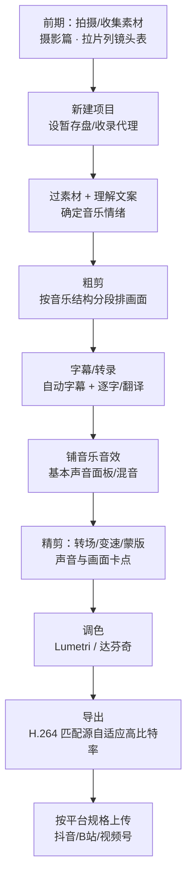

# 剪辑笔记 · 总索引（2026 版）

> 本笔记以 **Adobe Premiere v26.5（2026 年 9 月，Premiere Pro 已更名为 Adobe Premiere）** 为操作主线，
> 同时整理了视听语言、蒙太奇、拉片、剧本、达芬奇调色与摄影入门的完整体系，
> 全部内容由手写课程笔记升级、合并、去重而来，**翻一篇就能学完一块**。

## 目录

- [一、本笔记怎么组织（分类目录）](#一本笔记怎么组织分类目录)
- [二、建议学习顺序（附理由）](#二建议学习顺序附理由)
- [三、2026 剪辑工作流（一条线串起来）](#三2026-剪辑工作流一条线串起来)
- [四、费用标签与配图约定](#四费用标签与配图约定)
- [五、待确认事项（未逐字核实的地方）](#五待确认事项未逐字核实的地方)

---

## 一、本笔记怎么组织（分类目录）

### 01-Premiere 操作（软件怎么用）

| 文档 | 学完能做到 |
|---|---|
| [PR基础操作与项目设置](./01-Premiere操作/PR基础操作与项目设置.md) | 新建项目/序列、设暂存盘、导入素材（含 PSD 图层）、导出、项目打包 |
| [剪辑工作流-粗剪精剪与多轨道](./01-Premiere操作/剪辑工作流-粗剪精剪与多轨道.md) | 五步法全流程、准备阶段、粗剪/精剪、多轨道管理、广告片/宣传片节奏 |
| [快捷键与高效编辑](./01-Premiere操作/快捷键与高效编辑.md) | 工具、时间线、标记、素材/导出快捷键与效率技巧 |
| [转场创意与混剪实战](./01-Premiere操作/转场创意与混剪实战.md) | 内置转场、J/L-cut、匹配转场、无技巧转场、混剪与电子相册 |
| [字幕与文字工作流](./01-Premiere操作/字幕与文字工作流.md) | 开放式字幕、自动转录/自动字幕、逐字/翻译字幕、样式批量改、MOGRT、导出 SRT |
| [变速与慢动作](./01-Premiere操作/变速与慢动作.md) | 整体变速、时间重映射、帧混合/光流法、AI 生成式延长、插件方案 |
| [效果-蒙版与抠像](./01-Premiere操作/效果-蒙版与抠像.md) | 关键帧、蒙版/跟踪、AI 对象遮罩、混合模式、轨道遮罩、超级键抠像 |
| [代理剪辑与素材管理](./01-Premiere操作/代理剪辑与素材管理.md) | 收录/代理、切换代理、素材管理、脱机重链、DIT 交付思路 |
| [AI工具与第三方工作流](./01-Premiere操作/AI工具与第三方工作流.md) | PR AI 清单、Firefly 积分、第三方字幕/配音/音乐、工程交换、国内工作流 |

### 02-音频与声音（声音怎么处理与设计）

| 文档 | 学完能做到 |
|---|---|
| [音频处理与混音实战](./02-音频与声音/音频处理与混音实战.md) | 基本声音面板、Enhance Speech/Remix/闪避、降噪/EQ/压缩、频段、响度 LUFS、混音流程 |
| [声音设计与音乐音效](./02-音频与声音/声音设计与音乐音效.md) | 挑 BGM、节奏改造、多曲衔接、免版权平台选型、音乐风格、音效、声画关系、补充音效 |

### 03-调色（颜色怎么调）

| 文档 | 学完能做到 |
|---|---|
| [Premiere调色-Lumetri与色彩管理](./03-调色/Premiere调色-Lumetri与色彩管理.md) | 一级/二级校正、曲线、色轮、HSL、自动调色/匹配、色彩管理、LUT |
| [达芬奇调色-节点工作流入门与进阶](./03-调色/达芬奇调色-节点工作流入门与进阶.md) | 免费版/Studio 对比、一二级调色、节点拓扑、窗口/跟踪、肤色、示波器、色彩匹配 |

### 04-视听语言与剪辑理论（为什么这么剪）

| 文档 | 学完能做到 |
|---|---|
| [镜头视听语言-景别构图运镜角度](./04-视听语言与剪辑理论/镜头视听语言-景别构图运镜角度.md) | 景别体系、10 种构图、运镜、焦距景深、拍摄角度、组接结构 |
| [蒙太奇原理与剪辑手法](./04-视听语言与剪辑理论/蒙太奇原理与剪辑手法.md) | 库里肖夫效应、叙事/表现/理性蒙太奇全分类、条件与作用、混剪节奏 |
| [拉片方法与镜头调度](./04-视听语言与剪辑理论/拉片方法与镜头调度.md) | 三遍法、分析框架、记录清单、镜头调度、镜头表 |
| [剧本写作与故事结构](./04-视听语言与剪辑理论/剧本写作与故事结构.md) | 剧本格式、三幕式/起承转合、人物、伏笔高潮、广告/宣传/微电影文案 |

### 05-拍摄基础（前期怎么拍）

| 文档 | 学完能做到 |
|---|---|
| [摄影入门-构图光线曝光与器材](./05-拍摄基础/摄影入门-构图光线曝光与器材.md) | 好照片标准、对焦虚化、构图、曝光三要素、光线、角度焦段、器材 |

---

## 二、建议学习顺序（附理由）

**排序原则：先"能剪出来"保持手感，再补"为什么这么剪"建立审美，最后攻"高级技能"与专题。**
理论如果排在最前面，没有软件操作经验会觉得抽象；软件操作如果不及时配理论，又容易只学会"点按钮"而不知道何时用。所以采用"操作 → 理论 → 专题 → 提高"的交错路线。

### 第 1 阶段：先剪出一条片子（约 1 周）
1. [PR基础操作与项目设置](./01-Premiere操作/PR基础操作与项目设置.md)
2. [剪辑工作流-粗剪精剪与多轨道](./01-Premiere操作/剪辑工作流-粗剪精剪与多轨道.md)
3. [快捷键与高效编辑](./01-Premiere操作/快捷键与高效编辑.md)
4. [字幕与文字工作流](./01-Premiere操作/字幕与文字工作流.md)

> 目标：能独立完成"导入→粗剪→字幕→导出"一条完整流程。

### 第 2 阶段：建立镜头语言与剪辑思维（约 2 周，边看片边学）
5. [镜头视听语言-景别构图运镜角度](./04-视听语言与剪辑理论/镜头视听语言-景别构图运镜角度.md)
6. [蒙太奇原理与剪辑手法](./04-视听语言与剪辑理论/蒙太奇原理与剪辑手法.md)
7. [拉片方法与镜头调度](./04-视听语言与剪辑理论/拉片方法与镜头调度.md)
8. [剧本写作与故事结构](./04-视听语言与剪辑理论/剧本写作与故事结构.md)

> 目标：看得懂片子为什么这么拍、这么剪，能自己拉片、列镜头表。

### 第 3 阶段：把声音做对（约 1 周）
9. [音频处理与混音实战](./02-音频与声音/音频处理与混音实战.md)
10. [声音设计与音乐音效](./02-音频与声音/声音设计与音乐音效.md)
11. [转场创意与混剪实战](./01-Premiere操作/转场创意与混剪实战.md)

> 目标：人声清晰、BGM 合适、声画配合到位，转场与混剪有章法。

### 第 4 阶段：进阶效果与调色（约 1–2 周）
12. [变速与慢动作](./01-Premiere操作/变速与慢动作.md)
13. [效果-蒙版与抠像](./01-Premiere操作/效果-蒙版与抠像.md)
14. [Premiere调色-Lumetri与色彩管理](./03-调色/Premiere调色-Lumetri与色彩管理.md)
15. [达芬奇调色-节点工作流入门与进阶](./03-调色/达芬奇调色-节点工作流入门与进阶.md)

> 目标：掌握变速、遮罩抠像与完整调色流程；需要重活/精调时知道何时转达芬奇。

### 第 5 阶段：效率、专题与前期（随时回看）
16. [代理剪辑与素材管理](./01-Premiere操作/代理剪辑与素材管理.md)
17. [AI工具与第三方工作流](./01-Premiere操作/AI工具与第三方工作流.md)
18. [摄影入门-构图光线曝光与器材](./05-拍摄基础/摄影入门-构图光线曝光与器材.md)

> 说明：代理建议在开始处理 4K/大项目前就提前看；摄影篇服务于"自己拍素材"，不拍素材可后看。

---

## 三、2026 剪辑工作流（一条线串起来）

- 详细流程见 [剪辑工作流-粗剪精剪与多轨道](./01-Premiere操作/剪辑工作流-粗剪精剪与多轨道.md)。
- 国内平台导出规格（抖音/B站/视频号分辨率、码率、帧率）见该篇第七节。
- 各环节用哪些 AI 功能、哪些免费/不可用，见 [AI工具与第三方工作流](./01-Premiere操作/AI工具与第三方工作流.md)。

---

## 四、费用标签与配图约定

### 费用标签（只给 AI 功能标）
- **免费（含在订阅内 / Assistive AI）**：转录、自动字幕、逐字字幕、Enhance Speech、Remix、自动闪避、Media Intelligence、AI 对象遮罩、Lumetri 自动调色/匹配、Auto Reframe、场景编辑检测。
- **消耗 Firefly 积分**：生成式延长（1080p30 = 125 积分/秒 等）、文本生成视频、生成音效（10 积分/次）、生成音轨（20 积分/分钟）。
- **🔴 中国大陆不可用**：Firefly 及其在 PR 内的派生功能（生成式延长、26.5 生成式媒体工具、翻译视频/音频），官方明示该服务在中国不可用。
- 非 AI 传统工具/插件（RSMB、Twixtor、MOGRT、LAV、Media Encoder、PR 内置功能）**不标价格**，一句话带过。
- 免版权音乐平台不是 AI 工具，但在 [声音设计与音乐音效](./02-音频与声音/声音设计与音乐音效.md) 的选型表中列了价格/水印特点。

### 配图约定
- 界面截图只用**官方真实截图**（helpx.adobe.com / blackmagicdesign.com）；**禁止 AI 生成假界面**。
- 理论示意图用 **mermaid 流程图** 或**手写 SVG**（存在各文档同名 `.assets` 文件夹）。
- 课程截图拼图清晰度低，不直接抠图，一律重绘为示意图。

---

## 五、待确认事项（未逐字核实的地方）

以下内容在笔记中以"以实际版本为准 / 待核"标注，未当成定论：

1. **「图形模板面板」的简体中文确切名称** 与窗口菜单条目（基本图形面板自 v25.0 已移除，由属性面板 + 图形模板面板替代）。
2. **翻译字幕**走 Google/Microsoft 云通道时，在中国大陆网络环境下的实际可达性。
3. **剪映桌面端自动字幕 2026 年是否仍完全免费**（历史免费；鸿蒙版已将智能字幕列入会员，桌面端待确认）。
4. 免版权音乐平台具体价格（手写价格与公开定价有出入，已按"订阅/买断模式 + 以官网为准"处理）。
5. 蒙太奇原笔记中理性蒙太奇的个别子类型名、课程笔记中少量潦草专有名词/数字（已标"待核"，未臆造）。
6. 中国区个人订阅 RMB 售价官网未公开在线标价（引导电话/授权经销商）。

---

> 本套笔记共 **18 篇内容文档 + 本索引**，分 5 个分类文件夹；全部链接、图片路径已校验无死链。
