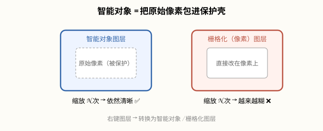

# 图层与智能对象（Photoshop 2026）

## 本篇导读
图层是 PS 的骨架。手写笔记这页把图层的增删改、编组、自由变换、智能对象、裁剪拉直、切片、两类壁纸（图案类/拼接类）全串在了一起，还顺带给了「缩放前先转智能对象」这条保命经验。本篇按 2026 菜单路径重排，所有口诀保留。配套阅读：[图片尺寸格式与色彩管理](./图片尺寸格式与色彩管理.md)。

## 本篇目录
- [2026 变化概览](#2026-变化概览)
- [一、视图操控与图层基本操作](#一视图操控与图层基本操作)
- [二、编组、多选、对齐与锁定](#二编组多选对齐与锁定)
- [三、自由变换与填充快捷键](#三自由变换与填充快捷键)
- [四、智能对象 vs 栅格化图层](#四智能对象-vs-栅格化图层)
- [五、裁剪、拉直与切片](#五裁剪拉直与切片)
- [六、实战：两类壁纸做法](#六实战两类壁纸做法)

## 2026 变化概览
- 智能对象仍是核心图层形态（27.8 刚修过重命名 bug，地位纹丝不动）。
- 图层面板右键菜单照旧：转换为智能对象、栅格化图层、合并形状/形状组件等都在。
- 27.10 起上下文任务栏可直接对选中图层做自然语言修改（🔴 生成式部分大陆账号不可用，见 [AI 工具与国产替代](../AI工具与国产替代.md)）。

## 一、视图操控与图层基本操作
| 操作 | 快捷键/路径 | 说明 |
|---|---|---|
| 缩放画面 | Alt + 滚轮 | 画布级缩放，不动内容 |
| 移动画面 | 空格 + 拖 | 临时抓手工具 |
| 复制图层 | Ctrl+J | 最常用，图层面板也可拖到「+」号上复制 |
| Alt 拖动内容 | 移动工具下直接拖 | 原地复制一份内容 |
| 命名图层 | 双击图层名字所在区域 | 双击缩略图是进样式，别点错 |
| 删除图层 | 选中图层 + Delete（或拖到垃圾桶） | Delete 在选区工具下是清空选区，注意区分 |

## 二、编组、多选、对齐与锁定
- **编组**：选中多个图层 Ctrl+G；**取消编组**：把图层拖出组外即可，不是按 Delete。
- **链接图层**：被链接的多个图层，移动、缩放时是**同步变化**的。
- **图层面板锁定**：可锁定透明像素/图像像素/位置/全部，点面板上方的锁形图标。
- **多选图层**：按住 Shift 点首尾两个图层，或 Ctrl 逐个点；多选后可整体移动、整体 Ctrl+T 自由变换。
- **等间距分布**：先摆好第一个和最后一个，对齐锚点，再点选项栏的「按水平居中分布」——图案类排版的关键动作。

## 三、自由变换与填充快捷键
| 操作 | 快捷键 |
|---|---|
| 自由变换 | Ctrl+T，回车结束 |
| 变换时从中心缩放 | 按住 Alt（在 Ctrl+T 之后） |
| 填前景色 | Alt+Del |
| 填背景色 | Ctrl+Del |
| 填充时临时取色 | 按住 Alt，填充桶变吸管，吸完松手恢复 |
| 拾色器 | 双击前景色色板打开：**左右拖 = 调色相（深浅），上下拖 = 调明度（明暗）** |
| 图像旋转 | 图像 → 图像旋转（画布+内容一起转） |

> 经验（手写笔记原话）：**缩放图像前，先右键图层 → 转换为智能对象，可以减少画质损失。** 这是全篇最值的一条。

## 四、智能对象 vs 栅格化图层
| | 智能对象图层 | 像素对象（栅格化）图层 |
|---|---|---|
| 本质 | 包了一层「包装」的图层，原始像素被保护 | 直接在像素上操作 |
| 反复缩放 | 无损，放大缩小多少次都不糊 | 每次缩放都吃画质，缩几次就糊 |
| 双击 | 打开独立编辑窗口（.psb），改完自动同步 | 直接进图层内容 |
| 滤镜 | 滤镜变成智能滤镜，可调可删 | 滤镜一刀扎死在像素上 |

- 转法：图层上右键 → **转换为智能对象**；回去：右键 → **栅格化图层**。
- **智能滤镜标准工作流**（手写笔记原话）：**编组（Ctrl+G）→ 复制一组 → 整体转换为智能对象 → 再添加滤镜**。滤镜以「智能滤镜」形式挂在图层下方，双击可重调参数、点眼睛可临时关闭、拖到垃圾桶可删除——全程不破坏原始像素。插画上磨砂杂色、海报上发光投影都这么做。
- 后续配合：矢量形状、样机模板、Camera Raw 智能对象重做、动作批处理，全都建立在智能对象上（详见后续《动作批处理与样机 Mockup》篇）。

## 五、裁剪、拉直与切片
- **裁剪工具**（左侧工具栏，C）：拖出的框可以拉大到画布外；选项栏里有「拉直」按钮——**左键拉一条斜线（沿着本该水平/竖直的景物边），PS 自动把斜的照片掰正**。
- 裁剪框上方可直接输入「宽×高×分辨率」三个数值，一键出固定尺寸。
- **切片工具**：画面上**右键 → 划分切片**，按行列数把大图切成网页用的小图；切完文件 → 导出 → 存储为 Web 所用格式导出切片。
- 框选工具的特性：有选区存在时，**所有操作都被限制在选区以内**。

## 六、实战：两类壁纸做法

### 图案类壁纸
1. 做一个小图案元素（小图标/小纹样）。
2. 复制多个，摆好首尾两个 → 选项栏点「等间距分布」。
3. 口诀：**小图案、大留白**——元素小一点、间距松一点，壁纸才耐看。

### 拼接类壁纸
1. 把每张图先**转智能对象**，再自由变换调大小和位置，随时可改不糊。
2. 用吸管吸取图片里的主色作背景色（配合第三节的 Alt 临时吸管），统一色调。
3. 拼完多余的边用裁剪工具收齐。

---
上一篇：[图片尺寸格式与色彩管理](./图片尺寸格式与色彩管理.md) ｜ 下一篇：[选区工具与AI抠图](../02-选区抠图与蒙版/选区工具与AI抠图.md)
