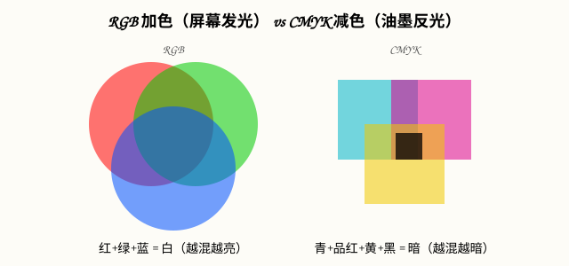

# 图片尺寸、格式与色彩管理（Photoshop 2026）

## 本篇导读
这篇是开档第一课：新建画布时分辨率填多少、屏幕图和印刷图差在哪、RGB 和 CMYK 怎么选、最后存成什么格式。手写笔记里的老规矩（屏幕 72PPI / 印刷 300PPI、PSD 存档、JPG 流传、PNG 透明）在 Photoshop 2026（v27.x，截至 2026-09 最新 27.11）里全部照旧，只是导出菜单和可选格式更新了。照着本篇点，建错画布、导错格式这类低级错误可以一次都不犯。

## 本篇目录
- [2026 变化概览](#2026-变化概览)
- [一、分辨率：屏幕 72 / 印刷 300](#一分辨率屏幕-72--印刷-300)
- [二、色彩模式：RGB 与 CMYK](#二色彩模式rgb-与-cmyk)
- [三、位深：8bit = 256 级](#三位深8bit--256-级)
- [四、图像大小 vs 画布大小](#四图像大小-vs-画布大小)
- [五、格式选择：PSD / JPG / PNG / WebP / GIF](#五格式选择psd--jpg--png--webp--gif)
- [六、2026 导出操作与路径](#六2026-导出操作与路径)
- [七、历史记录与工作区：纠错和界面复位](#七历史记录与工作区纠错和界面复位)

## 2026 变化概览
- 导出菜单整合为：**文件 → 导出 → 快速导出为 PNG** / **文件 → 导出 → 导出为…**（格式、尺寸、画布可一次调）/ **文件 → 导出 → 存储为 Web 所用格式（旧版）**（27.7 起对话框已现代化改版，GIF 动画仍走这里）。
- **WebP** 已成「导出为」里的一等格式，网页配图默认它，体积比 JPG 小约 30%。
- 首选项路径仍为：**Photoshop 菜单/编辑 → 首选项**（Mac 在顶部菜单栏 Photoshop 名下，Windows 在编辑菜单里）。

## 一、分辨率：屏幕 72 / 印刷 300
手写笔记的老口诀，2026 年仍然成立：

| 用途 | 分辨率 | 新建画布建议 |
|---|---|---|
| 屏幕/网页/手机壁纸/海报屏显 | **72 PPI** | 按像素建，如 1920×1080 px |
| 印刷（喷绘、写真、书刊） | **300 PPI** | 按厘米建，如 A4 = 21×29.7 cm |

操作：**文件 → 新建**，右侧「分辨率」处填 72 或 300，单位选 PPI；下面的「颜色模式」跟着第二节选。

> 实操经验（手写笔记原话保留）：压缩过的小图再拉大，**必须等比缩放**，否则画面失真；先等比放大再想细节，别直接拖框拉变形。

## 二、色彩模式：RGB 与 CMYK
路径：**图像 → 模式**。

| 模式 | 原理 | 用在哪 | 备注 |
|---|---|---|---|
| RGB 颜色 | 红/绿/蓝三原色**加色混合**，屏幕自发光 | 网页、手机、屏显海报、电商图 | 默认 8 位/通道，日常全部用它 |
| CMYK 颜色 | 青/品红/黄/黑**减色混合**，靠油墨反光 | 送印刷厂的最终文件 | 屏幕显示会发灰，别在 CMYK 模式下精修颜色 |
| 灰度 | 无彩色 | 黑白稿、熊猫头表情包 | 去色后再做对比拉色阶 |

> 经验：**先 RGB 做图、最后一次性转 CMYK**（图像→模式→CMYK 颜色），转完用 **窗口 → 校样颜色**（Ctrl+Y）软打样看看印刷色差，别一上来就建 CMYK 画布。

## 三、位深：8bit = 256 级
- 路径：**图像 → 模式 → 8 位通道**（也有 16 位/32 位）。
- 位数越高，可显示的色彩种数越多。日常做图 **8bit 就够**——单通道 2⁸ = 256 级亮度，三通道组合约 1677 万色。
- 16 位留给专业 raw 精修；普通学员和商业出图 8 位是默认值，不用纠结。

## 四、图像大小 vs 画布大小
两个菜单都在 **图像** 下，功能完全不同，手写笔记特意标了区别：

| 菜单 | 作用 | 重采样 | 口诀 |
|---|---|---|---|
| **图像 → 图像大小** | 改「图片内容本身」的像素尺寸 | 改像素尺寸时勾选「重新采样」；只想改分辨率不改变画布尺寸时不勾 | 改图大小用它 |
| **图像 → 画布大小** | 改「画纸」大小，内容不缩放，四周留白或裁切 | —— | 改画布用它，记得勾「相对」 |

- **图像 → 图像旋转**：旋转的是整个画布+内容。
- 裁剪工具拖框时框可以拉大到画布外，自动按背景色补边——做超长图、拼壁纸常用。
- **九宫格切片**：用切片工具把大图按行列划成多块、逐块导出（网页切图常用），具体手势见 [图层与智能对象](./图层与智能对象.md)「五、裁剪、拉直与切片」。

## 五、格式选择：PSD / JPG / PNG / WebP / GIF
| 格式 | 特点 | 什么时候存 |
|---|---|---|
| **PSD** | PS 源文件，保留全部图层/智能对象/蒙版 | 每做完一个阶段必存，是「原创者证据文件」 |
| **JPG** | 有损压缩、流传最广、兼容性最好 | 交作业、发客户预览、朋友圈大图 |
| **PNG** | 带 Alpha 透明通道、无损 | 图标、贴纸、抠好的透明底素材 |
| **WebP** | 体积比 JPG 小约 30%，支持透明 | 网页配图、小程序图（2026 首选网页格式） |
| **GIF** | 256 色动画 | 表情包、动图（导出见《GIF 动图与动态海报》） |

> 经验：导出 JPG 时**一定要开预览**，边拖品质滑块边看文件大小和画质的平衡点；PSD 永远留底，版权归原创者，交付时才出 JPG/PNG 成品。

> 补充（手写笔记）：PNG 在网页上显示时可勾选**「交错/隔行（Interlaced）」**——大图在加载过程中由模糊到清晰逐步显现，观感更好；但隔行会略增体积，小图标类 PNG 不必开。

## 六、2026 导出操作与路径
1. **快速出一张网图**：文件 → 导出 → 快速导出为 PNG（默认存 PNG，可在 **编辑 → 首选项 → 增效工具/导出** 里把默认格式改成 WebP）。
2. **要调格式/体积**：文件 → 导出 → 导出为…，左侧选 PNG/JPG/WebP/GIF，右侧调尺寸、品质，右侧直接看预估文件大小。
3. **做 GIF 动画**：文件 → 导出 → 存储为 Web 所用格式（旧版），格式选 GIF、循环选项选「永久」。
4. **存源文件**：Ctrl+S，默认 PSD；文件超 2GB 自动存 PSB（大文档格式）。

## 七、历史记录与工作区：纠错和界面复位
- **历史记录面板**（窗口 → 历史记录）：做错一步就点回去，可快速返回任意指定步骤，相当于无限级 undo。
- 界面右上角「工作区」下拉（手写笔记标为「右上角 PU 区」）：**可以新建自己的工作区、复位基本功能、新建布局**——面板被拖乱了就点「复位基本功能」一键还原。
- 缩放画布：Alt+滚轮；移动画面：空格+拖。

---
下一篇：[图层与智能对象](./图层与智能对象.md) —— 学会了建画布，下一步就是管图层。
