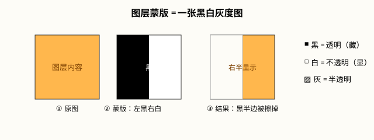

# 蒙版四种用法（Photoshop 2026）

## 本篇导读
蒙版的一句话口诀：**黑透、白不透、灰半透**。手写笔记这页把四种蒙版（图层蒙版/快速蒙版/矢量蒙版/剪贴蒙版）和画笔涂抹、停用启用、剪贴关系全记了下来。本篇按 2026 版整理成可照点的操作手册。配套阅读：[选区工具与AI抠图](./选区工具与AI抠图.md)。

## 本篇目录
- [2026 变化概览](#2026-变化概览)
- [〇、核心口诀：黑透白不透](#〇核心口诀黑透白不透)
- [一、图层蒙版（最常用）](#一图层蒙版最常用)
- [二、快速蒙版（临时选区模式）](#二快速蒙版临时选区模式)
- [三、矢量蒙版（路径定形）](#三矢量蒙版路径定形)
- [四、剪贴蒙版（倒过来的遮罩）](#四剪贴蒙版倒过来的遮罩)
- [五、四种蒙版对比速查](#五四种蒙版对比速查)
- [六、蒙版右键菜单与蒙版画笔手感](#六蒙版右键菜单与蒙版画笔手感)

## 2026 变化概览
- 蒙版体系 2026 年零改动，全部传统功能，🟢 免费可用、大陆无限制。
- 27.10 的 AI 辅助编辑器新增「蒙版限定编辑区域」玩法（🔴 生成式部分大陆不可用，见 [AI 工具与国产替代](../AI工具与国产替代.md)），底层仍是这套蒙版逻辑。

## 〇、核心口诀：黑透白不透
图层蒙版本质是一张黑白灰度图叠在图层右边：

| 蒙版上画的 | 图层显示效果 |
|---|---|
| **白** | 完全显示（不透） |
| **黑** | 完全隐藏（透过去） |
| **灰** | 半透明（羽化过渡） |

> 注意别和「遮罩/修边」搞混：遮罩是黑透白不透、作用于下一层；蒙版是黑透明、白保留，作用于当前层。

## 一、图层蒙版（最常用）
1. 选中图层 → 图层面板底部**添加蒙版按钮**（矩形带圆圈图标）。
2. 选中蒙版缩略图，用**黑色画笔涂抹 = 藏起来；白色画笔涂抹 = 恢复**。
3. **Alt 单击蒙版缩略图** = 切换到蒙版的黑白界面，直接在蒙版上画。
4. **按 D 复原前/背景黑白色板，按 X 快速切换黑白**——涂抹蒙版的标准姿势。
5. 画笔手感：**按住 Alt + 右键拖动 = 改笔刷大小；上下拖动 = 改硬度**。

蒙版右键菜单（手写笔记原话）：
- **取消链接**：缩略图和蒙版之间的锁链点掉，图层和蒙版可分开移动。
- **停用/启用蒙版**（Shift 单击缩略图也行）、**应用蒙版**（把效果永久扎进像素）、**删除蒙版**。

## 二、快速蒙版（临时选区模式）
- 左侧工具栏下方按钮（或按 **Q**）：切换「临时蒙版 / 选区」显示模式。
- 进入后**红色半透明 = 被挖去的部分**；用画笔涂红 = 把那部分排除出选区，涂白 = 加回。
- 退出 Q 后红色区域变回「未选中」——**它是临时的，不是最终效果**，用来精修选区最快。

## 三、矢量蒙版（路径定形）
1. **按住 Ctrl 键单击蒙版按钮**建立矢量蒙版（和普通蒙版的区别就在按 Ctrl）。
2. 确保选项栏在**路径模式**，用钢笔/形状工具画路径。
3. **路径所在位置 = 保留（显示）部分**，路径外全部隐藏。
4. 改形状：用直接选择工具（白箭头）拉锚点，缩放永远不糊——因为它是矢量。

## 四、剪贴蒙版（倒过来的遮罩）
- 手势：**按住 Alt，移到两个图层的交界处单击**（或右键上层图层 → 创建剪贴蒙版）。
- 关系：**上层是图、下层是形状**——上层内容只在下层形状的范围内显示，超出部分裁掉。
- 口诀：**倒过来的遮罩，只作用于下一层的形状**。
- 典型用途：渐变/图案/照片往一个文字或形状里「装进去」；调整图层（色阶/曲线）只压一层而不是整图。

## 五、四种蒙版对比速查
| | 图层蒙版 | 快速蒙版 | 矢量蒙版 | 剪贴蒙版 |
|---|---|---|---|---|
| 性质 | 永久、非破坏 | 临时选区 | 永久、矢量 | 两层绑定关系 |
| 工具 | 画笔/渐变 | Q 模式画笔 | 钢笔/形状 | Alt 点交界 |
| 显示逻辑 | 白显黑藏 | 红色=挖去 | 路径内显示 | 上层图装进下层形状 |
| 典型场景 | 融合两张图、擦背影 | 精修选区 | 图标/Logo 定形 | 照片装进文字、调整层限层 |

## 六、蒙版右键菜单与蒙版画笔手感
- 选区上右键 → **选择并遮住**，进修边面板调边缘，完事可直接「输出为带蒙版的选区」。
- 路径也可以**对齐/外对齐内对齐**（和描边对齐一个道理）。
- 做旧风：拿不规则笔刷在蒙版上乱画，边缘就毛了。
- 调色篇用到的「调整图层 + 蒙版」：调整图层自动带蒙版，画笔一涂哪里不想调就藏哪里。

---
上一篇：[选区工具与AI抠图](./选区工具与AI抠图.md) ｜ 返回目录：[AI 工具与国产替代](../AI工具与国产替代.md)
