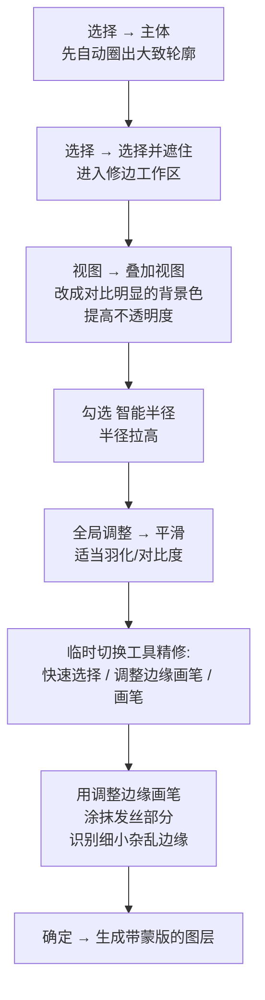
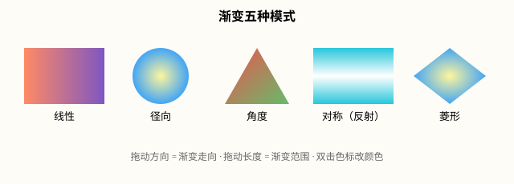

# 选区工具与 AI 抠图（Photoshop 2026）

## 本篇导读
抠图是 PS 第一大高频场景。手写笔记把它拆成三层：手动选区（选框/套索）→ 半自动（快速选择/魔棒/色彩范围）→ AI（对象选择/选择主体/选择并遮住），最后给了一张「什么图用什么招」的速查表，外加渐变填充的完整用法。本篇按 2026 版菜单重写，并把每个 AI 功能的费用与大陆可用性标清楚。配套阅读：[蒙版四种用法](./蒙版四种用法.md)、[图层与智能对象](../01-基础入门/图层与智能对象.md)。

## 本篇目录
- [2026 变化概览](#2026-变化概览)
- [一、选框与套索：手动选区基本功](#一选框与套索手动选区基本功)
- [二、布尔运算：并集/差集/交集](#二布尔运算并集差集交集)
- [三、快速选择 / 魔棒 / 色彩范围：半自动抠图](#三快速选择--魔棒--色彩范围半自动抠图)
- [四、AI 选区：对象选择 / 选择主体 / 选择并遮住](#四ai-选区对象选择--选择主体--选择并遮住)
- [五、Remove 工具与生成式填充：费用与大陆可用性](#五remove-工具与生成式填充费用与大陆可用性)
- [六、抠图方法速查表](#六抠图方法速查表)
- [七、渐变填充（色标五模式）](#七渐变填充色标五模式)
- [八、实战：剪贴画海报](#八实战剪贴画海报)

## 2026 变化概览
- **对象选择工具**仍是默认首发工具，悬停即识别主体，框一下就选中。
- **选择 → 主体**：可在 **编辑 → 首选项 → 图像处理** 里把模型位置切到 **Device（本地设备，快、可离线）/ Cloud（云端，默认、质量更好）**——中国大陆账号用 Device 模式即可稳定出结果。
- 27.11（2026-09）起**选择并遮住**新增 **Enhance edge（AI 修边，RGBA 扩散，专攻毛发/半透明边缘）**。
- **Remove 工具** 27.7 起可用**本地设备模型**处理，0 积分不消耗。

## 一、选框与套索：手动选区基本功
| 工具 | 位置 | 用法要点（手写经验保留） |
|---|---|---|
| 选框工具（矩形/椭圆） | 左侧工具栏 | 画规矩形状；选区内右键可「变换选区」或变换选框内容，Enter 完成 |
| 多边形套索 | 套索组内 | **每单击一次新建一个锚点，Delete 撤销上一个点**；曲折处多加点、直线处少加点，让范围更贴合图像 |
| 磁性套索 | 套索组内 | 单击一下左键，沿边缘移动，套索**自动吸附生成锚点**，适合边缘清晰的物体轮廓 |
| 套索最后收尾 | —— | 最后一下按 **Enter** 让首尾相连闭合 |

> 规律背景去水印老办法：选框框住水印 → 右键 → **填充 → 内容识别**（传统功能，免费，大陆可用）。
> 双击图层空白处 = 打开「图层样式」窗口，单击特效名即添加；在图层上右键可**拷贝/粘贴图层样式**。

## 二、布尔运算：并集/差集/交集
在工具选项栏最左一排四个小方块，或直接用快捷键（新选区模式下）：

| 运算 | 快捷键 | 含义 |
|---|---|---|
| 新选区 | —— | 画新的，替换旧的 |
| 并集（加选） | **Shift** | 两次选区相加 |
| 差集（减选） | **Alt** | 从已有选区里挖掉 |
| 交集 | **Shift+Alt** | 只留重叠部分 |

实操口诀：**先大笔刷抠主体、小笔刷修细节，加选减选配合着来。**

## 三、快速选择 / 魔棒 / 色彩范围：半自动抠图
| 工具 | 原理 | 关键参数 | 适用 |
|---|---|---|---|
| **快速选择工具** | 点击目标区域，自动识别边缘生长选区 | **笔刷大小 = 识别的最小范围**；Alt+左右拖动右键调笔刷大小 | 边缘清晰的主体 |
| **魔棒工具** | 一次性点击选取相近颜色 | 选项栏「容差」调相似度（默认 32）；选完可 **选择 → 选取相似** 扩大 | 大面积纯色背景 |
| **色彩范围** | **选择 → 色彩范围**，吸管吸纯色背景，预览里白色=选中 | 改「容差/颜色容差」滑块 | 大面积纯色背景抠图 |

经验：
- 魔棒是**一次性**选取，快速选择是**可累加**的涂抹——用完魔棒再用快速选择（加选模式）修细节。
- 色彩范围**只考虑颜色、不考虑边缘**，缺点是边缘锯齿；解决：把背景调成灰色过渡（羽化/调整边缘）后再**反选**出主体。
- 抠图顺序：**先整体后细节**，或右键「选择反向」提效；背景单一可先抠出背景再反选主体。

## 四、AI 选区：对象选择 / 选择主体 / 选择并遮住
| 功能 | 路径 | 费用标签 | 大陆账号 |
|---|---|---|---|
| 对象选择工具 | 左侧工具栏（套索组上方） | 🟢 本地/含在订阅，不扣积分 | ✅ 可用 |
| 选择主体 | **选择 → 主体** | 🟢 不扣积分；Device 本地模式离线可用 | ✅ Device 模式可用；Cloud 模式依赖地区 |
| 选择并遮住 | 选区后上下文任务栏 → **选择并遮住** | 🟢 传统部分免费；27.11 Enhance edge 为 AI 新功能（计费/地区待确认） | ✅ 传统部分可用 |
| 移除工具 Remove | 左侧工具栏（修复画笔组内） | 🟢 **0 积分，不消耗积分**；27.7 起本地设备模型 | ✅ 工具本体可用（本地模型包待确认） |

### 发丝级抠图完整流程（手写笔记原流程，2026 版）

> 视图叠加色选和头发反差大的颜色（如纯红/纯绿），发丝才看得清；27.11 后 Enhance edge 可一键做 RGBA 扩散修边。

## 五、Remove 工具与生成式填充：费用与大陆可用性
| 功能 | 路径 | 费用标签 | 大陆账号 |
|---|---|---|---|
| Remove 工具 | 工具栏（修复画笔组） | 🟢 0 积分 | ✅ 可用 |
| 内容识别填充 | **编辑 → 内容识别填充** | 🟢 传统功能免费 | ✅ 可用 |
| 天空替换 | **滤镜 → 天空替换** | 🟢 传统 AI（Sensei）免费 | ✅ 可用 |
| 生成式填充 | 选区后上下文任务栏 → **生成式填充** | 💠 标准 1 积分/次；Firefly Image 5 = 10 积分/次；合作模型另计 | 🔴 不可用 |
| 生成式扩展 | 裁剪工具拖大画布边缘 → 上下文任务栏 | 💠 同上 1 积分/次起 | 🔴 不可用 |
| AI 辅助编辑器（Beta） | 上下文任务栏自然语言指令 + 圈画标记 | 💠 按所选模型扣积分 | 🔴 不可用 |

> 中国大陆账号的抠图替代路线：Device 模式选择主体 + 选择并遮住 + Remove 工具 + 内容识别填充，这套本地组合完全不碰生成式 AI；需要「一句话换背景/文生图补图」时，见 [AI 工具与国产替代](../AI工具与国产替代.md)。

## 六、抠图方法速查表
| 图长什么样 | 用什么 |
|---|---|
| 边缘清晰、轮廓规整 | **快速选择工具**（大笔刷起手，小笔刷修边） |
| 背景大面积纯色 | **色彩范围**（吸背景→改容差→反选）；魔棒做辅助 |
| 轮廓模糊、有头发丝 | **选择主体 → 选择并遮住**（调整边缘画笔涂发丝） |
| 主体明确、一键即可 | **对象选择工具 / 选择主体（Device）** |
| 去路人、去杂物、去水印 | **Remove 工具** / 内容识别填充 |

## 七、渐变填充（色标五模式）
路径：左侧工具栏**渐变工具**（和油漆桶同组），选项栏选「线性/径向/角度/对称/菱形」渐变，属性面板/上下文任务栏编辑色标。

| 色标操作 | 手势 |
|---|---|
| 新建色标 | 渐变条下方**单击空白处** |
| 移动色标 | 左右拖拽 |
| 改颜色 | 双击色标 |
| 删除色标 | 向外拖走 |
| 不透明度色标 | 渐变条**上方**单击空白处 |

- **填充方法**：左键按住拖一根长线——**方向 = 渐变走向，长度 = 渐变范围**。
- 效果与：渐变模式 + 拖动方向 + 长度 三者都有关。
- 2026 特性：**参数化渐变（Live Gradient）**，拖出渐变线后实时预览、可非破坏式再编辑。
- 建筑摄影后期常用：为建筑物**替换天空 / 换渐变背景**（这也是手写笔记原文）。

## 八、实战：剪贴画海报
1. **多边形套索抠出目标 → Ctrl+C 复制**。
2. 新建一层，在原抠出目标**外一圈更大范围**的选区里右键**填充白色**，对这层加**投影**。
3. **链接两层**，重复上述步骤抠多个目标摆放到对应位置。
4. 调整阴影角度时可**取消「使用全局光」**，让每个投影方向独立。
5. 不规则小元素：新建图层 → 套索画形状 → 填充单一颜色即可。
6. 文字想要的效果：用**并集一笔一画描**出来，或用差集做缺口。

---
上一篇：[图层与智能对象](../01-基础入门/图层与智能对象.md) ｜ 下一篇：[蒙版四种用法](./蒙版四种用法.md)
