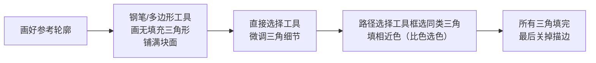
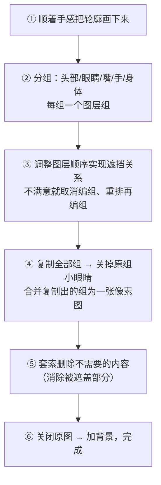
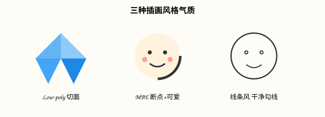

# 插画实战：Low-poly / MBE / 线条风（Photoshop 2026）

## 本篇导读
三种商业插画风格，全是用前面学的钢笔、形状、蒙版拼出来的：Low-poly（三角块面）、MBE（粗轮廓带断点、错位填色）、线条风（分而治之、图层遮挡）。本篇把手写笔记里三种风格的完整步骤整理成流水线，2026 菜单路径已校准。配套阅读：[钢笔与形状工具](./钢笔与形状工具.md)。

## 本篇目录
- [2026 变化概览](#2026-变化概览)
- [一、通用工具箱](#一通用工具箱)
- [二、Low-poly 块面风](#二low-poly-块面风)
- [三、线条风插画](#三线条风插画)
- [四、MBE 风格插画](#四mbe-风格插画)
- [五、三风格对比速查](#五三风格对比速查)

## 2026 变化概览
- 全部矢量/栅格混合手工技法，🟢 传统功能免费、大陆无限制。
- 通用升级点：形状图层编组后复制 → **转智能对象 → 加滤镜**，杂色/模糊全部变非破坏式，随时可调。

## 一、通用工具箱
| 动作 | 路径/手势 |
|---|---|
| 磨砂/噪感质感 | **滤镜 → 杂色 → 添加杂色**（选「高斯分布/单色」，数值按需） |
| 图形内部复制形状 | 路径选择工具 + **Alt 拖**（同图层内复制，再走布尔运算） |
| 编组 | 选中图层 Ctrl+G；调整顺序实现遮挡关系 |
| 背景 | 吸管吸取参考图主色作底色，统一调性 |

> 手写笔记总结论：**几何图形组合 + 渐变填充 + 添加杂色，是插画和海报设计中最常见的三板斧。**

## 二、Low-poly 块面风
特点：把颜色相近的块面用**三角形**一块块替代。

要点：三角形要「无缝对齐」相邻边；先全部画完无色块面，再逐个路径填色；描边最后统一关。

## 三、线条风插画
核心心法（手写原话）：**分而治之、遮挡与顺着感画。**

## 四、MBE 风格插画
**风格特点**（手写笔记原文提炼）：
- 轮廓线**较粗、且有故意的中断/断点**；
- 颜色**明快、有错位**（色块微微错开轮廓）；
- 点缀和表情**可爱**（小圆点腮红、豆豆眼）。

**制作步骤：**
1. 用基本形状拼装出整体轮廓；
2. 合并图层、合并形状组件（路径选择工具，选项栏「合并形状组件」）；
3. 复制一层轮廓，修剪出断点位置；
4. 加断点（在线段上开缺口）；
5. 填充颜色并做错位处理（色块偏移轮廓线一点）；
6. 加点缀（腮红、表情、小符号）；
7. 属性面板细调；编组 → 复制 → 转智能对象 → 加杂色滤镜收尾。

## 五、三风格对比速查
| | Low-poly | MBE | 线条风 |
|---|---|---|---|
| 视觉特征 | 三角块面切面感 | 粗轮廓断点、错位填色、可爱表情 | 干净单线勾线、平涂 |
| 主用工具 | 钢笔/多边形、路径填色 | 形状工具、合并形状组件、断点 | 钢笔/形状 + 图层分组遮挡 |
| 典型场景 | 海报背景、科技封面 | 运营插画、表情包、品牌 IP | 插画小图、贴纸、长图配文 |
| 收尾动作 | 关描边 | 智能对象+杂色 | 合并组+套索修边 |

---
上一篇：[钢笔与形状工具](./钢笔与形状工具.md) ｜ 下一篇：[字体排版与海报设计](../04-文字与排版/字体排版与海报设计.md)
