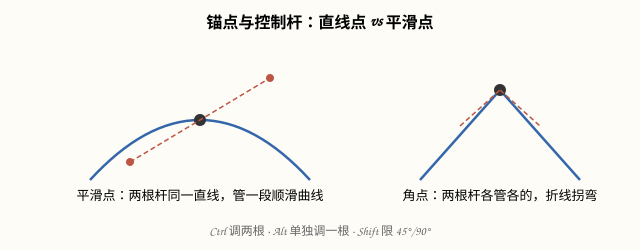

# 钢笔与形状工具（Photoshop 2026）

## 本篇导读
钢笔是 PS 里最「硬」的工具：它画的不是像素，是路径——**由属性定义、与像素无关、可无限放大**。手写笔记这页从矢量概念讲到锚点、控制杆、转换点工具，口诀全在里面（Ctrl 调两根、Alt 调一根、Shift 规范 45°）。形状工具组是钢笔的懒人版。配套阅读：[插画实战-Lowpoly-MBE-线条风](./插画实战-Lowpoly-MBE-线条风.md)。

## 本篇目录
- [2026 变化概览](#2026-变化概览)
- [一、矢量 vs 像素](#一矢量-vs-像素)
- [二、钢笔工具基本功](#二钢笔工具基本功)
- [三、锚点与控制杆：钢笔进阶](#三锚点与控制杆钢笔进阶)
- [四、路径选择 vs 直接选择](#四路径选择-vs-直接选择)
- [五、形状工具组](#五形状工具组)
- [六、描边与对齐](#六描边与对齐)

## 2026 变化概览
- 钢笔/形状体系 2026 零改动，全部传统功能，🟢 免费、大陆无限制。
- 27.6 起 Dynamic Text（文字沿形状路径流动排版）可与矢量路径联动（见 [字体排版与海报设计](../04-文字与排版/字体排版与海报设计.md)）。

## 一、矢量 vs 像素
| | 矢量图形 | 像素图形 |
|---|---|---|
| 定义方式 | 由锚点+路径+属性定义 | 像素点阵 |
| 放大 | 无限放大不糊 | 放大就糊 |
| 对应图层 | 形状图层（自带填充+描边属性） | 普通像素图层 |

## 二、钢笔工具基本功
1. 左侧工具栏选**钢笔工具**，选项栏模式选 **「形状」**（不是路径/像素）——画出来的图形同时有**填充**和**描边**两大属性。
2. **单击 = 创建锚点**，锚点之间自动由路径相连。
3. 选项栏「齿轮/橡皮带」打开后，下一段路径会实时预览。
4. 绘制时**沿用属性**：单击一下已有的形状图层，就在同层里接着画（新建一层再点则新开图层）。
5. 复制形状改局部：Ctrl+T 自由变换；撤回错锚点：Ctrl+Z。
6. **路径选择工具（黑箭头）**：单击选中**整个形状**；**直接选择工具（白箭头）**：精确选单个锚点。画布上按住 **Ctrl** 单击 = 临时切换到直接选择。

## 三、锚点与控制杆：钢笔进阶
- **每个锚点带两根控制杆**：控制杆与曲线在该点的曲率有关——**越长，曲线越偏离直线**。
- 调杆手势（手写口诀原样）：

| 手势 | 作用 |
|---|---|
| 钢笔下按住 **Ctrl** | 调出直接选择工具，调**两根**控制杆 |
| 按住 **Alt** | 激活转换点工具，单独调**某一根**控制杆（做角点/圆弧切换） |
| 按住 **Shift** | 规范路径与控制杆角度（限 45°/90°） |
| 单击拖出 | 单击建锚点并**拖拽 = 同时拖出控制杆** |

- **转换点工具**（Alt 单击锚点）：切换控制杆的「开启/关闭」= 圆弧点 ⇄ 直角点（拖出控制杆后按 Alt 激活）。
- **锚点少而精**：<180° 或半径小的圆弧，只在**两端**建锚点；更大的圆弧，划分成一段段小圆弧来画。

## 四、路径选择 vs 直接选择
| 工具 | 样子 | 选择范围 | 用途 |
|---|---|---|---|
| 路径选择工具 | **黑箭头** | 整个形状/整段路径 | 移动、整体改参数、对齐 |
| 直接选择工具 | **白箭头** | 单个锚点/一段路径 | 微调造型、拉控制杆 |

> 路径选择工具 **+ Alt 拖** = 在**同一图层内部复制形状**，再走布尔路径操作（类似选区加减）拼复杂图形。

## 五、形状工具组
同组右键展开：

| 工具 | 独特属性 | 口诀 |
|---|---|---|
| 矩形工具 | —— | 按住 Shift 画正方形 |
| 圆角矩形 | **圆角半径**可调 | 属性面板输半径数值 |
| 椭圆工具 | —— | 按住 Shift 画**正圆** |
| 多边形工具 | 边数 + **星形**勾选 | 画星星、徽章 |
| 直线工具 | **箭头**起点/终点 | 画流程图箭头 |
| 自定形状工具 | **矢量图形库** | 蝴蝶、箭头、符号随选 |

- 形状画完在**属性面板**里逐项细调；想批量加质感：编组 → 复制 → 转智能对象 → 加滤镜（见下一篇插画实战）。

## 六、描边与对齐
- 填充属性里有**图案填充**、渐变填充；描边属性里有**对齐方式**：
  - **内部对齐** = 描边画在形状内部边界内（类似 HTML 表单 input 的外对齐 button 的内对齐，手写笔记里拿网页打了比方）。
- 多个形状对齐：黑箭头多选 → 选项栏点对齐按钮；间距用「分布」（同图层内路径也可对齐）。

---
上一篇：[蒙版四种用法](../02-选区抠图与蒙版/蒙版四种用法.md) ｜ 下一篇：[插画实战-Lowpoly-MBE-线条风](./插画实战-Lowpoly-MBE-线条风.md)
