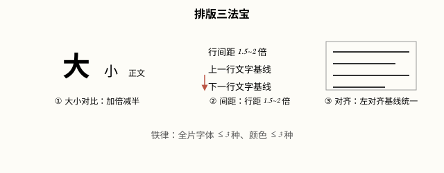
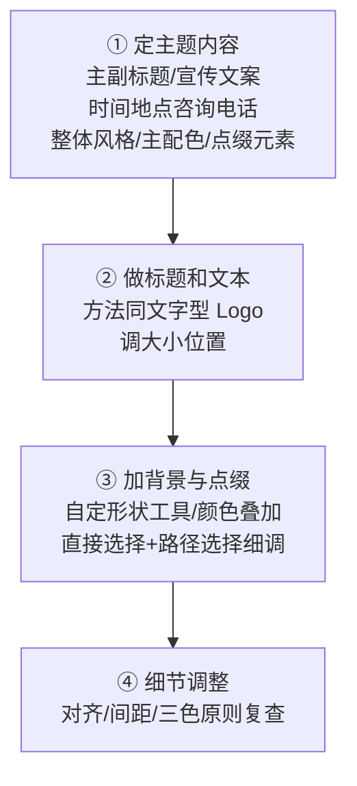

# 字体排版与海报设计（Photoshop 2026）

## 本篇导读
手写笔记这五页讲了两件事：字体怎么选怎么排（衬线/非衬线、排版三法宝、字符面板、文字转形状、Logo、沿路径排字），以及一张海报从无到有的完整流水线（规格、版式、四步制作、改规格复用）。本篇按 2026 菜单整理，全部口诀保留。

## 本篇目录
- [2026 变化概览](#2026-变化概览)
- [一、字体基础：衬线/非衬线与场景](#一字体基础衬线非衬线与场景)
- [二、排版三法宝](#二排版三法宝)
- [三、字符面板精调](#三字符面板精调)
- [四、文字进阶：转形状 / 沿路径 / Logo](#四文字进阶转形状--沿路径--logo)
- [五、海报规格与版式](#五海报规格与版式)
- [六、海报制作四步流水线](#六海报制作四步流水线)
- [七、改规格复用](#七改规格复用)

## 2026 变化概览
- 27.9.1 起字符面板字体列表支持**收藏/恢复常用字体**；Adobe Fonts 随订阅个人+商用授权（🟢 免费含在订阅内；但字形本身不能注册商标，见版权提示）。
- 27.10 起**文字可沿形状路径动态流动排版**（Dynamic Text），沿路径排字比旧版更顺。

## 一、字体基础：衬线/非衬线与场景
| 字体类别 | 特点 | 适用 |
|---|---|---|
| 衬线体 | 笔画末端有装饰小角 | **正文**（阅读舒适） |
| 非衬线体 | 笔画干净利落 | **标题**（远看醒目） |
| 书法体 | 毛笔/笔触感 | 古风场景 |
| 卡通体 | 圆胖可爱 | 儿童场景 |
| 手写体 | 随性自然 | 抒情场景 |

> 版权提示：Adobe Fonts 随 CC 订阅可商用；免费商用字体走正规开源渠道（思源系列 SIL OFL、Google Fonts），**logo 里能用这些字，但字体字形本身不能去注册版权**。

## 二、排版三法宝
1. **大小对比**：遵循**加倍减半原则**——标题是正文的两倍大，别只大一点点（对比不明显=没对比）。
2. **间距调整**：行间距适合 **1.5~2 倍**；字间距微调（别贴死、也别散）。
3. **细节对齐**：不同文字块作为整体出现时，从居中对齐 → 两端对齐 → 行间距统一；少文字时优先看「组合起来的视觉效果」。

铁律：**同一作品中字体和颜色各不超过三种**，优先用「重复之美」（同一元素反复出现）。

操作细节：
- 文字工具拖一个框 = 限制文字区域；写完按 **Esc** 结束文本编辑。
- 文本属性面板可选「缩放/镜像」。

## 三、字符面板精调
窗口 → 字符（字符面板）：

| 选项 | 作用 |
|---|---|
| 字符间距（字距） | 整段文字的松紧 |
| 字偶间距 | 选中两个字符后微调；选「视觉」自动处理 Lr / Tr / Ty / Wa 这类组合 |
| 基线偏移 | 单个字上下抬/压 |

## 四、文字进阶：转形状 / 沿路径 / Logo
### 主题字（艺术字）三种做法
做海报主标题/定制字时，按「想要的自由度」从低到高三选一：

| 方法 | 做法 | 适合 |
|---|---|---|
| ① 单层排版 | 同一个文字层内**换行**，配合**基线偏移**、字距微调做出错落 | 规整标题、不想拆层 |
| ② 逐字分层 | **每个字一个独立文字层**，分别摆位置、大小、旋转 | 错落书法字、海报主标题 |
| ③ 转形状 | 拷贝备份后右键**转换为形状**，用直接选择工具改笔画锚点 | Logo、笔画重合、夸张定制字 |

### 文字转形状
- 文字图层**拷贝备份一份**，右键原图层 → **转换为形状**（等同「栅格化后再路径化」，但更干净）。
- 转完用**直接选择工具（白箭头）**单独调每个字符的锚点——做笔画重合、夸张变形、字标 Logo。
- 书法体排版玩法：纵向**大小不一、错落有致**；横向**由大到小再到大**，造气势。

### 沿路径排文字
1. 钢笔画一条路径；
2. 选文字工具，**贴到路径上**点击输入文字；
3. 调大小间距；
4. 调文字范围和方位：路径上出现 ×○ 标记，**按住 Ctrl 键（黑箭头）拖动小叉**挪文字起点/终点；直接选择工具改路径曲线。

### 文字型 Logo 四步
定内容与风格 → 选字体 → 调大小位置 → 加点缀。Logo 三原则：**简洁 / 明了 / 别具一格**；分图案型与文字型两类。文字型要**紧凑一点**，配合栅格选区对齐。

## 五、海报规格与版式
常见印刷规格（新建画布按厘米建，300 PPI）：

| 规格 | 用途 |
|---|---|
| 40×57 cm | 小型海报/活动张贴 |
| 50×70 cm | 标准海报 |
| 60×90 cm | 大型张贴 |

屏显版统一 72 PPI。

| 版式 | 文字占比 | 图片占比 | 用途 |
|---|---|---|---|
| 图文版 | 字 ≈50% | 图 >90% | 促销、派对、电影 |
| 纯文字版 | 文字 >90% | 图 <10% | 艺术展、相亲活动 |
| 留白版 | 字 <10% | 图 ≈50%+大量留白 | 活动预告、倒计时 |

## 六、海报制作四步流水线

## 七、改规格复用
一套海报做完，改规格换皮就是别的物料：**视频封面、邀请函、贺卡、立式易拉宝、banner 横幅**——主题文字层不动，背景按新比例重排即可。

---
上一篇：[插画实战-Lowpoly-MBE-线条风](../03-矢量与插画/插画实战-Lowpoly-MBE-线条风.md) ｜ 返回根目录：[AI 工具与国产替代](../AI工具与国产替代.md)
