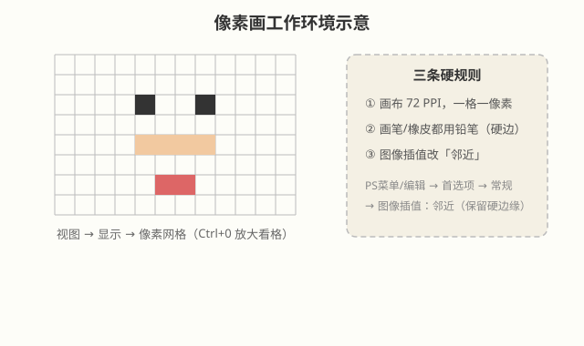

# 像素画

## 本篇导读
像素画是"反缩放"的画法：故意把画面拆成一颗一颗可见的小方块，靠硬边缘和纯色块造型。它和普通数位绘画最大的区别不在画技，而在**工作环境设置**——画布分辨率、像素网格、铅笔工具、图像插值，四样东西设对了，像素画才立得住。本篇内容精炼，照着配置一遍即可开工。

## 本篇目录
- [2026 变化概览](#2026-变化概览)
- [一、什么是像素画](#一什么是像素画)
- [二、像素画四件套设置](#二像素画四件套设置)
- [三、绘画流程](#三绘画流程)
- [四、常见坑](#四常见坑)

## 2026 变化概览
- 像素画依赖的全是传统功能（像素网格、铅笔工具、邻近插值），Photoshop 2026（v27.x）菜单路径与旧版一致，无 AI 改动、不扣费。
- 需注意：**不要开任何生成式 AI 功能去"补全"像素画**——AI 出图默认会柔化边缘，毁掉硬边风格（生成式填充本身在大陆也不可用 🔴，详见 [AI工具与国产替代](../AI工具与国产替代.md)）。

---

## 一、什么是像素画
把屏幕上的每个像素当成一块不可再分的小方砖，一格一色、硬边过渡，靠有限的色块拼出形象。复古游戏、独立游戏美术、贴纸图标都走这条路。

## 二、像素画四件套设置

| 序号 | 设置项 | 菜单路径 | 作用 |
|---|---|---|---|
| ① | 画布 72 PPI | 新建文件时分辨率填 72 | 屏幕原生像素密度，一格=一像素 |
| ② | 打开像素网格 | **视图 → 显示 → 像素网格**；再按 `Ctrl+0` 放大窗口 | 放大后看到对齐每一格的网格线 |
| ③ | 硬边铅笔 | 画笔工具里选**铅笔**项；橡皮切到**铅笔模式** | 画出无羽化的方头笔刷 |
| ④ | 图像插值改"邻近" | **Photoshop菜单/编辑 → 首选项 → 常规 → 图像插值：邻近（保留硬边缘）** | 放大缩小时不做模糊插值，边缘保持锯齿硬边 |

> 手写笔记要点：原来默认是"两次立方（自动）"，做像素画必须改成"邻近"，否则一拉大就糊。

## 三、绘画流程
1. 新建小尺寸画布（如 64×64、128×128 像素，72 PPI）；
2. `Ctrl+0` 或滚轮放大到像素网格清晰可见；
3. 选铅笔工具，选色板上的纯色，一格一格点；
4. 造型顺序：先剪影轮廓 → 再暗部 → 最后高光点缀色；
5. 导出 PNG 时**不要缩放**，需要放大展示时整体整数倍放大（2×、4×），并保持邻近插值。

> 两个手写小习惯：
> - 外轮廓若用**钢笔路径**来勾，勾完先把路径的**描边/填充删掉、再到路径面板删除工作路径**，然后转成选区填色，边缘才干净（手法详见 [画笔笔刷与数位绘画·让线条变流畅的三种方法](./画笔笔刷与数位绘画.md#九让线条变流畅的三种方法)）；
> - 调好的像素色**先存到色板**上，整张图固定那套少色板反复取用，不要边画边临时挑色。

## 四、常见坑
- **用了软边画笔** → 边缘糊掉，立刻换铅笔；
- **忘了改插值** → 缩过一次图就永久发虚，所以源文件永远保留像素级原始稿；
- **颜色太多** → 像素画靠少色板取胜，先定 8~16 色限制自己。

---

相关阅读：
- 画笔参数与数位绘画完整流程：[画笔笔刷与数位绘画](./画笔笔刷与数位绘画.md)
- 色彩模式与位深基础：[图片尺寸格式与色彩管理](../01-基础入门/图片尺寸格式与色彩管理.md)
