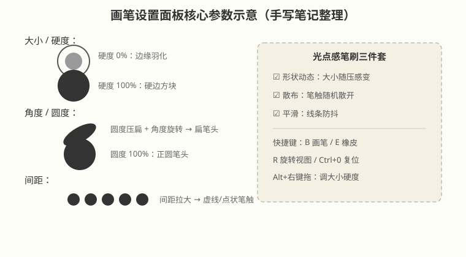
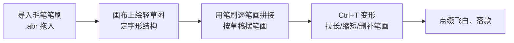

# 画笔笔刷与数位绘画

## 本篇导读
画笔是 Photoshop 里最"像真笔"的工具：改一个硬度、调一下流量，画出来的东西气质完全不同。本篇把手写笔记里的实操经验整理成两部分：一是笔刷本身怎么调、怎么装、怎么自己做一支；二是拿笔刷画画的完整流程（简笔卡通、四格漫画、粉笔插画、书法字拼接）。所有传统画笔功能在 Photoshop 2026（v27.x）里照常使用，不涉及 AI 扣费。

## 本篇目录
- [2026 变化概览](#2026-变化概览)
- [一、画笔设置面板：六个核心参数](#一画笔设置面板六个核心参数)
- [二、导入、自定义与导出笔刷](#二导入自定义与导出笔刷)
- [三、不透明度 vs 流量（最容易混的一对）](#三不透明度-vs-流量最容易混的一对)
- [四、光点感笔刷三件套](#四光点感笔刷三件套)
- [五、实战一：毛笔笔刷拼接书法字](#五实战一毛笔笔刷拼接书法字)
- [六、实战二：简笔卡通四步走](#六实战二简笔卡通四步走)
- [七、实战三：四格漫画](#七实战三四格漫画)
- [八、实战四：漫画转粉笔插画](#八实战四漫画转粉笔插画)
- [九、让线条变流畅的三种方法](#九让线条变流畅的三种方法)
- [十、辅助功能：对称、旋转视图、快捷键速查](#十辅助功能对称旋转视图快捷键速查)
- [十一、笔刷的另类用法（蒙版/涂鸦/橡皮）](#十一笔刷的另类用法蒙版涂鸦橡皮)

## 2026 变化概览
- 画笔设置面板、画笔面板、导入 `.abr`、自定义画笔预设这些核心操作在 Photoshop 2026（v27.x，最新 27.11）中全部沿用，菜单路径与旧版一致。
- 2026 这一年的大改都在 AI 方向（生成式填充、AI 辅助编辑器等），画笔本体没有颠覆性变化；传统画笔功能不消耗任何积分。
- 数位板压感、平滑（ Stabilizer ）等绘画体验随驱动与版本持续优化，属传统功能，免费使用。

---

## 一、画笔设置面板：六个核心参数

菜单路径：**窗口 → 画笔设置**（或选中画笔工具后按 F5）。面板里勾选不同选项即可修改画笔效果，核心参数：

| 参数 | 作用 | 典型用法 |
|---|---|---|
| 大小 | 笔头直径 | 画大面用大笔刷，勾细节换小笔刷 |
| 硬度 | 边缘羽化程度 | 硬度 0% 边缘柔和；100% 是硬边方块 |
| 角度 | 笔头旋转角度 | 配合扁圆度画侧锋笔触 |
| 圆度 | 笔头压扁程度 | 100% 正圆，压扁后像毛笔/钢笔尖 |
| 间距 | 相邻笔触的间隔 | 拉大间距 → 点状、虚线笔触 |
| 形状动态/散布/平滑 | 压感与随机变化 | 画光点、灰尘、飘散颗粒感 |

> 手写笔记口诀：**"大小、硬度、角度、圆度、间距"**——调笔先从这五项入手。

## 二、导入、自定义与导出笔刷

### 2.1 导入外部笔刷（.abr）
把 `.abr` 文件**直接拖到画笔面板/画笔设置面板**里即可，笔刷自动出现在列表末尾。

### 2.2 自己做一支笔（自定义画笔预设）
1. 在画布上画好/选好要做成笔刷的形状（黑底图形效果最好）；
2. 按住 `Ctrl` 单击图层面板里该图层的**小预览缩略图**，载入选区；
3. 菜单 **编辑 → 定义画笔预设**，起名保存。

### 2.3 导出笔刷分享
画笔面板菜单（右上角齿轮/三横线）→ **导出选中的画笔**，存成 `.abr` 发给别人，对方按 2.1 拖入即可。

## 三、不透明度 vs 流量（最容易混的一对）

| 项目 | 不透明度 | 流量 |
|---|---|---|
| 叠加性 | **单笔下不可叠加**（一笔涂到底浓度封顶） | **可叠加**，笔边走边积色，像喷漆 |
| 想叠加怎么办 | 松手、再涂一笔，多笔涂抹即可叠上去 | 不用松手，慢速多走两圈自动加深 |
| 记忆口诀 | 不透明度 = 整笔浓度上限 | 流量 = 上色的速度 |

> 手写笔记原话："两者效果差不多，区别在于后者（流量）可叠加，前者（不透明度）不可叠加；不透明度使用多笔涂抹则可以达到叠加效果。"

## 四、光点感笔刷三件套
在画笔设置面板里勾选三项：
- **形状动态**：笔触大小随压感/速度变化；
- **散布**：笔触随机散开，不画成死板一条线；
- **平滑**：线条防抖，画得稳。

三个一起开，光点、灰尘、烟花、粒子涂鸦都能画。

## 五、实战一：毛笔笔刷拼接书法字

流程：**导入笔刷 → 绘草图 → 笔画拼接 → 变形/增减 → 加点缀**

> 手写笔记心得：**笔刷拼接与书法字体结合，对一些关键笔画做替换，可以提高效率而且更有气势。**

## 六、实战二：简笔卡通四步走

**绘制草图 → 勾勒轮廓 → 分层上色 → 添加细节**

1. 草图：线可以草，把动作和比例定下来；
2. 轮廓：换干净图层勾线，线条一笔到底；
3. 分层上色：一个部位一个图层（脸一层、衣服一层），方便改色；
4. 细节：腮红、高光、小表情最后加。

## 七、实战三：四格漫画

**塑造角色 → 绘制框格 → 放入角色 → 制作文字 → 添加细节**

1. 先把主角造型定死（后面四格都长一个样才好笑）；
2. 用矩形/直线画出 2×2 框格；
3. 复制角色贴进每一格，改动作和表情；
4. 加对话气泡和文字；
5. 最后统一调整细节和阴影。

## 八、实战四：漫画转粉笔插画

**调低参考图透明度 → 导入粉笔笔刷 → 勾勒轮廓 → 分层上色 → 添加细节**

1. 把漫画参考图放最底层，图层不透明度降到 30% 左右当描底稿；
2. 新建图层，导入粉笔质感 `.abr`；
3. 沿参考勾轮廓；
4. 分层铺色，粉笔笔刷自带颗粒感；
5. 补高光和投影。

## 九、让线条变流畅的三种方法

手写笔记总结的三招，按顺手程度排：

1. **调高平滑**：画笔工具选项栏把"平滑"数值拉高（如 30%~50%），手抖自动修正；
2. **Shift 直线**：单击起点、按住 `Shift` 再单击终点，两点之间出一条笔直连线；
3. **钢笔路径 + 画笔描边**：用钢笔勾出轮廓路径，路径面板里**用画笔描边路径**，画完删掉工作路径——适合要求绝对顺滑的长线。

> 笔记补充：钢笔用路径绘制轮廓后，记得**删除路径描边/填充、删除工作路径**，不然路径线一直挂在画布上。

## 十、辅助功能：对称、旋转视图、快捷键速查

| 快捷键 | 功能 |
|---|---|
| `B` | 画笔工具 |
| `E` | 橡皮擦（用法和画笔完全一样，只是擦掉） |
| `R` | 旋转视图工具（把画布转顺手角度画） |
| `Ctrl+0` | 复位视图（旋转歪了一键归位） |
| `Alt+右键拖动` | 左右拖改笔刷大小、上下拖改硬度 |
| `D` / `X` | 恢复默认前景背景色 / 切换前景背景色 |

**对称绘画**：画笔工具选项栏上有个**蝴蝶形对称按钮**，点开选垂直/水平对称，画一半自动镜像另一半——画头像、纹样神器。用完后去**路径面板删掉对称路径**，否则下次还在。

> 手写笔记小技巧：
> - **继承上次画笔参数**：只要再点一下图层，新画笔就沿用上次设置；
> - 调好的填充色**存到色板**上，方便反复取用修改。

## 十一、笔刷的另类用法（蒙版/涂鸦/橡皮）

- **画不规则蒙版做旧风**：拿边缘不规则的笔刷在图层蒙版上涂，配合选区，做斑驳、撕边、旧纸效果；蒙版原理见 [蒙版四种用法](../02-选区抠图与蒙版/蒙版四种用法.md)。
- **恶搞涂鸦**：给人物、动物加搞笑表情，或随手画小点缀。
- **橡皮擦**：用法和画笔一模一样，硬度、大小、流量全部通用，只不过画出来的是"擦掉"。

---

相关阅读：
- 像素画是画笔的极端玩法（硬边铅笔 + 像素网格）：[像素画](./像素画.md)
- 画笔配合调色上色：[人像修图-磨皮液化与混合模式](../06-调色与修图/人像修图-磨皮液化与混合模式.md)
- AI 绘画/生成式替代方案（大陆可用性说明）：[AI工具与国产替代](../AI工具与国产替代.md)
