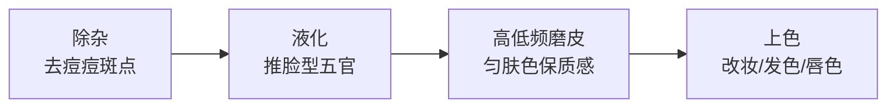
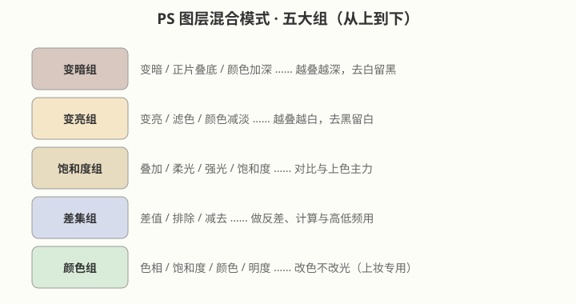
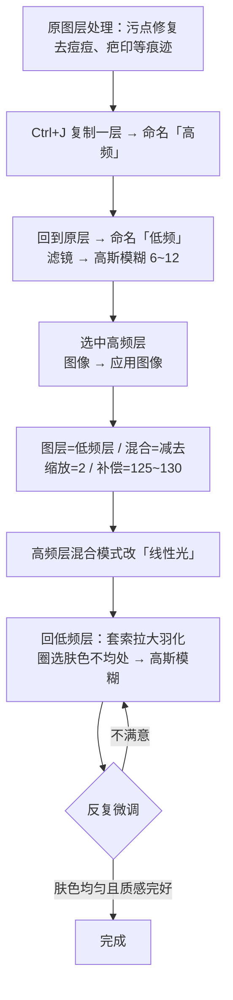

# 人像修图：磨皮、液化与混合模式

## 本篇导读
人像修图是一条流水线：**除杂 → 液化 → 磨皮 → 上色（改妆）**。手写笔记里最值钱的是高低频磨皮的完整参数（高斯模糊 6~12、应用图像减去/缩放 2/补偿 125~130、线性光），这套参数 2026 年照做依然成立。另外把混合模式五大分组一次讲清，以后上妆、去白背景、去黑背景都不会再翻半天菜单。

## 本篇目录
- [2026 变化概览](#2026-变化概览)
- [一、修图顺序总览](#一修图顺序总览)
- [二、除杂：污点修复与修复画笔](#二除杂污点修复与修复画笔)
- [三、液化：瘦脸推形的正确姿势](#三液化瘦脸推形的正确姿势)
- [四、混合模式五大分组](#四混合模式五大分组)
- [五、上色：改妆容发色唇色](#五上色改妆容发色唇色)
- [六、高低频磨皮（核心实操）](#六高低频磨皮核心实操)

## 2026 变化概览
- 污点修复画笔、修复画笔、液化、混合模式、高低频磨皮全是传统功能，Photoshop 2026（v27.x）路径不变、不扣费。
- 2026 新增的 **Remove 工具**（修复画笔组内，27.7 起可选本地设备模型）：**0 积分、不消耗 Firefly 额度**，修路人/杂物比传统修复更快；本地模型对大陆账号是否开放待确认，传统修复画笔照常可用。
- ACR 18.7 里的 **AI 皮肤瑕疵移除**是本地 AI、免费，可作为除杂环节的辅助（见 [照片调色-直方图色阶曲线与ACR](./照片调色-直方图色阶曲线与ACR.md)）。
- 生成式修图类功能（生成式填充补脸等）🔴 大陆不可用。

---

## 一、修图顺序总览

手写笔记给人像修图四个字：**除杂、上色、磨皮、液化**。合理顺序是：

> 为什么先液化后磨皮？手写笔记明确：**高低频磨皮在液化操作之后**——先把形推对，再处理皮肤，不然推形又会把磨好的皮拉变形。

## 二、除杂：污点修复与修复画笔

| 工具 | 用法 | 手写笔记要点 |
|---|---|---|
| 污点修复画笔 | 一次涂抹，自动取周围像素补 | **小笔刷、多次涂抹**：先把目标（痘痘/闪粉）去掉，再抹几次，让生成的背景更自然 |
| 修复画笔工具 | 按住 `Alt` 取样，再涂抹 | **会搬取样点附近的像素**，适合结构明确的地方（如眼袋、疤痕） |
| Remove 工具（2026） | 圈住即移除 | 0 积分；修杂物比修复画笔快，人像细节仍建议用上面两件传统工具 |

口诀：**小笔刷、点几次、别贪一笔抹大区域。**

## 三、液化：瘦脸推形的正确姿势

菜单路径：**滤镜 → 液化**。

| 要点 | 手写笔记经验 |
|---|---|
| 笔刷大小/压力 | **笔刷调大、压力调小**（小 tips）——推得柔，不会出现褶皱 |
| 调数值位置 | 点左侧工具栏选工具，或右侧面板调参数 |
| 工具分组 | 常规变形（向前变形）、特效变形（湍流等，可加蒙版）、人脸工具（五官自动滑块） |
| 操作顺序 | **先拖出头部整体，再调五官** |

## 四、混合模式五大分组

PS 把图层面板混合模式从上到下分五组，记住分组就不会翻不到：

| 组 | 代表模式 | 人像修图里干嘛用 |
|---|---|---|
| 变暗组 | 正片叠底 | **类 CMYK，颜色越加越深，可一键去除白色背景**（线稿上色、抠白底图） |
| 变亮组 | 滤色 | **类 RGB，颜色越加越白，可一键去除黑色背景**（黑底光斑、星空素材） |
| 饱和度组 | 叠加、柔光 | 上色主力：新图层涂色后叠"叠加"，透得自然 |
| 差集组 | 差值、减去 | 高低频磨皮里"应用图像"要用（见第六节） |
| 颜色组 | 色相、颜色 | 改色不改明暗，上妆专用 |

## 五、上色：改妆容发色唇色

手写笔记的上色流程（2026 照做）：
1. **新建空白图层**（不上色在原图层上，方便随时擦）；
2. 选柔边笔刷，直接涂要改的部位：妆容、发色、唇色、衣服色都行；
3. 把该图层**混合模式改为"叠加"**；
4. 图层**不透明度调低**（如 30%~60%），直到颜色看着自然。

> 想更透一点可以换"柔光"；想只改颜色不动明暗，换"颜色"模式。

## 六、高低频磨皮（核心实操）

**原理**：颜色突变的边缘频率高。把画面拆成两层——
- **低频层 = 整体颜色（色块）** → 任务：均衡肤色；
- **高频层 = 轮廓与细节（毛孔、纹理）** → 任务：原样保留。

**分步参数照抄：**

| 步骤 | 操作 | 关键数值 |
|---|---|---|
| 1 | 低频层用污点修复去痘痘、疤印 | 小笔刷多次 |
| 2 | 处理完按 `Ctrl+J` 复制一层，命名"高频" | 原层改名"低频" |
| 3 | 回低频层：**滤镜 → 模糊 → 高斯模糊** | **半径 6~12**（按图大小试） |
| 4 | 选中高频层：**图像 → 应用图像** | 图层选"低频"；混合选"减去"；**缩放=2**；**补偿值=125~130** |
| 5 | 高频层混合模式改为 | **线性光** |
| 6 | 切回低频层：套索工具**拉大羽化**，一次性圈选肤色不均处（额头、脸颊、下巴，可加选区布尔加） | 再走一次**高斯模糊** |
| 7 | 第 6 步重复几次，反复微调 | — |

> 手写笔记验收标准：**肤色均衡，且皮肤质感完好**（毛孔纹理都在，不是塑料脸）。

---

相关阅读：
- 调色基础（直方图/曲线/HSL）：[照片调色-直方图色阶曲线与ACR](./照片调色-直方图色阶曲线与ACR.md)
- 蒙版与画笔涂抹（磨皮收尾常用）：[蒙版四种用法](../02-选区抠图与蒙版/蒙版四种用法.md)
- 画笔笔刷基础：[画笔笔刷与数位绘画](../05-画笔与绘画/画笔笔刷与数位绘画.md)
- AI 修图替代工具（大陆可用）：[AI工具与国产替代](../AI工具与国产替代.md)
