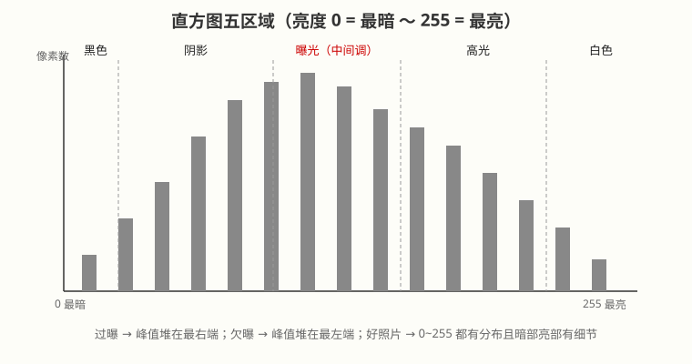
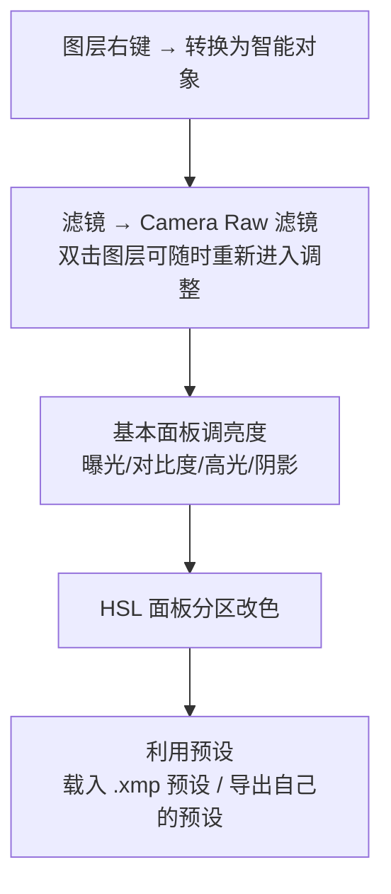
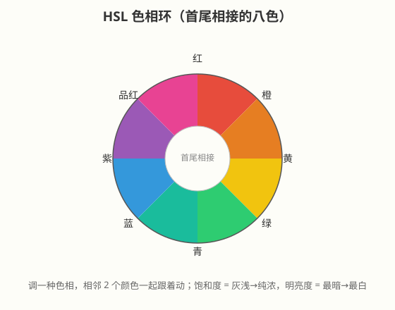

# 照片调色：直方图、色阶、曲线与 Camera Raw

## 本篇导读
调色的本质就一句话：**对照片上每个像素的颜色数值进行调整**，让它变清晰、变鲜艳、变成另一种色调，或做网格化（黑白）处理。手写笔记的思路非常正确——先学会"看数"（直方图），再学会"改数"（色阶、曲线），最后用 ACR 批量落地。本篇把这套流程整理成可直接照做的操作手册，并附三种经典风格（青橙/小清新/赛博朋克）的完整参数套路。

## 本篇目录
- [2026 变化概览](#2026-变化概览)
- [一、调色是什么：直方图思维](#一调色是什么直方图思维)
- [二、直方图五区域与曝光判断](#二直方图五区域与曝光判断)
- [三、色阶：三个滑块定黑白场](#三色阶三个滑块定黑白场)
- [四、曲线：比色阶精确十倍](#四曲线比色阶精确十倍)
- [五、Camera Raw 滤镜（ACR）完整流程](#五camera-raw-滤镜acr完整流程)
- [六、HSL：八色环的局部改色](#六hsl八色环的局部改色)
- [七、三种经典调色风格参数表](#七三种经典调色风格参数表)

## 2026 变化概览
- Photoshop 2026（v27.x）中，**直方图面板、色阶/曲线调整图层、Camera Raw 滤镜**的菜单路径与旧版完全一致。
- Camera Raw 已升级到 **18.7（2026-09）**：AI 蒙版新增羽化/边缘控制，新增 **AI 皮肤瑕疵移除**（本地 AI，免费含在订阅内）。
- ⚠️ ACR 里的**生成式移除 / 生成式扩展 / 人物干扰移除**属于 Firefly 生成式能力：🔴 **中国大陆账号不可用**，且按标准价 1 生成式积分/次扣费（境外账号口径）；传统调色、AI 蒙版、预设载入导出全部免费可用。

---

## 一、调色是什么：直方图思维

- **调色** = 对照片上每个像素的颜色做调整，目标：变清晰 / 变鲜艳 / 变色调 / 黑白网格化。
- **滤镜** = 别人调好的一整套调色参数打包，一键套用（LR/ACR 预设、PS 滤镜都算）。
- 关键概念：**能观察数值的是直方图，能对数值做调整的是曲线**。这里的"数值"就是每个像素点的**亮度数值（0~255，共 256 级色阶）**。
- 直方图把一张图里**亮度相同的像素统计到一起**，按亮度等级排开，直观看出像素分布情况。
- 照片由 R、G、B 三原色不同亮度值组合而成；面板里三条颜色通道各有各的亮度图，**直方图就是三个亮度通道数值相加后的合成图**。

## 二、直方图五区域与曝光判断

菜单路径：**窗口 → 直方图**。横轴从左到右就是亮度从最暗（0）到最亮（255）：

| 区域 | 位置 | 对应调整滑块 | 管什么 |
|---|---|---|---|
| 黑色 | 最左端 | 阴影/黑色滑块左端 | 黑位定不死就发灰 |
| 阴影 | 左 1/4 | 阴影 | 暗部层次 |
| 曝光（中间调） | 正中间 | 曝光/中间调滑块 | 画面整体明暗 |
| 高光 | 右 1/4 | 高光 | 亮部层次 |
| 白色 | 最右端 | 白色滑块右端 | 白位过冲就过曝 |

**怎么读直方图判断曝光：**

| 照片状态 | 直方图表现 |
|---|---|
| 过曝 | 峰值全堆在最右端（白色区被切平） |
| 欠曝 | 峰值全堆在最左端（黑色区被切平） |
| 正常 | 0~255 均有像素分布，且暗部、亮部都有细节 |

> 手写笔记标准：正常照片是"0-255 均有分布，且有细节（暗部亮部都有）"。

## 三、色阶：三个滑块定黑白场

两种打开方式：
1. **破坏性**：图层选中 → **图像 → 调整 → 色阶**；
2. **推荐（非破坏）**：图层面板底部调整图层按钮 → **色阶**，生成调整图层。

输入色阶三个滑块：

| 滑块 | 位置 | 作用 |
|---|---|---|
| 左黑标 | 直方图最左 | 向右拖：把该点以后的像素全部压成 0（最黑） |
| 中间灰标 | 中间 | **向左拖 = 变亮，向右拖 = 变暗**（管中间调） |
| 右白标 | 直方图最右 | 向左拖：把该点以后的像素全部拉成 255（最白） |

> 手写笔记口诀：右白标以后调为 255、左黑标调至 0、中间标**左亮右暗**。

**调整图层的好处**（手写笔记原话保留）：
- 可以反复编辑；
- **可以画蒙版**，只作用在画面局部；
- 默认作用于**下方所有图层**；
- 按住 `Alt` 两个图层之间单击建立**剪贴蒙版**后，只作用于下方邻近一层。

## 四、曲线：比色阶精确十倍

打开方式同色阶：**图像 → 调整 → 曲线**，或调整图层里选"曲线"。

- 坐标系：横轴 = **原图亮度（输入）**，纵轴 = **调整后亮度（输出）**；对角线默认"输出 = 输入"，PS 里曲线面板的背景就是直方图。
- 操作：在曲线上**点一下建锚点、向上拖 = 提亮**。
- 手写笔记经典例子：**输入 125、输出 160**——把原图中亮度 125 的那批像素点，精确提升到 160。这就是曲线比色阶强的地方：色阶只管三段，曲线想拉哪段拉哪段。

| 曲线形状 | 效果 |
|---|---|
| S 形（左下上拖、右下下压） | 增强明暗对比，"发灰"照片救星 |
| √ 形（上凸曲线） | 胶片感、柔和层次 |
| 直线斜率拉陡 | 整体画面对比度拉高 |

- 面板里的**取样（目标调整）工具**可以直接在原图上按住上下拖动，对应区域的曲线点自动跟着动。

## 五、Camera Raw 滤镜（ACR）完整流程

菜单路径：**滤镜 → Camera Raw 滤镜**（最新 ACR 18.7）。手写笔记五步流程，2026 年仍照用：

| 步骤 | 操作 | 要点 |
|---|---|---|
| 1 | 转智能对象 | 双击智能对象图层即可重新打开 ACR，参数随时改，不毁原图 |
| 2 | 打开 ACR | 菜单 **滤镜 → Camera Raw 滤镜** |
| 3 | 基本界面调亮度 | 曝光、对比度、高光、阴影四件套 |
| 4 | HSL 调整 | 见下节 |
| 5 | 预设 | 预设面板可**载入**别人的 `.xmp` 预设，也可**导出**自己的参数存档 |

**手写笔记两个血泪教训：**
- **过度锐化 → 照片失真**：锐化不是越高越好，边缘发飘就过头了；
- **夜景照片噪点多 → 细节面板"减少杂色"** 拉一拉再睡。

**ACR 里的 AI 功能费用标签：**

| 功能 | 费用 | 大陆账号 |
|---|---|---|
| AI 蒙版（主体/人物/亮度/颜色蒙版，含 18.7 新增羽化边缘控制） | 本地 AI，免费含在订阅内 | 可用 |
| AI 皮肤瑕疵移除（18.7 新增） | 本地 AI，免费 | 可用 |
| 生成式移除 / 生成式扩展 / 人物干扰移除 | 1 生成式积分/次起 | 🔴 不可用（Firefly 生成式整体不对大陆开放） |

## 六、HSL：八色环的局部改色

HSL 和 RGB、CMYK 是同级的颜色描述方式，三个字母：

| 维度 | 含义 | 从…到… |
|---|---|---|
| H 色相 | 什么颜色 | 红橙黄绿青蓝紫（八色） |
| S 饱和度 | 颜色浓淡 | 灰浅 → 纯浓 |
| L 明亮度 | 颜色亮暗 | 最暗 → 最白 |

**手写笔记关键规律：八色两两相接，第八个（紫）和第一个（红）首尾相接成环——所以调一种色相，相邻 2 个颜色会一起跟着动。** 做青橙、赛博朋克时靠的就是这个联动。

> 另一个习惯：调完整体后，到 HSL 里把**亮部、暗部的像素分布再拉均匀一些**，让过渡更自然（手写笔记原话："展现细节，亮部暗部的像素分布均匀些"）。

## 七、三种经典调色风格参数表

### 7.1 青橙色调（欧美/电影感）

| 方向 | 参数套路 |
|---|---|
| 主色 | 青蓝色 + 橙黄色为主，色彩鲜艳、细节清晰、胶片质感 |
| HSL | 不需要的杂色 → 饱和度降低 |
| 人物主体 | 主体颜色的**明亮度**降低一些，压暗突出氛围 |

### 7.2 小清新（日系）

| 方向 | 参数套路 |
|---|---|
| 整体 | 偏亮、色彩较淡 |
| ACR | **提高曝光、降低对比、提高清晰度** |
| 皮肤（橙黄） | 饱和度**降低**、明度**提高** |
| 草地（黄绿） | 相色调向**青色**偏一点 |

### 7.3 赛博朋克（高科技低生活）

核心气质：强调"高科技水平"和"低生活水平"的冲突——青色 + 洋红的霓虹灯渲染氛围，黑夜画面偏暗、对比强烈、充满霓虹色。

| 面板 | 参数套路 |
|---|---|
| ACR 基本 | 增加曝光让灯亮一点；暗部提起来增加细节；**对比度调低**，画面扁平一些突出灯光氛围 |
| 色调 | 整体往洋红偏 |
| HSL | 红橙色相 → 洋红；蓝紫色相 → 青；其他不需要的颜色**饱和度降低** |
| 分离色调 | 高光：色相→洋红、饱和度拉高；阴影：色相→青、饱和度拉高 |
| 细节 | 减少杂色（噪点） |
| 效果 | 晕影数量**向左拉**，压暗四角渲染氛围 |
| 最后 | 加 Logo |

---

相关阅读：
- 人像精修（磨皮/液化/上妆）：[人像修图-磨皮液化与混合模式](./人像修图-磨皮液化与混合模式.md)
- 排版加 Logo、做海报：[字体排版与海报设计](../04-文字与排版/字体排版与海报设计.md)
- 生成式 AI 在大陆不可用时的替代方案：[AI工具与国产替代](../AI工具与国产替代.md)
