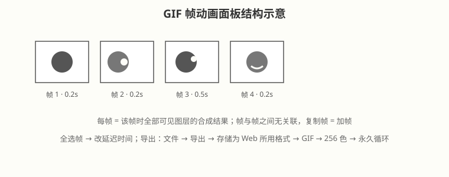
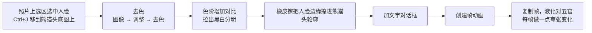

# GIF 动图与动态海报

## 本篇导读
GIF 是"会动的图片"：没有声音、帧率低，本质还是一张张图，靠视觉暂留骗过眼睛。手写笔记里记录了两类实战——做熊猫头表情包、给现成动图换文字换元素，外加动态海报的两种做法。2026 年 PS 导出 GIF 的路径依旧是"存储为 Web 所用格式"，27.7 只是把对话框改版变现代了，流程不变。

## 本篇目录
- [2026 变化概览](#2026-变化概览)
- [一、动图原理与两种时间轴](#一动图原理与两种时间轴)
- [二、帧动画面板操作规则](#二帧动画面板操作规则)
- [三、实战一：熊猫头表情包](#三实战一熊猫头表情包)
- [四、实战二：给经典动图替换元素](#四实战二给经典动图替换元素)
- [五、实战三：改文字搞笑动图](#五实战三改文字搞笑动图)
- [六、GIF 导出参数](#六gif-导出参数)
- [七、动态海报两种做法](#七动态海报两种做法)

## 2026 变化概览
- Photoshop 2026（v27.x）：**文件 → 导出 → 存储为 Web 所用格式**（旧版）对话框在 27.7 做了现代化改版，功能不变；GIF 导出仍选格式 GIF、循环选项"永久（Forever）"、颜色 256。
- 帧动画/视频时间轴两种模式沿用，智能对象关键帧动画照常。
- 全部传统功能，不涉及 AI 积分。

---

## 一、动图原理与两种时间轴

**动图 = 没有声音、帧率较低的视频，本质是图片**，利用视觉暂留原理连续播放产生动画效果。

PS 里做动图有两种模式（**窗口 → 时间轴** 切换）：

| 模式 | 特点 | 适用 |
|---|---|---|
| 创建帧动画 | 每一帧是单独独立的画面，添加"延迟"可让该帧停留更久 | 表情包、逐帧小动图、熊猫头 |
| 创建视频时间轴 | 图层变成轨道，可打关键帧做位移动画 | 改文字动图、动态海报、替换元素 |

## 二、帧动画面板操作规则

手写笔记总结的面板规则，全部照做：

- **每一帧展示的是这一帧时全部可见图层的综合效果**；帧与帧之间无关联；
- **复制帧 = 加帧**（面板底部"复制所选帧"按钮）；
- 图层面板前的小眼睛 = 回播该帧显示哪些层；
- **全选帧后统一改延迟时间**（每帧下方下拉，如 0.2 秒；最后一帧可留长一点做停留）；
- 想做"动一下停一下"：给关键帧单独设 0.5s~1s 延迟。

## 三、实战一：熊猫头表情包

**静态版流程**：抠出人物五官 → 去色 → 色阶调整 → 擦除多余内容 → 加文字 → 液化整形

**让它动起来**：
1. 帧动画面板复制 2~3 帧；
2. 每帧里用**液化**对人物五官做一点点夸张变化（瞪眼、张嘴）；
3. 文字可以不动，只动脸，就是经典熊猫头动态表情。

## 四、实战二：给经典动图替换元素

走**视频时间轴模式**：
1. **打开动图素材（.gif）**——PS 会按帧导入；
2. 用**裁剪工具**裁掉不要的部分、改画面范围；
3. 把要替换的元素（如原图里的人）用修复/蒙版盖掉；
4. 新建图层**添加替换元素**（你的 Logo、产品图、人物），摆到对应轨道位置。

## 五、实战三：改文字搞笑动图

1. 菜单 **文件 → 打开** 找到 `.gif` 文件；
2. 时间轴面板右上菜单切换为**视频时间轴**；
3. 找到原文字帧，盖掉旧字、打上新字；
4. **关键帧插值**：位置关键帧中间默认线性插值（◇标记变化处），让动起来不生硬；
5. 导出和普通 GIF 一样；手写笔记技巧：**导出时把比例改 100% 来控制文件大小**（ GIF 太大时适当缩尺寸）。

## 六、GIF 导出参数

菜单路径：**文件 → 导出 → 存储为 Web 所用格式（旧版）**

| 参数 | 手写笔记值 | 说明 |
|---|---|---|
| 格式 | **GIF** | 不要选成 JPEG/PNG |
| 颜色 | **256** | GIF 最高就是 256 色 |
| 循环选项 | **永久 / Forever** | 不选只播一遍 |
| 大小 | 需要更小体积就缩像素尺寸 | 上一节的 100% 技巧 |

> 老路径"存储为 Web 所用格式"在 27.7 改版后仍在，**导出 GIF 动画目前还必须走它**，"快速导出 PNG"不出动画。

## 七、动态海报两种做法

| 做法 | 流程 | 要点 |
|---|---|---|
| A. 动图盖排版 | 先找一段视频/动图素材铺底，再在上面盖一层排好版的图文信息 | 文字图层永远在最上，锁定不动 |
| B. 平面元素动起来 | 先做好静态海报的平面元素，再让物体逐个动起来 | **循环动图首尾必须一样**，否则接缝跳 |

> 手写笔记关键技巧：**把要动的平面元素图层转成智能对象，再在视频时间轴上给它打关键帧**（位移/缩放/透明度），动得干净不毁图。智能对象原理见 [图层与智能对象](../01-基础入门/图层与智能对象.md)。

---

相关阅读：
- 智能对象关键帧/批量模板：[动作批处理与样机Mockup](./动作批处理与样机Mockup.md)
- 排版打底：[字体排版与海报设计](../04-文字与排版/字体排版与海报设计.md)
- 抠熊猫头/人脸素材：[选区工具与AI抠图](../02-选区抠图与蒙版/选区工具与AI抠图.md)
