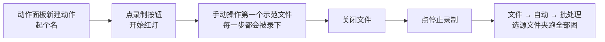
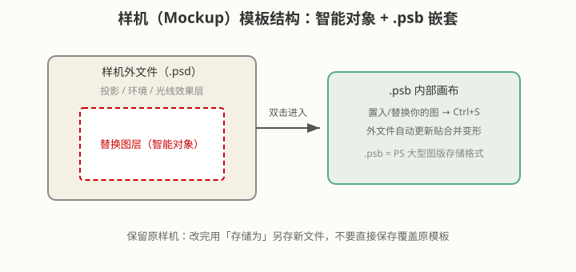

# 动作批处理与样机 Mockup

## 本篇导读
自动化在 PS 里就两大件：**动作**解决"一百张图做同一件事"，**样机（Mockup）**解决"一键把我的设计贴到真实场景里"。前者靠录制+批处理，后者靠智能对象模板。本篇把手写笔记里的完整操作链（录制步骤、水印案例、.psb 嵌套、存模板习惯）全部保留，并升级到 Photoshop 2026 的新动作面板。

## 本篇目录
- [2026 变化概览](#2026-变化概览)
- [一、自动化两大类：动作 vs 样机](#一自动化两大类动作-vs-样机)
- [二、动作录制六步流程](#二动作录制六步流程)
- [三、实战案例：批量改尺寸 + 右下角水印](#三实战案例批量改尺寸--右下角水印)
- [四、动作的分享与播放](#四动作的分享与播放)
- [五、样机（Mockup）怎么用](#五样机mockup怎么用)
- [六、.psb 与模板保存习惯](#六psb-与模板保存习惯)
- [七、品牌形象四件套](#七品牌形象四件套)

## 2026 变化概览
- Photoshop 2026（v27.x）的**动作面板在 27.6 做过大改版**：支持**自然语言搜索动作、按当前图推荐动作、画布预览动作效果**——录动作还是老流程，找动作/看动作比以前方便。
- 批处理入口不变：**文件 → 自动 → 批处理**；PSB（>2GB 大文档）格式照常支持。
- 全是传统功能，不涉及 AI 积分。

---

## 一、自动化两大类：动作 vs 样机

| 类别 | 解决什么 | 一句话 |
|---|---|---|
| 动作功能 | 批量处理（几十上百张图重复同一套操作） | 录一遍，自动跑完全部文件 |
| 样机渲染 | 一键生成逼真效果（海报贴墙、Logo 印衣服） | 换张图，模板自动贴合变形 |

共同底层都是**智能对象**：可以链接和替换原件，所有操作不影响原始文件，因此能做成"一键生成"的模板。

## 二、动作录制六步流程

> 手写笔记原话流程：**新建动作 → 录制按钮 → 按步骤完成第一个示范 → 关闭文件 → 结束录制 → 批处理**。

注意事项：
- 录之前先把第一个文件打开、状态干净，别带着多余操作录进去；
- 涉及鼠标点选位置的操作录不准，批量前先拿一两张试跑；
- 动作面板可以先**建组**再新建动作（一组一类活，方便管理）。

## 三、实战案例：批量改尺寸 + 右下角水印

手写笔记的例子：**把原图文件夹里全部图片修改成同样大小，并在右下角加上水印，保存到新文件夹。**

录制分解：
1. 打开第一张图；
2. **裁剪工具**：选项栏直接输入 **长 × 宽 × 分辨率** 数值（如 1000×1000px、72 PPI），一键统一尺寸；
3. 右下角打水印（文字图层或贴水印 logo），调好透明度；
4. 另存到一个**新文件夹**（批处理"目标"选这个文件夹）；
5. 停止录制 → **文件 → 自动 → 批处理**：动作选刚录的、源选原图文件夹、目标选新文件夹，开跑。

## 四、动作的分享与播放

- 动作面板菜单里**可以把动作组存成 `.atn` 文件分享给别人**；
- 别人拿到后，动作面板菜单**载入动作**即可播放；
- 27.6 改版后面板还能直接**搜索动作名/按图推荐**，不用一个个翻。

## 五、样机（Mockup）怎么用

**哪里找**：搜索关键词 **mock-up**（mockup）。常用种类：

| 种类 | 用途 |
|---|---|
| 海报 | 设计稿贴到墙面/海报架场景 |
| Logo | Logo 贴在名片/招牌/立牌 |
| 网页/手机/电脑展示 | UI 设计稿套进设备样机 |
| 衣服 | T恤/帆布袋印图案效果 |
| 商务周边 | 纸杯、工牌、笔 |
| 手绘场景 | 草稿纸、桌面俯拍风 |

**使用步骤：**
1. 打开 `.psd` 样机文件；
2. 找到**写着"双击替换"的替换图层**（样机的灵魂图层）；
3. **必须先把替换图层转成智能对象**（右键 → 转换为智能对象），双击进入；
4. 进入嵌套画布后置入你的图、`Ctrl+S` 保存；
5. 回到外文件，效果自动贴合透视/光影。
6. 以后想换图：智能对象图层**右键 → 重新链接到文件 → 置入**新图即可。

> 合法来源提示：样机素材走正规免费商用渠道（如官方免费样机页、CC0 资源站），不使用盗版资源包。

## 六、.psb 与模板保存习惯

- **双击替换图层会进入 `.psb` 文件**——可以理解成"PSB 是套在 PSD 里面的嵌套画布"；
- **.psb 是 PS 存储大型图版文件的格式**（超过 2GB 的大文档用它）；
- **铁律：保留原样机，不要直接保存覆盖！** 改完效果后用 **文件 → 存储为** 另存新文件（存储为时还可以换导出格式），原模板永远干净。

## 七、品牌形象四件套

手写笔记总结，做 VI/品牌设计时一套包含：
**Logo / 标准色 / 标准图形 / 标准字体**。

做品牌展示时，就是拿本节的样机体系，把这四件套分别贴到海报、周边、门店样机上出效果图。

---

相关阅读：
- 智能对象原理与基础操作：[图层与智能对象](../01-基础入门/图层与智能对象.md)
- 动态海报里智能对象打关键帧：[GIF动图与动态海报](./GIF动图与动态海报.md)
- 品牌字体选择：[字体排版与海报设计](../04-文字与排版/字体排版与海报设计.md)
