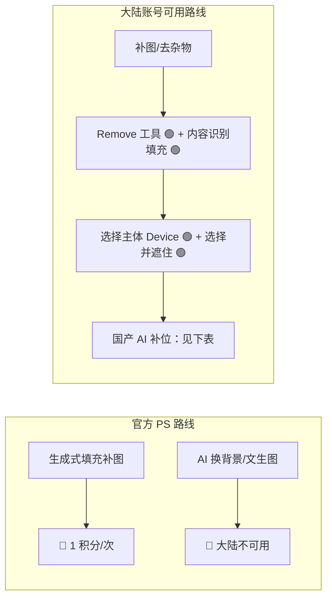

# PS 2026 AI 工具与国产替代（总览）

## 本篇导读
Photoshop 2026（v27.x，2026-09 最新 27.11）的 AI 版图已经很全：生成式填充、生成式扩展、AI 辅助编辑器、Firefly 文生图、Remove 工具、选择主体本地模型……但对中国大陆账号，**生成式 AI 整体不可用**。本篇把「哪些能用、哪些要积分、哪些要绕道国产替代」一次讲清，并给出大陆可用的完整替代工作流。

## 本篇目录
- [一、AI 功能总表（费用 × 大陆可用性）](#一ai-功能总表费用--大陆可用性)
- [二、Firefly 积分怎么扣](#二firefly-积分怎么扣)
- [三、中国大陆账号：能直接用什么](#三中国大陆账号能直接用什么)
- [四、AI 工作流对照：大陆可用路线](#四ai-工作流对照大陆可用路线)
- [五、国产/免费替代工具](#五国产免费替代工具)
- [六、来源与待确认](#六来源与待确认)

## 一、AI 功能总表（费用 × 大陆可用性）
费用标签口径：🟢 免费（本地模型/含在订阅/不扣积分）｜💠 消耗 Firefly 积分｜🔴 中国大陆账号不可用。

| 功能 | 菜单路径 | 费用 | 大陆账号 |
|---|---|---|---|
| 生成式填充 Generative Fill | 选区 → 上下文任务栏 → 生成式填充 | 💠 标准 1 积分/次；Firefly Image 5 = 10 积分/次；合作模型另计 | 🔴 |
| 生成式扩展 Generative Expand | 裁剪工具拖大画布 → 上下文任务栏 | 💠 1 积分/次起 | 🔴 |
| Firefly 文生图 Generate Image | 工作区内直接文字生图置入画布 | 💠 标准 1 积分/次 | 🔴 |
| AI 辅助编辑器（Beta） | 上下文任务栏自然语言 + 圈画标记（Markup） | 💠 按所选模型扣积分 | 🔴 |
| Firefly Boards 灵感板 | 图层右键 → 发送到 Firefly Boards | 板免费，板内生图扣积分 | 🔴 生成部分 |
| 旋转画布内物体 Rotate Object | 上下文任务栏 | 💠 20 积分/物体 | 🔴 |
| Remove 移除工具 | 工具栏（修复画笔组） | 🟢 **0 积分**；27.7 起本地设备模型 | ✅ 可用 |
| 选择主体（Device 本地） | 选择 → 主体；首选项 → 图像处理 → Device | 🟢 不扣积分、可离线 | ✅ |
| 选择并遮住 / Enhance edge | 选区 → 上下文任务栏 → 选择并遮住 | 🟢 传统部分；Enhance edge 计费/地区待确认 | ✅ 传统部分 |
| 内容识别填充 | 编辑 → 内容识别填充 | 🟢 传统功能 | ✅ |
| 天空替换 | 滤镜 → 天空替换 | 🟢 传统 Sensei | ✅ |
| Camera Raw AI 蒙版 | 滤镜 → Camera Raw 滤镜 | 🟢 AI 蒙版本地免费；生成式移除/扩展 🔴 | ✅ 蒙版 |
| Neural Filters 神经网络滤镜 | 滤镜 → Neural Filters | 🟡 面板在，部分滤镜需下载；地区受限待确认 | 🟡 待确认 |

## 二、Firefly 积分怎么扣
- **标准功能**（PS 内 Firefly 自家模型填充/扩展）：**1 积分/次**；持 CC Pro / Firefly / 积分套餐者标准生成不限量。
- **高级功能**：Firefly Image 5 生图 10 积分/次；Image 4 Ultra 20 积分/次；Topaz 降噪 ≤25MP = 10 积分；Rotate Object 20 积分/物体。
- **PS 单应用订阅月度额度**：2025-06-17 之前订阅 = 500 积分/月；之后订阅 = 25 积分/月（老用户 500 / 新用户 25 的规则 2026-09 官方 FAQ 仍成立）。
- CC Pro（全家桶）：标准生成不限量 + 4000 高级积分/月。
- 积分**不结转**，每月按订阅日重置；生成失败自动退款；余额看「生成式积分用量」面板。
- 2026-09 起免订阅 Freemium：邮箱登录即可下载 PS 桌面版，每日免费 AI 生成次数（每日刷新）。

## 三、中国大陆账号：能直接用什么
官方明示：生成式 AI 功能在 China / Russia / Belarus / Cuba / Iran / North Korea / Syria 不可用。**大陆账号仍可用**：
1. **本地设备模型**：选择主体 Device 模式、Remove 工具本地模型（模型包可下载性待确认）；
2. **传统智能功能**：内容识别填充、天空替换、Camera Raw 传统与 AI 蒙版；
3. **全部传统 PS 能力**：选区、蒙版、钢笔、排版、调色、动作批处理、PSB、导出。

## 四、AI 工作流对照：大陆可用路线

- 去路人/去水印/补一块缺失：Remove 工具 + 内容识别填充，免费免积分。
- 换背景/发丝抠图：Device 选择主体 → 选择并遮住，免费。
- 「一句话改图」「文生图」这类纯生成需求：转国产工具（下表），不再纠结 PS 里的灰按钮。

## 五、国产/免费替代工具
| 工具 | 类型 | AI 能力 | 费用要点 |
|---|---|---|---|
| Photopea | 网页版 PS（类界面） | 无生成式 AI；完整 PSD 读写、图层/蒙版/智能对象 | 免费（侧栏广告），Premium 约 €5/月 |
| GIMP | 桌面开源 | 无生成式 AI；像素修图完整 | 完全免费，最新稳定 3.2.6（2026-09） |
| 美图秀秀 | 手机+PC+网页 | AI 抠图、AI 消除、AI 扩图、AI 换背景、AI 变清晰 | 手机粉钻约 ¥15/月；PC 版约 ¥30/月 |
| 美图设计室 | 电商 SaaS | 批量抠图、AI 设计 | 连续包月约 ¥30 |
| 稿定设计 | 模板+在线 PS | AI 创作、批量抠图、尺寸延展、套模板二创 | 大会员年付有折扣（精确价待确认） |
| Canva 可画 | 模板设计 | Magic Studio 文生图/扩图/抠图 | 免费版每月约 20 次 AI；Pro $18/月 |
| 醒图 | 手机修图（字节系） | 消除、抠图、AI 扩图 | 基础免费；高清导出看广告或 VIP |
| 即梦 AI | 字节系文生图/视频 | 文生图、图生图、视频 | 每日送免费积分；会员 ¥59~1399/月 |
| 可灵 AI | 快手视频生成 | 图/文生视频 | 连续包月约 ¥58~1149 四档 |

> 工作流建议：**PS（本地抠图/修图/排版） + 国产 AI（生成/扩图/换背景）** 组合，是大陆账号 2026 年最现实的搭法。PS 内传统能力见本套文档其余各篇。

## 六、来源与待确认
- 版本与功能事实核对：Adobe 官方发行说明页（helpx.adobe.com，2026-10-05 更新）、生成式积分 FAQ（2026-09-30）、生成式 AI 地区限制 KB。
- 待确认项：Remove/选择主体本地模型包对大陆账号的实际可下载性；Enhance edge 是否扣积分及地区；Neural Filters 当前各滤镜存活清单；稿定官方精确定价；即梦每日免费积分精确值；PS 单应用中国区人民币定价。

---
各操作篇链接：
- [图片尺寸格式与色彩管理](./01-基础入门/图片尺寸格式与色彩管理.md) ｜ [图层与智能对象](./01-基础入门/图层与智能对象.md)
- [选区工具与AI抠图](./02-选区抠图与蒙版/选区工具与AI抠图.md) ｜ [蒙版四种用法](./02-选区抠图与蒙版/蒙版四种用法.md)
- [钢笔与形状工具](./03-矢量与插画/钢笔与形状工具.md) ｜ [插画实战-Lowpoly-MBE-线条风](./03-矢量与插画/插画实战-Lowpoly-MBE-线条风.md)
- [字体排版与海报设计](./04-文字与排版/字体排版与海报设计.md)
