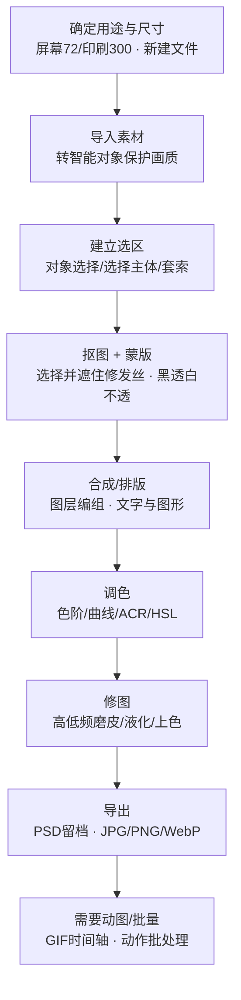

# Photoshop 笔记 · 总索引（2026 版）

> 本笔记由 37 页手写 Photoshop 课程笔记升级、归并、去重而来，操作主线为 **Adobe Photoshop 2026（v27.x，2026 年 9 月）**。
> 翻一篇就能学完一块，与平级的 `pr2026`（剪辑笔记）互为姊妹篇：PS 管"图"、PR 管"片"。

## 目录

- [一、分类目录](#一分类目录)
- [二、建议学习顺序（附理由）](#二建议学习顺序附理由)
- [三、2026 修图工作流（一条线）](#三2026-修图工作流一条线)
- [四、费用标签与配图约定](#四费用标签与配图约定)
- [五、待确认事项](#五待确认事项)

---

## 一、分类目录

### 01-基础入门（先把地基打牢）

| 文档 | 学完能做到 |
|---|---|
| [图片尺寸格式与色彩管理](./01-基础入门/图片尺寸格式与色彩管理.md) | 分辨率 72/300、RGB/CMYK、位深、图像/画布大小、PSD/JPG/PNG/WebP/GIF、2026 导出 |
| [图层与智能对象](./01-基础入门/图层与智能对象.md) | 图层增删/编组/对齐、自由变换、填充、智能对象 vs 栅格化、裁剪/拉直/切片、壁纸实战 |

### 02-选区抠图与蒙版（把东西抠出来、融合好）

| 文档 | 学完能做到 |
|---|---|
| [选区工具与AI抠图](./02-选区抠图与蒙版/选区工具与AI抠图.md) | 选框/套索、布尔运算、快速选择/魔棒/色彩范围、对象选择/选择主体/选择并遮住、渐变填充 |
| [蒙版四种用法](./02-选区抠图与蒙版/蒙版四种用法.md) | 图层/快速/矢量/剪贴蒙版，"黑透白不透"，蒙版画笔与右键菜单 |

### 03-矢量与插画（放大不失真的图形）

| 文档 | 学完能做到 |
|---|---|
| [钢笔与形状工具](./03-矢量与插画/钢笔与形状工具.md) | 矢量概念、钢笔锚点/控制杆、转换点、路径选择、形状工具组、描边对齐 |
| [插画实战-Lowpoly-MBE-线条风](./03-矢量与插画/插画实战-Lowpoly-MBE-线条风.md) | Low-poly / 线条风 / MBE 三种风格的特点与完整步骤 |

### 04-文字与排版

| 文档 | 学完能做到 |
|---|---|
| [字体排版与海报设计](./04-文字与排版/字体排版与海报设计.md) | 衬线/非衬线、排版三法宝、字符面板、文字转形状/沿路径/Logo、海报规格版式与流水线 |

### 05-画笔与绘画

| 文档 | 学完能做到 |
|---|---|
| [画笔笔刷与数位绘画](./05-画笔与绘画/画笔笔刷与数位绘画.md) | 画笔参数、导入/自定义/导出笔刷、不透明度 vs 流量、书法拼接、简笔卡通、四格漫画 |
| [像素画](./05-画笔与绘画/像素画.md) | 像素画四件套设置、绘画流程与常见坑 |

### 06-调色与修图

| 文档 | 学完能做到 |
|---|---|
| [照片调色-直方图色阶曲线与ACR](./06-调色与修图/照片调色-直方图色阶曲线与ACR.md) | 直方图、色阶、曲线、Camera Raw、HSL、青橙/小清新/赛博朋克参数 |
| [人像修图-磨皮液化与混合模式](./06-调色与修图/人像修图-磨皮液化与混合模式.md) | 污点修复、液化、混合模式五分组、上色、高低频磨皮 |

### 07-动图与自动化

| 文档 | 学完能做到 |
|---|---|
| [GIF动图与动态海报](./07-动图与自动化/GIF动图与动态海报.md) | 帧/视频时间轴、熊猫头、替换元素、GIF 导出、动态海报 |
| [动作批处理与样机Mockup](./07-动图与自动化/动作批处理与样机Mockup.md) | 动作录制/批处理、批量水印、样机 Mockup、.psb、品牌形象 |

### 根目录专题

| 文档 | 学完能做到 |
|---|---|
| [AI工具与国产替代](./AI工具与国产替代.md) | PS 2026 AI 总表、Firefly 积分、大陆可用路线、国产/免费替代 |

---

## 二、建议学习顺序（附理由）

**原则：先理解"画布/图层"的底层逻辑，再学"选区抠图/蒙版"这对核心技能，之后矢量、文字、绘画按需展开，调色修图与效率工具放最后。**
PS 的一切操作都建立在"图层"上，而"选区 + 蒙版"是出现频率最高的能力，所以这两块务必先吃透；风格化创作（插画/绘画）需要前面的工具基础，放中间；调色修图和自动化属于进阶，放后面。

### 第 1 阶段：基础（约 3–5 天）
1. [图片尺寸格式与色彩管理](./01-基础入门/图片尺寸格式与色彩管理.md)
2. [图层与智能对象](./01-基础入门/图层与智能对象.md)

### 第 2 阶段：核心技能（约 1 周）
3. [选区工具与AI抠图](./02-选区抠图与蒙版/选区工具与AI抠图.md)
4. [蒙版四种用法](./02-选区抠图与蒙版/蒙版四种用法.md)

> 目标：能把任意对象抠出来、自然融合到新背景。

### 第 3 阶段：图形与文字（约 1 周）
5. [钢笔与形状工具](./03-矢量与插画/钢笔与形状工具.md)
6. [插画实战-Lowpoly-MBE-线条风](./03-矢量与插画/插画实战-Lowpoly-MBE-线条风.md)
7. [字体排版与海报设计](./04-文字与排版/字体排版与海报设计.md)

### 第 4 阶段：绘画与调色修图（约 1–2 周）
8. [画笔笔刷与数位绘画](./05-画笔与绘画/画笔笔刷与数位绘画.md)
9. [像素画](./05-画笔与绘画/像素画.md)（不做像素风可跳过）
10. [照片调色-直方图色阶曲线与ACR](./06-调色与修图/照片调色-直方图色阶曲线与ACR.md)
11. [人像修图-磨皮液化与混合模式](./06-调色与修图/人像修图-磨皮液化与混合模式.md)

### 第 5 阶段：效率与专题（随时回看）
12. [GIF动图与动态海报](./07-动图与自动化/GIF动图与动态海报.md)
13. [动作批处理与样机Mockup](./07-动图与自动化/动作批处理与样机Mockup.md)
14. [AI工具与国产替代](./AI工具与国产替代.md)（处理批量图/想用 AI 时重点看）

---

## 三、2026 修图工作流（一条线）

---

## 四、费用标签与配图约定

### AI 费用标签（只给 AI 功能）
- **免费 / 含在订阅内 / 本地设备模型**：对象选择、选择主体（设备）、选择并遮住、Remove 工具（移除工具，0 积分）、Camera Raw AI 蒙版、天空替换、内容识别填充。
- **消耗 Firefly 积分**：生成式填充（标准 1 积分/次，Firefly Image 5 约 10 积分/次）、生成式扩展（按规格）、文生图；单应用 PS 订阅老用户 500 积分、2025-06-17 后新订阅仅 25 积分/月。
- **🔴 中国大陆不可用**：Firefly 及其在 PS 内的生成式功能（生成式填充、生成式扩展、AI 辅助编辑器、文生图），官方明示在中国/俄罗斯/白俄罗斯/古巴/伊朗/朝鲜/叙利亚不可用。
- 传统功能、滤镜、插件、动作/智能对象**不标价**；国产替代的 AI 会员/积分在 [AI工具与国产替代](./AI工具与国产替代.md) 中简述。

### 配图约定
- 界面截图只用 **Adobe 官方帮助页真实截图**，**禁止 AI 生成假界面**；
- 流程类用 mermaid；概念示意图（RGB/CMYK、蒙版黑白、钢笔控制杆、直方图、HSL 色环、混合模式、像素网格、时间轴）用手写 SVG，存各文档同名 `.assets`。

---

## 五、待确认事项

以下内容在笔记中标注"以实际版本为准 / 待确认"，未当成定论：

1. 本地设备模型（Remove 工具、选择主体）对中国大陆账号的实际可下载性；
2. 27.11 新增 Enhance edge（RGBA 修边）是否扣积分、大陆是否可用；
3. 神经网络滤镜（Neural Filters）现存滤镜清单与各地区可用性；
4. 画笔面板"导出选中画笔"等简体中文菜单逐字名称；
5. 国产工具（美图、稿定、即梦等）的精确价格/每日积分以官方为准；
6. PS 单应用中国区 RMB 定价官网未公开在线标价。

---

> 本套笔记共 **14 篇内容文档 + 本索引**，分 7 个分类文件夹；全部链接、图片路径已校验无死链。
